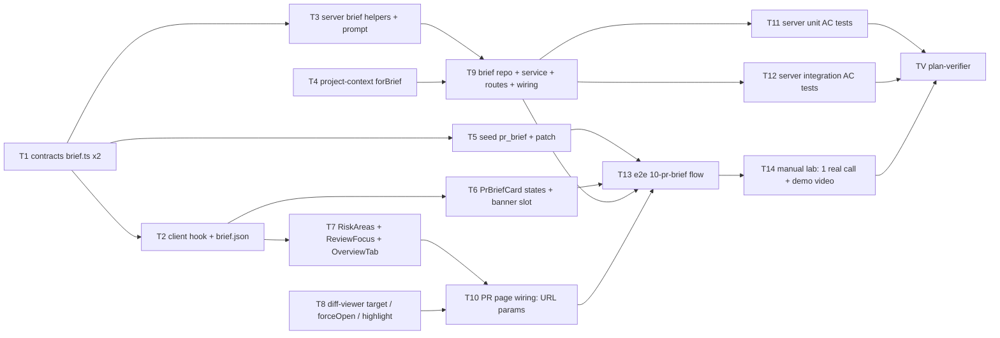
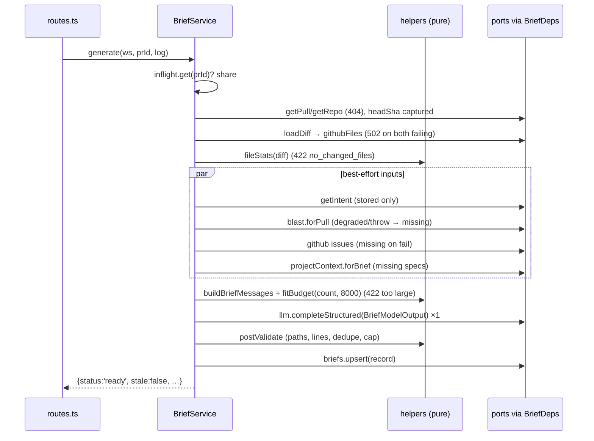

# Implementation Plan: PR Brief — why the PR exists, where it is risky, where to start reading
Spec: `specs/pr-brief.md` (SPEC-03)

## Overview
The Overview tab gets a PR Brief block. It holds a short summary, **Risk areas** (each risk tied to a
real file) and **Review focus** (`file:line — why`, in reading order). These come from exactly one
structured `risk_brief` model call on the user's Generate / Refresh. The input is only facts DevDigest
already has: the stored intent, the blast map, per-file stats with hunk ranges, the PR description,
linked issues and attached project-context documents. Diff hunk bodies are never sent. The server
checks every path and line the model returns before it caches the brief per PR in `pr_brief`, tied to
the head SHA. A read never calls the model and marks the brief Outdated when the SHA moves. A Review
focus item opens Files changed at that file and line.

## Execution mode
**multi-agent (parallel).** The user chose this on 2026-10-29. The contracts (`brief.ts`, both vendor
copies, T1) and the client data hook plus messages (T2) land first. After that, four lanes share no
files: **server** (`modules/brief/`, the project-context `forBrief`, seed), **Overview card**,
**diff-viewer navigation**, and **e2e**. All implementers share one branch, so concurrent tasks have
disjoint `Owned paths` (checked in the Red-flags section). A task that edits a file another lane
needs runs in a later phase.

**Concurrency (what may run at once):**
- Phase 1: T1, then T2. T4 and T8 depend on nothing and may start alongside T1.
- Phase 2 (after T1): T3 ∥ T4 ∥ T5 ∥ T8, and T6 ∥ T7 once T2 is in.
- Phase 3: T9 (needs T3 and T4) ∥ T10 (needs T7 and T8).
- Phase 4: T11 ∥ T12 (test-writer, after the architecture gate), then T13 once T5, T6, T9 and T10 are in.
- Phase 5: T14 (manual, user), then TV.

## Spec verification (Step 1)
`specs/pr-brief.md` passes all checks. It is `Status: approved` with no `[NEEDS CLARIFICATION]`. Every
AC is a single EARS statement with a condition and a reaction, no two contradict, and the ACs describe
behaviour, not implementation. Non-goals are explicit. Every edge case maps to an AC or is marked
`accepted`, and every input has a provenance tag. **The spec was not edited.** These planning facts do
not change any requirement:
- **AC-63 re-prompt.** The re-prompt on schema-invalid output lives inside each real adapter
  (`server/src/adapters/llm/openai.ts:127`, `anthropic.ts:143`, `reviewer-core/src/llm/openrouter.ts:123`).
  `MockLLMProvider` (`server/src/adapters/mocks.ts:98`) does not re-prompt. So the AC-63 test uses a
  fake provider in the test file built on the exported `parseWithRepair`
  (`reviewer-core/src/index.ts:31-37`), which is the same helper the adapters use (Decision D9).
- **AC-26 rate limit in tests.** `@fastify/rate-limit` is NOT registered when `nodeEnv === 'test'`
  (`server/src/app.ts:112`), and a per-route `config.rateLimit` does nothing without the plugin. The
  AC-26 test builds its own app with a non-test `nodeEnv` (T12 gotcha).
- **`INJECTION_GUARD` is not exported** (`reviewer-core/src/prompt.ts:16`, module-private). The
  Intent Layer meets "untrusted data under the injection guard" with `wrapUntrusted()` plus the
  SECURITY paragraph of its system prompt (`server/src/prompts/intent.system.md:4`). The brief
  follows the same pattern and `reviewer-core` stays unchanged, as the spec's Non-goal requires.
- **Error codes.** `ValidationError` always has code `validation_error` (`server/src/platform/errors.ts:31`).
  AC-20 and AC-21 need the codes `brief_input_too_large` and `no_changed_files`, so the service throws
  `new AppError(<code>, msg, 422)`. The `AppError` constructor already takes `(code, message, statusCode)`.
- **Agent order.** `AgentRepository.listEnabled` has no `ORDER BY` (`server/src/modules/agents/repository.ts:104`).
  AC-15 needs creation order, so the pure union helper sorts by `createdAt` (tie-break `id`), and the
  agents module is left untouched.
- **Seeded files have no patches.** The seeded PR #482 `pr_files` rows have no `patch`
  (`server/src/db/seed.ts:160`), so Files changed renders no lines for it. The e2e flow for AC-58 needs
  a patch on the target file, which T5 adds.

## Open questions & recommendations
- Q1: Execution mode → answer: **multi-agent**, contracts plus client hook first, then 4 lanes (user, 2026-10-29).
- Q2: Where the documents union lives → answer: a new facade method `container.projectContext.forBrief(workspaceId, repoId)`, with the pure union/dedupe in `project-context/helpers.ts` (user).
- Q3: Cache and in-flight sharing → answer: new `server/src/modules/brief/repository/brief.repo.ts`, plus an in-flight `Map` in `BriefService` like `IntentService.inflight`, with narrow `BriefDeps` (user).
- Q4: Demo / e2e → answer: seed one `pr_brief` row for PR #482 in `server/src/db/seed.ts` and add flow `e2e/specs/10-pr-brief.flow.json` (AC-50/57/58). The single Generate call is recorded by hand with a real `risk_brief` provider (log line AC-28) (user).
- Q5: AC-63 test → answer: a fake `LLMProvider` in the test file that runs the exported `parseWithRepair` from `@devdigest/reviewer-core` in the adapters' validate-and-re-prompt loop. **It is exported**, so the fallback (an OpenAI adapter with a mocked SDK) is not needed (user).
- Rec: optional `target` / `forceOpen` / `data-highlighted` props on the shared diff viewer, with a pure `resolveTarget` helper → **accepted**.
- Rec: pure brief helpers with an injected token counter (`(text) => number`) → **accepted**.
- Rec: `config: { rateLimit: { max: 10, timeWindow: '1 minute' } }` on the POST route, as in `intent/routes.ts:37` → **accepted**.
- Rec (new, pending): an e2e spec note `e2e/docs/specs/pr-brief.md` (the folder holds per-feature e2e specs, owned by `spec-creator`). It is not required by any AC, so it is left out of this plan; `spec-creator` can add it.
- Rec (new, pending): expose the same brief through MCP later. This is an explicit Non-goal now; recorded so it is not lost.

## Decisions
| Decision | Choice | Rejected alternative (reason) |
|---|---|---|
| D1 Module | New `server/src/modules/brief/` (`routes.ts`, `service.ts`, `helpers.ts`, `constants.ts`, `repository/brief.repo.ts`, `index.ts`), service reached as `container.brief` | Extending `intent` or `blast`: the brief composes both, and putting it in either makes a module depend on its sibling the wrong way (server INSIGHTS 2026-10-23) |
| D2 Cache storage | Existing `pr_brief(pr_id, json)` through a new `brief.repo.ts`; `head_sha` inside the JSON; no migration | New methods on `ReviewRepository`: grows a baseline class that already mixes concerns. A new table or column: needs a migration for data that fits the existing JSONB |
| D3 Documents union | `container.projectContext.forBrief(workspaceId, repoId)` plus pure `unionBriefDocs()` in `project-context/helpers.ts` | The brief querying attachment tables itself: a cross-module data reach (`no-cross-module-internals`) that duplicates the clone-read, 1 MB and tokenizer rules |
| D4 Agent order | Sort enabled agents by `createdAt` then `id` inside the pure helper | Adding `ORDER BY` to `AgentRepository.listEnabled`: changes ordering for review runs in another module for no gain there |
| D5 Changed files with ranges | `loadDiff` (via `reviews/index.ts` facade) → if empty, GitHub `getPullRequest().files[].patch` → if that fails, log and throw `ExternalServiceError` (502). Ranges taken from parsed hunks / `@@` headers only | Reading `pr_files` directly: unreliable (server INSIGHTS 2026-10-25). Reusing `BlastService.changedFiles`: private, returns paths only, no hunks |
| D6 Linked issues | Reuse `parseReferences` + `issueText` from the intent facade (exported additively from `intent/index.ts`), `kind === 'github'` only | A second PR-body parser: two parsers drift. Taking intent's repo-file/URL refs too: the spec says only GitHub issue/PR references |
| D7 Injection guard | `wrapUntrusted()` for title, body, issues, documents and paths, plus the SECURITY paragraph in a new `server/src/prompts/brief.system.md`, as Intent does | Exporting `INJECTION_GUARD` from reviewer-core: a Non-goal (no changes to the guard), and it would change reviewer-core's public API |
| D8 Budget and trim | Pure `fitBudget(sections, count, 8000)` that counts all messages (system + user) with an injected tiktoken `count`; trim order: documents from the end → issue text → description; untrimmable = system + title + intent + blast + stats | Character budgets like intent's `applyBudget`: AC-17 requires tiktoken counts. Trimming blast or stats: forbidden by AC-18 |
| D9 AC-63 test | Fake `LLMProvider` in the test that loops `parseWithRepair` (exported) up to `maxRetries` and returns `attempts` | Mocking the OpenAI SDK under the real adapter: couples the test to one provider's wire format, and the brief code is provider-agnostic |
| D10 In-flight sharing | `Map<prId, Promise<BriefResponse>>` in `BriefService`, cleared in `finally` | A DB advisory lock or a `generating` flag row: needs a write before the call and cleanup after crashes, while one server process already gives the guarantee |
| D11 Error codes | `new AppError('no_changed_files' \| 'brief_input_too_large', msg, 422)` | `ValidationError` with details: its code is fixed to `validation_error`, but AC-20/21 name the code |
| D12 Post-validation | Pure `postValidate(output, files, blast)` with exact path match, hunk-range / caller-line checks, dedupe, cap 8/8 and `dropped` counts | Grounding through `groundFindings()`: a different contract (findings) and a spec Non-goal to touch it |
| D13 Navigation | URL `?tab=diff&file=&line=` set by `PrDetailView` in one `router.replace`; `DiffViewer target` → `FileCard forceOpen` + `scrollIntoView` + header focus; `CodeLine data-highlighted` + a visible marker | Scrolling by DOM query from Overview: fragile, couples Overview to diff internals, and does not work for deep links / reload (AC-58, AC-61) |
| D14 PR page wiring as its own task | T10 owns `PrDetailView` + `DiffTab` after T7 and T8 land | Letting the Overview or diff-viewer task edit `PrDetailView`: both would need it, so the owned paths would overlap |
| D15 Generation-in-progress state | `useIsMutating({ mutationKey: ['brief','generate',prId] })` exposed as `useIsGeneratingPrBrief` | Lifting the mutation into `OverviewTab` and drilling props: the card and the lists sit in different components, and props grow per state |
| D16 Seed and demo | Seed one valid `pr_brief` row (built with `BriefRecord.parse`) plus a patch for `src/middleware/ratelimit.ts` on PR #482 | A mock-LLM mode for e2e: e2e is "no LLM, no keys" by design (`e2e/AGENTS.md`), and it adds scope |

## Affected modules & contracts
- **`server/src/vendor/shared` + `client/src/vendor/shared`** — `contracts/brief.ts`: new schemas next to the existing ones; `Risk.kind` narrowed (AC-62).
- **server** — new module `modules/brief/`; `project-context` gets `forBrief` + `unionBriefDocs`; the `intent` facade adds 2 exports; `platform/container.ts` (`brief` getter + `ContainerOverrides.brief`); `modules/index.ts` (register); new prompt `prompts/brief.system.md`; `db/seed.ts` (demo row + patch); `README.md` (API map).
- **client** — new hooks domain `lib/hooks/brief.ts` (+ barrel line); `messages/en/brief.json` (new keys); `PrBriefCard`, `VerdictBanner` (action slot), new `RiskAreas` and `ReviewFocus` components, `OverviewTab`, `PrDetailView`, `DiffTab`, route `helpers.ts`; shared `components/diff-viewer/` (`DiffViewer`, `FileCard`, `CodeLine`, `helpers.ts`, `styles.ts`); `messages/en/shell.json` (highlight label).
- **e2e** — new `specs/10-pr-brief.flow.json`.
- **reviewer-core, mcp-server** — no change.
- **Contracts:** additions in `contracts/brief.ts` (both copies, kept identical by `./scripts/check-shared.sh`):
  `RiskKind` enum; `ReviewFocusItem`; `BriefModelOutput`; `BriefMissingInput`; `BriefTrimmedInput`;
  `BriefRecord` (stored brief); `BriefResponse` (discriminated union on `status`).
  **Explicit callout — existing schema change:** `Risk.kind: z.string()` → `RiskKind` (AC-62, spec D7).
  Its only consumer outside `brief.ts` is `server/test/contracts.test.ts:88-89` (`kind: 'security'`, still
  valid). `PrBrief`, `PrHistory` and `SmartDiff*` are unchanged.

## Architecture changes
- `server/src/vendor/shared/contracts/brief.ts` — **ring 0**, zod only.
- `server/src/modules/brief/helpers.ts`, `constants.ts` — **ring 1**, pure: hunk ranges, file stats,
  valid-path set, ref parsing, `postValidate`, `fitBudget`, `buildBriefMessages`, `isStale`,
  `toBriefResponse`. Imports only `@devdigest/shared`, `@devdigest/reviewer-core` (`wrapUntrusted`)
  and `import type` row types.
- `server/src/modules/brief/service.ts` — **ring 2**: `BriefService` with narrow `BriefDeps`
  (`getPull`, `getRepo`, `getIntent`, `briefs: {get, upsert}`, `loadDiff`, `githubFiles`,
  `blast(workspaceId, prId)`, `docs(workspaceId, repoId)`, `github()`, `model(workspaceId)`, `llm(provider)`,
  `count(text)`, `now()`). `createBriefService(container)` does the composition at the bottom (the intent pattern).
- `server/src/modules/brief/repository/brief.repo.ts` — **ring 3a**: `getBriefJson(db, prId)` and
  `upsertBrief(db, prId, json)` (`onConflictDoUpdate`). Returns `unknown` JSON; parsing happens in the service.
- `server/src/modules/brief/routes.ts` — **ring 3b**: `GET /pulls/:id/brief` and `POST /pulls/:id/brief`
  (`IdParams`, POST `rateLimit` 10/min). Each handler is context → one service call → DTO.
- `server/src/modules/brief/index.ts` — facade: `BriefService`, `createBriefService`, `BriefPort`, `BriefDeps`.
- `server/src/platform/container.ts` — **composition root**: `get brief(): BriefPort` (lazy) and `ContainerOverrides.brief`.
- `server/src/modules/index.ts` — register `brief`.
- `server/src/modules/intent/index.ts` — add `parseReferences`, `issueText`, `type PrSelf`.
- `server/src/modules/project-context/{service,helpers}.ts` — `forBrief()` on `ProjectContextPort`;
  new `enabledAgents` dep wired in `createProjectContextService` from `container.agentsRepo.listEnabled`.
- Client: the `"use client"` boundary stays where it is today (all PR-detail components are already
  client). New UI uses `useTranslations("brief")`. Data goes only through `lib/hooks/brief.ts` → `lib/api.ts`.

## Phased tasks

### Phase 1 — Contracts and client data layer (T1 → T2; T4, T8 may start in parallel)

- [ ] **T1** Shared contracts in `brief.ts` (both copies) → AC-1, AC-62 (scaffolding for every other task) → `server/test/brief-contracts.test.ts` (T11) + `./scripts/check-shared.sh` + `server/test/contracts.test.ts` (existing, unmodified)
  - **Action:** In `server/src/vendor/shared/contracts/brief.ts`, below the existing Risks section:
    `RiskKind = z.enum(['security','dependency','performance','breaking_change','data','config','other'])`;
    change `Risk.kind` to `RiskKind`; add `ReviewFocusItem {file: z.string().min(1), line: z.number().int().min(1), reason: z.string().trim().min(1)}`;
    `BriefModelOutput {summary: z.string().trim().min(1), risks: z.array(Risk), review_focus: z.array(ReviewFocusItem)}`;
    `BriefMissingInput {input: z.enum(['intent','blast','linked_issue','specs']), reason: z.string()}`;
    `BriefTrimmedInput = z.enum(['specs','linked_issue','description'])`;
    `BriefRecord {pr_id, head_sha, generated_at, model, summary, risks, review_focus, missing_inputs, trimmed_inputs, dropped:{risks,review_focus}, input_tokens, cost_usd: number|null}`;
    `BriefResponse = z.discriminatedUnion('status', [{status:'none'}, {status:'ready', stale, current_head_sha, brief: BriefRecord}])`.
    Export each with its `z.infer` type. Update the file's header comment. Then run `./scripts/check-shared.sh --sync`.
  - **Module:** server (vendor/shared) + client (vendor mirror)
  - **Type:** backend
  - **Skills to use:** zod, typescript-expert, onion-architecture
  - **Owned paths:** `server/src/vendor/shared/contracts/brief.ts`, `client/src/vendor/shared/contracts/brief.ts`
  - **Depends-on:** none
  - **Risk:** low
  - **Known gotchas:** `server/src/vendor/shared` is canonical. Edit there, then `--sync`; never hand-edit the client copy (server INSIGHTS 2026-09-20). Keep `snake_case` wire fields and do not rename existing ones. The `PrBrief` composite stays as it is (Non-goal). `BriefModelOutput` is sent as a JSON schema (`toJsonSchema`), so avoid `.transform()` / `.default()` in it, which strict JSON-schema modes reject.
  - **Acceptance:** `./scripts/check-shared.sh` exits 0; `cd server && pnpm typecheck` and `cd client && pnpm typecheck` pass; `server/test/contracts.test.ts` passes without edits.

- [ ] **T2** Client data hook + all new `brief` messages → scaffolding for AC-38…AC-61 (AC-56 messages side) → covered by T6/T7 RTL tests (rendered with the real `messages/en/brief.json`)
  - **Action:** New `client/src/lib/hooks/brief.ts`: `usePrBrief(prId)` (GET `/pulls/${prId}/brief`, `retry: false`, key `["brief", prId]`); `useGeneratePrBrief(prId)` (POST, `mutationKey: ["brief","generate",prId]`, `onSuccess` → `setQueryData`); `useIsGeneratingPrBrief(prId)` (`useIsMutating` with that key, `> 0`). Add `export * from "./brief";` to `lib/hooks/index.ts`. In `client/messages/en/brief.json`, add keys and remove the two keys that become unused, `unavailable` and `unavailableHint` (T2 owns this file; T6 and T7 only read it): `generate`, `refresh`, `refreshAria`, `outdated`, `riskAreas`, `reviewFocus.title` ("Review focus — read these first"), `reviewFocus.count`, `noFocus`, `fileNotInDiff` ("File not in this PR's diff"), `missing.prefix` ("Generated without:"), `missing.input.{intent,blast,linked_issue,specs}`, `missing.reason.{not_computed,flag_off,index_failed,index_partial,repo_too_large,no_data,error,no_github_token,fetch_failed,not_cloned,unreadable}`, `riskKind.{security,dependency,performance,breaking_change,data,config,other}`, `severity.{high,medium,low}`, `riskRowAria` ("{severity} risk: {title}"), `expandRisk`, `collapseRisk`, `focusItemAria` ("Open {location}"), `intentPendingHint`, `generateError`, `emptyTitle`, `emptyHint`.
  - **Module:** client
  - **Type:** ui
  - **Skills to use:** frontend-architecture, react-best-practices, next-best-practices
  - **Owned paths:** `client/src/lib/hooks/brief.ts`, `client/src/lib/hooks/index.ts`, `client/messages/en/brief.json`
  - **Depends-on:** T1
  - **Risk:** low
  - **Known gotchas:** One file per domain, never one per hook (`client/AGENTS.md`). Import wire types from `@devdigest/shared`. Keys are camelCase dotted by surface; the enum-derived keys keep the wire spelling (`breaking_change`) so lookups need no mapping.
  - **Acceptance:** `cd client && pnpm typecheck && pnpm lint` pass; `brief.json` is valid JSON and every key above exists (T6/T7 tests render through it).

### Phase 2 — Parallel lanes (server helpers ∥ project-context ∥ seed ∥ Overview UI ∥ diff-viewer)

- [ ] **T3** Pure brief helpers, constants and system prompt → AC-5, AC-10, AC-11, AC-17, AC-18, AC-29, AC-30, AC-31, AC-32, AC-33, AC-34, AC-35, AC-36 (pure side; also feeds AC-13, AC-16, AC-20) → `server/test/brief-helpers.test.ts` (T11)
  - **Action:** `server/src/modules/brief/constants.ts`: `BRIEF_TOKEN_BUDGET = 8000`, `MAX_RISKS = 8`, `MAX_FOCUS = 8`, `LLM_TEMPERATURE`, `BRIEF_SCHEMA_NAME = 'BriefModelOutput'`, `TRIM_MARKER`. `server/src/modules/brief/helpers.ts`, all pure:
    - `hunkRangesFromPatch(patch)`: matches `^@@ -a(,b)? \+c(,d)? @@` per line and keeps only numbers.
    - `fileStatsFromDiff(diff)` / `fileStatsFromPrFiles(files)` → `{path, additions, deletions, newRanges, oldRanges}[]`. These read `DiffHunk` numbers only, never `lines` or the header text.
    - `validPathSet(files, blast)`: blast callers only when `!blast.degraded` (AC-29).
    - `parseRef(ref)` → `{path, from?, to?}` | invalid (AC-32).
    - `postValidate(output, files, blast)` → `{risks, review_focus, dropped}` (AC-30–AC-36). New-side ranges are used, old side when a file has no new-side lines. A caller file is checked against its caller lines. Exact string match only.
    - `buildBriefMessages(input)` → `ChatMessage[]`: `wrapUntrusted` for title, description, issues, documents (labels with `"` removed, as in `intent/helpers.ts:220`), blast block and file list. Stats are `path (+a -d) new:[10-20, 40-41] old:[…]`.
    - `fitBudget(sections, count, budget)` → `{messages, trimmed: {input, tokens}[], inputTokens}` or `{tooLarge: true, untrimmableTokens}`. Steps: documents dropped from the end, then the issue text cut, then the description cut (AC-18).
    - `isStale(record, pullHeadSha)` (AC-5) and `toBriefResponse(record, pullHeadSha)`.

    `server/src/prompts/brief.system.md`: the role, the SECURITY paragraph copied from `intent.system.md:4-6`, the kind enum, the ref forms `path` / `path:N` / `path:N-M`, "use only listed paths and lines inside listed ranges", ≤ 8 + 8, reading order.
  - **Module:** server
  - **Type:** backend
  - **Skills to use:** onion-architecture, typescript-expert, zod, security
  - **Owned paths:** `server/src/modules/brief/helpers.ts`, `server/src/modules/brief/constants.ts`, `server/src/prompts/brief.system.md`
  - **Depends-on:** T1
  - **Risk:** medium (AC-31 range semantics, AC-18 trim loop)
  - **Known gotchas:** Ring 1 must not import a value from `db`, `adapters`, `platform` (except `errors.ts`) or `js-tiktoken`. The token counter is a parameter (`count: (s: string) => number`). Function-context text after `@@ … @@` and every `+`/`-`/space line must never reach the output (AC-11). Hunk header ranges with `,0` (pure deletion / pure addition) give empty new-side / old-side ranges. Rename or binary files have no hunks, so their focus items drop and their risk refs keep the bare path (AC-31, AC-33).
  - **Acceptance:** `cd server && pnpm typecheck && pnpm arch:check` pass; T11's `brief-helpers.test.ts` passes.

- [ ] **T4** Project-context `forBrief` + pure documents union → AC-15, AC-16 (read + skip-log side) → `server/test/project-context-helpers.test.ts` (extended, T11) + `server/test/brief.it.test.ts` (T12)
  - **Action:** In `server/src/modules/project-context/helpers.ts`, add `unionBriefDocs(agents: {id, createdAt, agentPaths, skills: {id, name, paths}[]}[])`. It sorts agents by `createdAt` then `id`, applies `buildEffectiveSet` per agent (SPEC-01 AC-40 order) and keeps the first occurrence of each path → `string[]`. In `service.ts`:
    - Add the dep `enabledAgents(workspaceId): Promise<{id, createdAt}[]>`.
    - Add `async forBrief(workspaceId, repoId, log?)` → `{docs: {path, text, tokens}[], attached: number, notCloned: boolean, unreadable: {path, reason}[]}`. It uses `attachments.listForRun` per agent with `deps.activeSkills(agentId)`, reads each path via `deps.docs.read(clonePath, path, readScope())` and skips (with a log line) missing / not text / too large / not cloned. It applies **no** 12k budget, because the brief budgets on its own.
    - Add `'forBrief'` to `ProjectContextPort`, and wire `enabledAgents: (ws) => container.agentsRepo.listEnabled(ws)` in `createProjectContextService`.
  - **Module:** server
  - **Type:** backend
  - **Skills to use:** onion-architecture, drizzle-orm-patterns, typescript-expert
  - **Owned paths:** `server/src/modules/project-context/helpers.ts`, `server/src/modules/project-context/service.ts`
  - **Depends-on:** none
  - **Risk:** medium
  - **Known gotchas:** Do not change `forRun` behaviour (SPEC-01 tests in `project-context-run.it.test.ts` must stay green). `listForRun` returns skill paths only for the skill ids passed. Tenancy: `getRepo(workspaceId, repoId)` before reading. `inArray(col, [])` is invalid SQL in Drizzle, so skip the query when there are no enabled agents (`agents/repository.ts:117`).
  - **Acceptance:** `cd server && pnpm typecheck && pnpm arch:check && pnpm test:unit` pass (existing project-context unit tests green); T11's AC-15 case passes.

- [ ] **T5** Seed: a demo brief and a patch for PR #482 → scaffolding for AC-50, AC-57, AC-58 (e2e T13, demo T14) → `e2e/specs/10-pr-brief.flow.json` (T13); `server/test/brief.it.test.ts` seeds through `seed()` (T12)
  - **Action:** In `server/src/db/seed.ts`, inside the existing "PR #482 created" branch:
    - Give `src/middleware/ratelimit.ts` a `patch` (one hunk `@@ -0,0 +1,84 @@` with plausible lines; additions stay 84).
    - Insert one `pr_brief` row built with `BriefRecord.parse({...})`, using `head_sha: 'a1b2c3d4e5f6'` (equal to `pull_requests.head_sha`, so not stale) and `model: 'seed/fixture'`. It has a summary, 3 risks (high `security` on `src/middleware/ratelimit.ts:12-18`, medium `config` on `src/config.ts`, low `performance`), and 3–4 review focus items. One of them, `src/middleware/ratelimit.ts:25`, is inside the seeded hunk. The rest is `missing_inputs: []`, `trimmed_inputs: []`, `dropped: {risks:0, review_focus:0}`, `input_tokens` 0 and `cost_usd: null`.
    - Idempotent: inserted only when the PR is created, like the other demo rows.
  - **Module:** server
  - **Type:** backend
  - **Skills to use:** drizzle-orm-patterns, zod
  - **Owned paths:** `server/src/db/seed.ts`
  - **Depends-on:** T1
  - **Risk:** medium (e2e seed coupling)
  - **Known gotchas:** e2e flows rely on the seeded `acme/payments-api` data and even on locators (e2e INSIGHTS 2026-09-23). Do not change existing titles, counts or `src/config.ts`, which flow `05-pr-diff` asserts. Seeded text must not imply a real model call. `pnpm db:seed` must stay re-runnable.
  - **Acceptance:** on a fresh DB, `pnpm db:migrate && pnpm db:seed` succeeds twice in a row; `select count(*) from pr_brief` = 1; `./scripts/e2e.sh` flows 01–09 still pass.

- [ ] **T6** PR Brief block states: Generate / refresh / Outdated / skeleton / errors / banner → AC-38, AC-39, AC-40 (summary skeleton), AC-42, AC-50, AC-51, AC-52, AC-53, AC-54, AC-55, AC-56, AC-65, AC-66 → `PrBriefCard.test.tsx` (rewritten cases) + `VerdictBanner.test.tsx` (existing + action slot case)
  - **Action:** Rewrite `PrBriefCard.tsx` on `usePrBrief`, `useGeneratePrBrief`, `useIsGeneratingPrBrief`, the existing `usePrReviews` / `usePrRuns`, and `useIntent` (read only its `isPending`; it shares the Intent card's cache key, so no extra request).
    - **Loading:** a skeleton.
    - **GET error:** `ErrorState` whose Retry refetches, with no Generate button (AC-53).
    - **`none`:** a centred empty state with a **Generate brief** button (AC-38, AC-66).
    - **`ready`:** with a review → `VerdictBanner` whose `summary` is the brief summary (AC-55), with the refresh button and Outdated badge passed in a new optional `action` slot (top-right, AC-66). Without a review → the summary paragraph, with refresh and Outdated top-right of the block.
    - **No brief but a review:** the banner keeps the review summary (AC-55).
    - **While generating:** the button is `disabled` and a summary skeleton shows (AC-39, AC-40).
    - **Mutation error:** an inline `role="alert"` with the server message; the previous brief stays because the query data is untouched (AC-54).
    - **`missing_inputs`:** the note "Generated without: Intent — not computed yet; …" (AC-42).
    - **Intent pending:** the `intentPendingHint` next to the button while `useIntent(prId).isPending`; the button stays enabled (AC-65).
    - **Outdated:** a text badge `outdated` when `stale` (AC-51).

    In `VerdictBanner.tsx` add `action?: React.ReactNode`, rendered top-right; existing callers are unchanged. Do not edit `brief.json`; T2 owns it.
  - **Module:** client
  - **Type:** ui
  - **Skills to use:** frontend-architecture, react-best-practices, react-testing-library, next-best-practices
  - **Owned paths:** `client/src/app/repos/[repoId]/pulls/[number]/_components/PrBriefCard/**`, `client/src/app/repos/[repoId]/pulls/[number]/_components/VerdictBanner/**`
  - **Depends-on:** T2
  - **Risk:** medium (many states in one card; keep `PrBriefCard.tsx` ≤ ~200 lines by moving state picking to `helpers.ts` and atoms to `_components/`)
  - **Known gotchas:** Allowed test changes are ONLY `PrBriefCard.test.tsx:146` (AC-55) and `:152-158` (AC-38). The `fetch` fake must route `/brief`, `/intent`, `/reviews` and `/runs` separately (client INSIGHTS 2026-10-25, the BlastRadiusCard fake). `Button active` works only for `kind="tertiary"` (client INSIGHTS 2026-10-25). `VerdictBanner` is also used by `ReviewRunAccordion` and `PrDetailView`; the new prop must be optional. Plain text only for model text, so no `dangerouslySetInnerHTML` and no markdown. No `useEffect` for derived state.
  - **Acceptance:** `cd client && pnpm typecheck && pnpm lint && pnpm test -- PrBriefCard VerdictBanner` pass; these named cases exist and pass: double click → 1 POST (AC-39); GET 500 → Retry → new GET, no Generate (AC-53); POST 502 → message plus previous summary, button enabled (AC-54); `stale:true` → "Outdated" (AC-51); refresh → new summary (AC-52); fetch log has GET `/brief` and no POST on mount (AC-50); intent pending → hint, then gone (AC-65); review+brief / review only / brief only (AC-55); refresh placement in banner vs block (AC-66).

- [ ] **T7** Risk areas, Review focus and the Overview layout → AC-38 (no lists while `none`), AC-40 (list skeletons), AC-41, AC-43, AC-44, AC-45, AC-46, AC-47, AC-48, AC-49, AC-56, AC-59 (click → callback), AC-60, AC-64, AC-67, AC-68 → `RiskAreas.test.tsx`, `ReviewFocus.test.tsx`, `OverviewTab.test.tsx` (new)
  - **Action:**
    - **`_components/RiskAreas/`** (`RiskAreas.tsx`, `helpers.ts`, `constants.ts`, `styles.ts`, `index.ts`, test). `sortBySeverity` is stable, high → medium → low (AC-43). `KIND_ICON: Record<RiskKind, IconName>` maps security → shield, dependency → package, performance → bolt, plus one fixed icon each for the other four (AC-64). `SEVERITY_COLOR: Record<RiskSeverity, …>` = `SEV.CRITICAL.c` / `SEV.WARNING.c` / `SEV.INFO.c` from `@devdigest/ui` (AC-67). Each row's accessible name holds the severity (AC-44). The chevron `button` has `aria-expanded`, and rows start collapsed (AC-45). The first ref is shown in mono and in full (AC-43, AC-68). Every ref is a button calling `onOpenFile(path, firstLine | null)` when the path is in `renderedFiles`; otherwise it shows `fileNotInDiff` and does not navigate (AC-59, AC-60). Empty → `noRisks` (AC-46).
    - **`_components/ReviewFocus/`**: a full-width block, title + count badge (AC-47), items in stored order as `file:line — reason` buttons with `aria-label` `focusItemAria`. Paths are never cut and reasons wrap (`white-space: normal; overflow-wrap: anywhere`, no `text-overflow`, AC-68). Clicking follows the same `renderedFiles` rule (AC-60). Empty → `noFocus` (AC-48).
    - **`OverviewTab.tsx`**: read `usePrBrief(prId)` and `useIsGeneratingPrBrief(prId)`. Layout: `PrBriefCard`, then a grid with column 1 = `IntentCard` + `RiskAreas` (Risk areas sit under Intent's lists and render even when Intent errors, AC-49) and column 2 = `BlastRadiusCard`, then `ReviewFocus` full width, then the description (AC-41, AC-47). Lists are absent while `none` (AC-38) and show skeletons while generating (AC-40). New props: `renderedFiles: readonly string[]` and `onOpenFile(file: string, line: number | null)`, both optional until T10 wires them (default `[]` / no-op, so `PrDetailView` still compiles).
  - **Module:** client
  - **Type:** ui
  - **Skills to use:** frontend-architecture, react-best-practices, react-testing-library, next-best-practices, security
  - **Owned paths:** `client/src/app/repos/[repoId]/pulls/[number]/_components/RiskAreas/**`, `client/src/app/repos/[repoId]/pulls/[number]/_components/ReviewFocus/**`, `client/src/app/repos/[repoId]/pulls/[number]/_components/OverviewTab/**`
  - **Depends-on:** T2
  - **Risk:** medium
  - **Known gotchas:** Do NOT edit `IntentCard` or `BlastRadiusCard` (Non-goal); Risk areas go *below* `IntentCard` in the same column. Check the `@devdigest/ui` `Icon` set for the chosen names before using them, and never edit `vendor/ui` (do-not-touch, client INSIGHTS 2026-10-25). `getByTitle` misses nested SVG titles (client INSIGHTS 2026-10-25), so assert icons via `aria-label` / `data-kind` instead. Model text is plain text and no links are built from it (Security NFR). Use `{count > 0 && …}`, never `{count && …}`.
  - **Acceptance:** `cd client && pnpm typecheck && pnpm lint && pnpm test -- RiskAreas ReviewFocus OverviewTab` pass, with named cases: one risk per kind → the mapped icon (AC-64); high vs low same kind → only the colour differs, `color === SEV.*.c` (AC-67); severity order (AC-43); `aria-expanded` toggles (AC-45); 4 items + badge 4 (AC-47); 120-char path / 300-char reason shown in full (AC-68); caller file click → `fileNotInDiff` and `onOpenFile` not called (AC-60); `src/a.ts:12-18` → `onOpenFile('src/a.ts', 12)` (AC-59); Intent 500 + ready brief → Risk rows visible (AC-49); `grep -nE '>[A-Z][a-z]+ [a-z]+<' ` over the new `.tsx` finds no literal UI text (AC-56).

- [ ] **T8** Diff-viewer navigation target → AC-57 (expand + scroll), AC-58, AC-61 (viewer side) → `client/src/components/diff-viewer/DiffViewer/DiffViewer.test.tsx` (new) + `client/src/components/diff-viewer/helpers.test.ts` (new or extended)
  - **Action:**
    - `helpers.ts`: pure `resolveTarget(files, target)` → `{file: string | null, lineIndex: number | null}`. It uses the existing `parsePatch` line numbers: new-side number first, old-side for deletions. An unknown file → `null`, and an unrendered line → file only (AC-61).
    - `DiffViewer`: optional `target?: {file: string; line: number | null}`; passes `forceOpen` and `highlightLine` to the matching `FileCard` only.
    - `FileCard`: when `forceOpen` becomes true it sets `open` (a keyed reset or an `open || forceOpen` derivation, not an effect copying props). The header becomes a focusable element (`role="button"`, `tabIndex={0}`, Enter/Space toggle, `aria-expanded`) with a ref. When targeted it calls `scrollIntoView({block:'start'})` on the card, then on the highlighted line, and `focus()` on the header in one `useEffect` keyed on the target (an external DOM sync, so a legitimate effect).
    - `CodeLine`: optional `highlighted` → `data-highlighted="true"`, `aria-current="location"` plus a visible text/marker (not colour only, AC-58).
    - Add a `diffViewer.targetLine` label to `messages/en/shell.json` if a visible marker label is needed.
  - **Module:** client
  - **Type:** ui
  - **Skills to use:** frontend-architecture, react-best-practices, react-testing-library, typescript-expert
  - **Owned paths:** `client/src/components/diff-viewer/DiffViewer/**`, `client/src/components/diff-viewer/FileCard/**`, `client/src/components/diff-viewer/CodeLine/**`, `client/src/components/diff-viewer/helpers.ts`, `client/src/components/diff-viewer/helpers.test.ts`, `client/src/components/diff-viewer/styles.ts`, `client/messages/en/shell.json`
  - **Depends-on:** none
  - **Risk:** medium (shared component also used by other tabs; behaviour without `target` must be byte-for-byte the same)
  - **Known gotchas:** jsdom has no `Element.prototype.scrollIntoView`, so stub it in the test (`vi.fn()`) and assert calls. `FileCard` is keyed by path in `DiffViewer`; keep that key. Making the header a `button` changes its role, so check that e2e `05-pr-diff` and any `getByText(path)` click still work (the inner span text is unchanged). The `file` URL value is only compared with `files[].path`, never fetched or used as a path (Security NFR).
  - **Acceptance:** `cd client && pnpm typecheck && pnpm lint && pnpm test -- diff-viewer` pass, with cases: collapsed (> 200 lines) target file opens + `scrollIntoView` called (AC-57); target line has `data-highlighted="true"` and the file header has focus (AC-58); unknown file → normal render, no error, no scroll; known file + unrendered line → file scrolled, no highlight (AC-61); no `target` → existing open/closed behaviour unchanged.

### Phase 3 — Integration (T9 ∥ T10)

- [ ] **T9** Brief repository + service + routes + container wiring → AC-2, AC-3, AC-4, AC-6, AC-7, AC-8, AC-9, AC-12, AC-13, AC-14, AC-16 (missing `specs`), AC-19, AC-20, AC-21, AC-22, AC-23, AC-24, AC-25, AC-26, AC-27, AC-28, AC-37, AC-63 → `server/test/brief-service.test.ts` (T11) + `server/test/brief.it.test.ts` (T12)
  - **Action:**
    - **`repository/brief.repo.ts`**: `getBriefJson(db, prId): Promise<unknown | undefined>` and `upsertBrief(db, prId, json)` (insert … `onConflictDoUpdate` on `prBrief.prId`).
    - **`service.ts`** `BriefService(deps: BriefDeps)`. `read(ws, prId, log)`: pull (404 via `NotFoundError`, workspace-scoped `getPull`) → `getBriefJson` → `BriefRecord.safeParse`, where a failure gives `log.warn` + `{status:'none'}` (AC-7) → `toBriefResponse` (AC-3, AC-4, AC-5, AC-27; no LLM or GitHub dep is touched). `generate(ws, prId, log)`:
      1. Share an in-flight promise for the PR (AC-25).
      2. Load the pull and capture `headSha` (AC-6, AC-23).
      3. Resolve changed files via `loadDiff` → `githubFiles`; both failing → `log.warn` + `ExternalServiceError` (AC-22). An empty list → `AppError('no_changed_files', …, 422)` (AC-21).
      4. Gather inputs in parallel with `Promise.allSettled`:
         - `getIntent`, stored only, else missing `{intent, not_computed}` (AC-12);
         - `blast(ws, prId)`, where degraded → `{blast, reason}` and a throw → `{blast, 'error'}`, and a degraded map is not used for valid caller paths (AC-13, AC-29);
         - GitHub refs from `parseReferences(pull.body, self)` filtered to `kind === 'github'` and fetched with `issueText`. If `github()` is null → `{linked_issue, no_github_token}`; if any fetch fails → `{linked_issue, fetch_failed}` (AC-14);
         - `docs(ws, repoId)`, where attached > 0 and none read → `{specs, notCloned ? 'not_cloned' : 'unreadable'}` (AC-16).
      5. `buildBriefMessages` + `fitBudget(…, deps.count, 8000)`: too large → `AppError('brief_input_too_large', …, 422)` with no call (AC-20); each trim → one `log.info` line naming the input and its tokens, recorded in `trimmed_inputs` (AC-19).
      6. One `llm.completeStructured({model, schema: BriefModelOutput, schemaName: 'BriefModelOutput', messages, temperature})` with the model from `deps.model(ws)` (AC-8, AC-9). A throw or still-invalid output → rethrow as `ExternalServiceError` and write nothing (AC-2, AC-24, AC-63).
      7. `postValidate` (AC-29–AC-37), then build the `BriefRecord` (`model: provider/model`, `input_tokens: res.tokensIn`, `cost_usd: res.costUsd`).
      8. `upsertBrief` and return `{status:'ready', stale:false, current_head_sha: headSha, brief}` (AC-23, AC-37).
      9. On success or model failure, write one `log.info('brief: generated', {prId, model, inputTokens, outputTokens, costUsd, missingInputs, trimmedInputs, droppedRisks, droppedFocus, durationMs})` (AC-28).

      `createBriefService(container)` wires `container.reviewRepo` (`getPull`, `getRepo`, `getIntent`), `brief.repo` with `container.db`, `loadDiff` via `reviews/index.ts`, `githubFiles` via `container.github()`, `container.blast.forPull`, `container.projectContext.forBrief`, `resolveFeatureModel(container, ws, 'risk_brief')`, `container.llm`, `container.tokenizer.count`.
    - **`routes.ts`**: `GET /pulls/:id/brief` and `POST /pulls/:id/brief` with `config: { rateLimit: { max: 10, timeWindow: '1 minute' } }` (AC-26). Both use `schema: { params: IdParams }` and adapt `req.log` to `BriefLog {info, warn}` (the `toIntentLog` pattern). Each handler is `getContext` → one service call.
    - **`index.ts`**: the facade.
    - **`platform/container.ts`**: `brief` getter + `ContainerOverrides.brief?: BriefPort`.
    - **`modules/index.ts`**: register `brief`.
    - **`modules/intent/index.ts`**: export `parseReferences`, `issueText`, `type PrSelf`.
    - **`server/README.md`**: add both routes to the API map (shapes, errors 404/422/429/502).
  - **Module:** server
  - **Type:** backend
  - **Skills to use:** onion-architecture, fastify-best-practices, drizzle-orm-patterns, zod, typescript-expert, security
  - **Owned paths:** `server/src/modules/brief/service.ts`, `server/src/modules/brief/routes.ts`, `server/src/modules/brief/index.ts`, `server/src/modules/brief/repository/brief.repo.ts`, `server/src/platform/container.ts`, `server/src/modules/index.ts`, `server/src/modules/intent/index.ts`, `server/README.md`
  - **Depends-on:** T3, T4
  - **Risk:** high (orchestration, failure contract, the one-call guarantee)
  - **Known gotchas:**
    - The global error handler does NOT log `AppError`s, so log before throwing on the 502 path (server INSIGHTS 2026-10-25, `app.ts:170`).
    - `brief → reviews / intent / settings` go only through their `index.ts` facades; `blast` and `projectContext` go through the container (server INSIGHTS 2026-10-23), with no deep imports.
    - Never call `container.intent.getOrCompute` (AC-8, AC-12); use `reviewRepo.getIntent` only.
    - `blast.forPull` itself throws `ExternalServiceError` when changed files are unknown. Step 3 already failed fast in that case, so here a throw means `{blast, 'error'}`.
    - Never put an API key or token in messages or the log line (Security NFR).
    - A rate limit does nothing under `NODE_ENV=test` (`app.ts:112`).
    - The service takes narrow deps, not `Container` (onion skill §6, item 8).
  - **Acceptance:** `cd server && pnpm typecheck && pnpm arch:check && pnpm test:unit` pass and `.dependency-cruiser-known-violations.json` does not grow; `curl -s localhost:3001/pulls/<seeded-pr-id>/brief` returns `status: ready` on a seeded dev DB; T11 + T12 pass.

- [ ] **T10** PR page wiring: URL params → Overview clicks and diff target → AC-57 (URL + tab switch), AC-59, AC-60 (tab unchanged), AC-61 (deep link / reload) → `client/src/app/repos/[repoId]/pulls/[number]/_components/PrDetailView/PrDetailView.test.tsx` (new) + `client/src/app/repos/[repoId]/pulls/[number]/helpers.test.ts` (extended)
  - **Action:** In the route `helpers.ts`, add pure `parseDiffTarget(search)` → `{file, line: number | null} | null`. `line` must be an integer ≥ 1, else null; an empty `file` gives null. Also add `diffTargetQuery(sp, file, line)`. In `PrDetailView.tsx`, add `openFile(file, line)`: one `router.replace` setting `tab=diff`, `file`, `line` (line removed when null). Pass `renderedFiles={pr.files.map(f => f.path)}` and `onOpenFile={openFile}` to `OverviewTab`, and `target={parseDiffTarget(search)}` to `DiffTab`. When switching tabs by hand (`setTab`), drop `file` / `line` so a stale target doesn't re-scroll. In `DiffTab.tsx`, take the optional `target` and forward it to `DiffViewer`.
  - **Module:** client
  - **Type:** ui
  - **Skills to use:** frontend-architecture, next-best-practices, react-best-practices, react-testing-library
  - **Owned paths:** `client/src/app/repos/[repoId]/pulls/[number]/_components/PrDetailView/**`, `client/src/app/repos/[repoId]/pulls/[number]/_components/DiffTab/**`, `client/src/app/repos/[repoId]/pulls/[number]/helpers.ts`, `client/src/app/repos/[repoId]/pulls/[number]/helpers.test.ts`
  - **Depends-on:** T7, T8
  - **Risk:** medium (the `PrDetailView` test needs `next/navigation` mocked and a fetch fake for several queries)
  - **Known gotchas:** `useSearchParams` is already used in `PrDetailView` (it is a client component inside the existing Suspense), so don't add a second source of URL state. Keep `?severity` and `?trace` working (`PrDetailView.tsx:66-77`). Mock `useRouter().replace` and assert the URL string. Stub `scrollIntoView`.
  - **Acceptance:** `cd client && pnpm typecheck && pnpm lint && pnpm test` pass (whole client suite), with cases: click a focus item for a rendered file → `replace` called with `tab=diff&file=src%2F…&line=25`, and after re-render the target `FileCard` is open and `scrollIntoView` called (AC-57); risk ref `src/a.ts:12-18` → `line=12` (AC-59); caller-file item → message, `replace` not called (AC-60); initial URL `?tab=diff&file=unknown.ts&line=3` → diff renders, no error (AC-61).

### Phase 4 — AC tests (test-writer, after the architecture gate) and e2e

- [ ] **T11** Server unit AC tests (no Docker) → AC-1, AC-2, AC-5, AC-8, AC-10, AC-11, AC-12, AC-13, AC-14, AC-15, AC-16, AC-17, AC-18, AC-19, AC-20, AC-22, AC-24, AC-25, AC-28, AC-29, AC-30, AC-31, AC-32, AC-33, AC-34, AC-35, AC-36, AC-37, AC-62, AC-63 → `server/test/brief-contracts.test.ts`, `server/test/brief-helpers.test.ts`, `server/test/brief-service.test.ts`, `server/test/project-context-helpers.test.ts` (extended)
  - **Action:** Derive the cases from the spec's `observable` notes before reading the implementation. Then:
    - **`brief-contracts.test.ts`**: valid fixture parses; empty summary, `line: 0` and empty reason are rejected (AC-1); each `RiskKind` parses and `'auth'` is rejected (AC-62).
    - **`brief-helpers.test.ts`**:
      - AC-5 `isStale`; AC-10 the message contains each fixture fact.
      - AC-11 marker on `+`, `-`, context and `@@ … @@ fnContext` lines → absent.
      - AC-17 an oversized fixture is ≤ 8000 with the real `TiktokenTokenizer` count passed in. That is allowed in a test, since the test is not ring 1; it may also go through `container.tokenizer`.
      - AC-18 each trim step happens only when needed, with intent, blast and stats intact.
      - AC-29–AC-36 tables, including a degraded blast, a deleted file's old-side line, a caller line, `src/a.ts:9-3`, `src/a.ts:400-410` → bare path, dedupe, 10 risks → 8 + `dropped`.
    - **`project-context-helpers.test.ts`**: AC-15 `unionBriefDocs`, with two enabled agents sharing a path, a disabled one excluded by the caller, and creation-order sorting.
    - **`brief-service.test.ts`** with fake `BriefDeps` (the `intent-service.test.ts` pattern) and `MockLLMProvider`:
      - AC-2 malformed output → error, the `upsert` spy is not called; AC-8 `llm.calls.filter(c => c.method === 'completeStructured').length === 1` with `schemaName 'BriefModelOutput'` and `getIntent` only.
      - AC-12, AC-13 (`index_partial`, throw → `error`), AC-14 (issue text in the message; GitHub failing → `fetch_failed`; null client → `no_github_token`; body with no refs → nothing missing), AC-16 (fake `docs` result all unreadable → `specs`).
      - AC-19 log spy, AC-20 a 2,000-file fixture → 422 `brief_input_too_large`, 0 calls; AC-22 both file sources fail → 502, a warn log, 0 calls; AC-24 LLM throws → error, no upsert.
      - AC-25 two concurrent `generate` → 1 call, equal results; AC-28 log fields; AC-37 only invented paths → summary + empty lists stored.
      - AC-63 a fake provider looping `parseWithRepair` (first raw `kind:'auth'`, then valid → 1 outer invocation, `attempts: 2`, stored; always invalid → throws, no upsert).
  - **Module:** server
  - **Type:** backend
  - **Skills to use:** typescript-expert, zod, onion-architecture
  - **Owned paths:** `server/test/brief-contracts.test.ts`, `server/test/brief-helpers.test.ts`, `server/test/brief-service.test.ts`, `server/test/project-context-helpers.test.ts`
  - **Depends-on:** T9 (and T1, T3, T4 through it)
  - **Risk:** medium
  - **Known gotchas:** The unit run excludes `*.it.test.ts`, so none of these may need Docker. `parseWithRepair` is imported from `@devdigest/reviewer-core` (public API), never a deep path. `MockLLMProvider` validates the fixture against the schema, so a malformed-output test needs `structuredBySchema` to hold an invalid object or a throwing fake.
  - **Acceptance:** `cd server && pnpm typecheck && pnpm test:unit` pass; every test title starts with its `AC-N` (as in `project-context.it.test.ts`), so the verifier can grep `AC-` per file.

- [ ] **T12** Server integration AC tests (Docker) → AC-3, AC-4, AC-5, AC-6, AC-7, AC-9, AC-15 (real DB order), AC-16 (real clone read), AC-20 (row unchanged), AC-21, AC-23, AC-24 (byte-identical row), AC-26, AC-27, AC-37 → `server/test/brief.it.test.ts`
  - **Action:** Testcontainers PG + `buildApp` with `MockLLMProvider` / `MockGitHubClient` / `MockGitClient` overrides and a fixture clone (`test/helpers/project-context-fixtures.ts`), following the `project-context.it.test.ts` setup. Cases:
    - AC-3 fresh PR → 200 `none`; AC-4 stored → `ready` with LLM and GitHub call counters at 0; AC-5 update `pull_requests.head_sha` → `stale: true`, unchanged → `false`; AC-27 a stale-state GET → 0 calls.
    - AC-6 unknown id and another workspace's PR → 404 for GET and POST, 0 calls; AC-7 a legacy `pr_brief.json` row (`{intent:…}`) → 200 `none` + one warn log.
    - AC-9 switch the `risk_brief` setting → model id in `llm.calls` and `brief.model` change.
    - AC-15 two enabled agents created in order plus a disabled one, with attachments → document order in the captured message.
    - AC-16 one missing + one readable doc → only the readable one; all missing → `missing_inputs` specs.
    - AC-20 / AC-24 the `pr_brief.json` text is byte-identical before and after a failing POST; AC-21 a PR with no files → 422 `no_changed_files`.
    - AC-23 POST response deep-equals the next GET, with one row; AC-37 → 200 with empty lists.
    - AC-26 a **separate app built with `nodeEnv: 'development'`** (rate-limit plugin registered): 11th POST → 429, LLM count unchanged.
  - **Module:** server
  - **Type:** backend
  - **Skills to use:** fastify-best-practices, drizzle-orm-patterns, typescript-expert
  - **Owned paths:** `server/test/brief.it.test.ts`, `server/test/helpers/brief-fixtures.ts` (new, optional)
  - **Depends-on:** T9 (T5 only if the test reuses `seed()`; the brief row it seeds must not collide with fixtures — use a fresh PR)
  - **Risk:** medium
  - **Known gotchas:** The global rate limit is skipped under test (`app.ts:112`). Building the AC-26 app with a non-test `nodeEnv` may need a DB URL and secrets in config, so reuse `loadConfig({...process.env, NODE_ENV: 'development'})`. `describe.skip` when Docker is missing (the existing pattern). Use a fresh PR per case or reset `pr_brief` between cases, and close apps in `afterAll`.
  - **Acceptance:** `cd server && pnpm test:integration -- brief` passes with Docker running; titles carry `AC-N`.

- [ ] **T13** e2e flow: seeded brief → focus item → diff line → AC-50, AC-57, AC-58 → `e2e/specs/10-pr-brief.flow.json`
  - **Action:** Flow steps:
    1. Open `/`, `wait --url /pulls`, `wait --text "Add rate limiting to public API endpoints"`, click the row.
    2. `wait --url /pulls/482` + `networkidle`; `wait --text` the seeded brief summary, plus "Risk areas" and "Review focus — read these first".
    3. Reload (`open` the same URL again) and `wait --text` the same summary (AC-50, read only).
    4. `find role button click --name "src/middleware/ratelimit.ts:25"` (the focus item's accessible name).
    5. `wait --url tab=diff`, `wait --url file=`, then assert the highlighted line exists (`wait` on a `[data-highlighted="true"]` selector, or `get`/`is` per `e2e/docs/flow-contract.md`) (AC-57, AC-58).
  - **Module:** e2e
  - **Type:** e2e
  - **Skills to use:** typescript-expert
  - **Owned paths:** `e2e/specs/10-pr-brief.flow.json`
  - **Depends-on:** T5, T6, T9, T10
  - **Risk:** medium (agent-browser selector support, seed coupling)
  - **Known gotchas:** Put `wait --text <row text>` before any `find … click` after navigation (e2e INSIGHTS 2026-10-16). `find role button --name` matches a case-insensitive substring (e2e INSIGHTS 2026-10-20), so use the full `file:line`. The flow is read-only: no Generate click, because e2e has no LLM. Check `e2e/docs/flow-contract.md` for the allowed commands before using a selector check.
  - **Acceptance:** `./scripts/e2e.sh` passes 10/10 flows on a freshly seeded DB (`PATH=~/Library/pnpm/bin:$PATH`).

### Phase 5 — Lab and verification

- [ ] **T14** Manual lab run on a real `risk_brief` model + demo video (user) → AC-8 and AC-28 real-world evidence, AC-9 (the setting in effect), plus the demo for AC-38, AC-41, AC-52, AC-57 → manual evidence in the PR description
  - **Action:** The user sets Settings → Feature Models → Risk Brief to a real provider/model. On a real indexed PR (or the seeded one after `pull_requests.head_sha` changes, which shows Outdated first), the user opens Overview, clicks **Generate brief**, waits and sees summary / Risk areas / Review focus. Then:
    - Check the server log for exactly **one** `brief: generated` line, with `model`, `inputTokens` ≤ 8000 and `costUsd`, and no second provider call. Any adapter re-prompt shows as `attempts` > 1 inside the same call.
    - Reload: no new log line (AC-50).
    - Click a Review focus item: the line is highlighted on Files changed.
    - Record the video and paste the log line into the PR description.
  - **Module:** server + client (manual)
  - **Type:** e2e
  - **Skills to use:** none (manual)
  - **Owned paths:** none (evidence goes in the PR description)
  - **Depends-on:** T13
  - **Risk:** low
  - **Known gotchas:** Fork-PR heads are not in the clone, so a real PR may resolve its files through GitHub, which needs a PAT (server INSIGHTS 2026-10-25). Make sure the repo is indexed, or the brief shows "Blast radius — …" as missing, which is correct but a weaker demo.
  - **Acceptance:** The PR description holds the one log line (fields of AC-28), a reload with no second line, and the video link.

- [ ] **TV** `plan-verifier` against `specs/pr-brief.md` + this plan → matrix AC → task → test → commit for AC-1…AC-68, gate PASS
  - **Owned paths:** none (read-only)
  - **Depends-on:** T11, T12, T13, T14 (and every implementation task through them)
  - **Acceptance:** the verifier report lists all 68 ACs as covered, with a test and a commit each; the final report is attached to the PR.

## Traceability
| AC | Tasks | Test(s) |
|---|---|---|
| AC-1 | T1 | `brief-contracts.test.ts`; `./scripts/check-shared.sh` |
| AC-2 | T9 | `brief-service.test.ts` |
| AC-3 | T9 | `brief.it.test.ts` |
| AC-4 | T9 | `brief.it.test.ts` |
| AC-5 | T3, T9 | `brief-helpers.test.ts`; `brief.it.test.ts` |
| AC-6 | T9 | `brief.it.test.ts` |
| AC-7 | T9 | `brief.it.test.ts` |
| AC-8 | T9, T14 | `brief-service.test.ts`; manual log (T14) |
| AC-9 | T9, T14 | `brief.it.test.ts` |
| AC-10 | T3, T9 | `brief-helpers.test.ts`; `brief-service.test.ts` |
| AC-11 | T3 | `brief-helpers.test.ts` |
| AC-12 | T9 | `brief-service.test.ts` |
| AC-13 | T9 | `brief-service.test.ts` |
| AC-14 | T9 | `brief-service.test.ts` |
| AC-15 | T4 | `project-context-helpers.test.ts`; `brief.it.test.ts` |
| AC-16 | T4, T9 | `brief-service.test.ts`; `brief.it.test.ts` |
| AC-17 | T3 | `brief-helpers.test.ts` |
| AC-18 | T3 | `brief-helpers.test.ts` |
| AC-19 | T9 | `brief-service.test.ts` |
| AC-20 | T3, T9 | `brief-service.test.ts`; `brief.it.test.ts` |
| AC-21 | T9 | `brief.it.test.ts` |
| AC-22 | T9 | `brief-service.test.ts` |
| AC-23 | T9 | `brief.it.test.ts` |
| AC-24 | T9 | `brief-service.test.ts`; `brief.it.test.ts` |
| AC-25 | T9 | `brief-service.test.ts` |
| AC-26 | T9 | `brief.it.test.ts` |
| AC-27 | T9 | `brief.it.test.ts` |
| AC-28 | T9, T14 | `brief-service.test.ts`; manual log (T14) |
| AC-29 | T3 | `brief-helpers.test.ts` |
| AC-30 | T3 | `brief-helpers.test.ts` |
| AC-31 | T3 | `brief-helpers.test.ts` |
| AC-32 | T3 | `brief-helpers.test.ts` |
| AC-33 | T3 | `brief-helpers.test.ts` |
| AC-34 | T3 | `brief-helpers.test.ts` |
| AC-35 | T3 | `brief-helpers.test.ts` |
| AC-36 | T3 | `brief-helpers.test.ts` |
| AC-37 | T3, T9 | `brief-service.test.ts`; `brief.it.test.ts` |
| AC-38 | T6, T7 | `PrBriefCard.test.tsx`; `OverviewTab.test.tsx` |
| AC-39 | T6 | `PrBriefCard.test.tsx` |
| AC-40 | T6, T7 | `PrBriefCard.test.tsx`; `OverviewTab.test.tsx` |
| AC-41 | T7 | `OverviewTab.test.tsx` |
| AC-42 | T6 | `PrBriefCard.test.tsx` |
| AC-43 | T7 | `RiskAreas.test.tsx` |
| AC-44 | T7 | `RiskAreas.test.tsx` |
| AC-45 | T7 | `RiskAreas.test.tsx` |
| AC-46 | T7 | `RiskAreas.test.tsx` |
| AC-47 | T7 | `ReviewFocus.test.tsx` |
| AC-48 | T7 | `ReviewFocus.test.tsx` |
| AC-49 | T7 | `OverviewTab.test.tsx` |
| AC-50 | T6, T13 | `PrBriefCard.test.tsx`; `10-pr-brief.flow.json` |
| AC-51 | T6 | `PrBriefCard.test.tsx` |
| AC-52 | T6 | `PrBriefCard.test.tsx` |
| AC-53 | T6 | `PrBriefCard.test.tsx` |
| AC-54 | T6 | `PrBriefCard.test.tsx` |
| AC-55 | T6 | `PrBriefCard.test.tsx`; `VerdictBanner.test.tsx` |
| AC-56 | T2, T6, T7 | `PrBriefCard.test.tsx`, `RiskAreas.test.tsx`, `ReviewFocus.test.tsx` (real messages) + literal-string grep |
| AC-57 | T8, T10, T13 | `DiffViewer.test.tsx`; `PrDetailView.test.tsx`; `10-pr-brief.flow.json` |
| AC-58 | T8, T13 | `DiffViewer.test.tsx`; `10-pr-brief.flow.json` |
| AC-59 | T7, T10 | `RiskAreas.test.tsx`; `PrDetailView.test.tsx` |
| AC-60 | T7, T10 | `RiskAreas.test.tsx`, `ReviewFocus.test.tsx`; `PrDetailView.test.tsx` |
| AC-61 | T8, T10 | `DiffViewer.test.tsx`, `diff-viewer/helpers.test.ts`; `PrDetailView.test.tsx` |
| AC-62 | T1 | `brief-contracts.test.ts`; `contracts.test.ts` (unmodified); `check-shared.sh` |
| AC-63 | T9 | `brief-service.test.ts` (fake provider on `parseWithRepair`) |
| AC-64 | T7 | `RiskAreas.test.tsx` |
| AC-65 | T6 | `PrBriefCard.test.tsx` |
| AC-66 | T6 | `PrBriefCard.test.tsx` |
| AC-67 | T7 | `RiskAreas.test.tsx` |
| AC-68 | T7 | `RiskAreas.test.tsx`, `ReviewFocus.test.tsx` |

All 68 ACs (AC-1…AC-68) map to at least one task and at least one test.

## Testing strategy
- Tests come from the ACs, not from the finished code: `test-writer` writes T11/T12 after the architecture gate, from the spec's `observable` notes. Client RTL tests are written by the implementer of each UI task (colocated `*.test.tsx`), because `test-writer` covers the backend and reviewer-core.
- Server tests are split so they run in parallel with disjoint files. **T11** is unit only (`server/test/*.test.ts`, no Docker): contracts, pure helpers, service with fake deps. **T12** is integration (`brief.it.test.ts`, Docker): routes, storage, tenancy, rate limit. The single "all server tests" task was the critical path of the project-context run (824 s).
- Commands per module:
  - `server`: `pnpm typecheck`, `pnpm test:unit`, `pnpm test:integration`, `pnpm arch:check`.
  - `client`: `pnpm typecheck`, `pnpm lint`, `pnpm test`.
  - contracts: `./scripts/check-shared.sh`.
  - e2e: `./scripts/e2e.sh` (flow 10 plus the regression of 01–09).
  - reviewer-core: unchanged, but `npm run typecheck && npm test` run once at the end as a regression, since server imports `parseWithRepair` / `wrapUntrusted` from it.
- "Exactly one model call" is checked three ways: `MockLLMProvider.calls` counts in T11 (AC-8, AC-25, AC-63), 0-call counters on every read in T12 (AC-4, AC-27), and the single real log line in T14 (AC-28).
- Every test title starts with its `AC-N`, so `plan-verifier` can trace AC → test by grep.

## Risks & mitigations
- **The model invents paths and lines, so most items get dropped** → hunk ranges are in the input (spec D1), the system prompt lists the allowed ref forms, and AC-37 keeps the summary even when every item drops.
- **The 8k budget is blown by the blast map on huge PRs** → AC-20 answers a 422 rather than trimming untrimmable input; the 2,000-file fixture proves it.
- **`loadDiff` runs twice** (the brief's own resolution plus inside `blast.forPull`) → acceptable against the 1.5 s NFR (local git diff). If T14 shows it slow, add a recommendation for a `forPullWithFiles` blast method later, not in this plan.
- **The shared diff viewer regresses** → `target` is optional and T8's acceptance includes "no target → unchanged"; e2e `05-pr-diff` runs again in T13.
- **e2e seed coupling** → T5 does not change existing seeded values; T13 runs all 10 flows.
- **Rate limit untested because the plugin is off in test** → a dedicated app with a non-test `nodeEnv` in T12.
- **A concurrent POST and an outdated read show different briefs** → the in-flight map shares the promise and the mutation's `onSuccess` replaces the cache; the client never merges.
- **Prompt injection through PR body, issue or docs** → `wrapUntrusted` plus the SECURITY paragraph; post-validation drops any invented path (AC-29–AC-34); plain-text rendering.
- **Parallel agents on one branch touch `brief.json` / `index.ts`** → all new `brief` keys and the hooks barrel line belong to T2 only; T6/T7 only read them.

## Cross-model review
Skipped by the user's decision (P2, non-blocking).

## Red-flags check
- [x] Spec was `approved`, with no open `[NEEDS CLARIFICATION]`; it was not edited
- [x] Every AC maps to ≥ 1 task and ≥ 1 test; every task lists its AC-IDs (T2, T5 are scaffolding for named AC tasks)
- [x] Execution mode is recorded (multi-agent) and the plan is shaped for it
- [x] Dependencies form a DAG (no cycles): T1→T2→{T6,T7}; T1→{T3,T5}; {T3,T4}→T9; {T7,T8}→T10; T9→{T11,T12}; {T5,T6,T9,T10}→T13→T14; {T11,T12,T14}→TV
- [x] (multi-agent) Concurrent tasks have non-overlapping Owned paths. Phase 2: T3 (`modules/brief/helpers|constants`, `prompts/brief.system.md`), T4 (`project-context/{helpers,service}.ts`), T5 (`db/seed.ts`), T6 (`PrBriefCard/**`, `VerdictBanner/**`), T7 (`RiskAreas/**`, `ReviewFocus/**`, `OverviewTab/**`), T8 (`components/diff-viewer/*` listed, `messages/en/shell.json`). Phase 3: T9 (`modules/brief/{service,routes,index}.ts`, `brief.repo.ts`, `container.ts`, `modules/index.ts`, `intent/index.ts`, `README.md`) vs T10 (`PrDetailView/**`, `DiffTab/**`, route `helpers(.test).ts`). Phase 4: T11 vs T12 vs T13, disjoint files.
- [x] Every Acceptance is measurable (a named test, a command exit code, or a log line)
- [x] Every decision records its rejected alternative (D1–D16)
- [x] Edits to existing shared contracts are called out: `Risk.kind` narrowed (AC-62); everything else is additive
- [x] No edit to an existing migration (no migration at all); no cross-module import that `pnpm arch:check` forbids (brief → reviews / intent / settings via `index.ts`; blast / projectContext via the container)
- [x] Final phase runs `plan-verifier` (TV)
