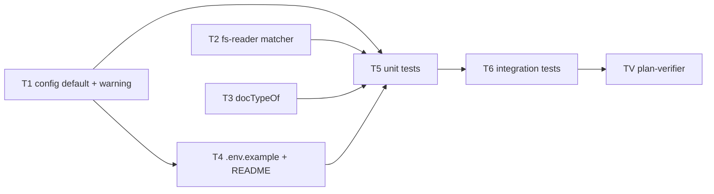

# Implementation Plan: Project Context — module `INSIGHTS.md` files as `insights` documents
Spec: `server/specs/project-context-insights.md` (SPEC-02, supersedes SPEC-01 AC-1 / AC-3 in `specs/project-context.md`)

## Overview
Under SPEC-01 the `insights` group is always empty. The default glob `**/{specs,docs,insights}/**/*.md`
only matches files inside an `insights/` directory, but the repo keeps its insights as
`<module>/INSIGHTS.md` files. The typing rule also looks only at directories. SPEC-02 widens the default
so every `INSIGHTS.md` (file name in any case) is listed, previewable, attachable and typed `insights`.
Every pattern, default or custom, now matches path names case-insensitively, while the `.md` extension
must stay lowercase. The server warns once at start when `.env` still carries the old default. Only
server matching, typing, config and docs change; the wire contract and the client stay as they are.

## Execution mode
**single-agent (one pass).** The user chose this on 2026-10-28. The change is server-only, about 7
source/doc files, and tightly coupled: `config.ts` exports the default that `fs-reader.ts`, the tests and
`.env.example` all have to agree on. Tasks run top to bottom, so owned-path overlap does not matter. They
are still listed per task for review.

## Open questions & recommendations
- Q: Execution mode → answer: single-agent (user, 2026-10-28).
- Q: Default pattern string → answer: `**/{{specs,docs,insights}/**/*,INSIGHTS}.md`, matched with picomatch
  `{ dot: true, nocase: true }` plus a case-sensitive `.md` suffix check (user, 2026-10-28).
- Q: Where the AC-15 warning is logged → answer: in `server/src/server.ts` after `buildApp`, through
  `app.log.warn`. The message comes from a pure, unit-tested function in `platform/config.ts` (user,
  2026-10-28).
- Q: AC-13 vs AC-12 conflict on `server/test/project-context.it.test.ts:108` → resolved by spec-creator.
  AC-13 now names that single `body.glob` assertion as superseded by AC-12. It moves to the new default,
  and every other existing assertion stays unchanged.
- Rec: Keep `project-context/service.ts` untouched. List, content and attachment validation already go
  through `docs.scan` / `docs.read`, and typing goes through `docTypeOf`, so changing the adapter and the
  helper covers AC-7 without touching the use case → accepted (no user objection).
- Rec: Integration tests build config from `{ ...process.env }`, which `dotenv/config` fills from
  `server/.env`. New SPEC-02 cases pass `CONTEXT_GLOB: ''` explicitly so they test "unset" whatever a
  developer's `.env` holds → accepted (folded into T6).
- Rec (out of scope): `EXCLUDED_DIRS` stays case-sensitive (`node_modules`, `.git`), as in SPEC-01. The
  spec does not ask for a change, so this is not planned → pending, user decides.

## Decisions
| Decision | Choice | Rejected alternative (reason) |
|---|---|---|
| Default pattern | `**/{{specs,docs,insights}/**/*,INSIGHTS}.md`, one string | `{**/{specs,docs,insights}/**/*.md,**/INSIGHTS.md}`: checked against picomatch 4.0.7, it misses every root-level path (`specs/x.md`, `docs/y.md`, `Docs/y.md`, `INSIGHTS.md`), which breaks AC-1/AC-2. An array of globs: AC-12 and the `DocsScope.glob: string` port require a single string |
| Case rule (AC-1, AC-10) | One private matcher in `fs-reader.ts`: `picomatch(glob, { dot: true, nocase: true })` AND `rel.endsWith('.md')` (case-sensitive), used by both `scan` and `read` | Case classes inside the pattern (`[Ii][Nn][Ss]…`): unreadable in the empty state and they do not apply to a custom `CONTEXT_GLOB`. A `caseInsensitive` flag on `DocsScope`: it would edit the shared port (`vendor/shared/adapters.ts`) to add a knob the spec rules out ("one case rule for every pattern") |
| Where the default lives | `DEFAULT_CONTEXT_GLOB` and `LEGACY_CONTEXT_GLOB` exported from `server/src/platform/config.ts` | `modules/project-context/constants.ts`: `platform/` may not import a feature module (`.dependency-cruiser.cjs`, only `container.ts` may), and the default is config, not domain |
| AC-15 warning | Pure `legacyContextGlobWarning(glob): string \| null` in `platform/config.ts`. `server.ts` calls `app.log.warn` once if it returns a string | `console.warn` inside `loadConfig`: bypasses pino and fires on every `loadConfig` call, including dozens of test apps. Logging in `buildApp`: fires once per test app, not once per server start. Rewriting the old value to the new default: a spec non-goal (AC-15 "keep using the configured old pattern unchanged") |
| Typing rule (AC-5, AC-6) | `docTypeOf` checks the lowercased file name `=== 'insights.md'` first, then the deepest directory segment compared lowercase against `DOC_BUCKETS`, else `docs` | Typing from the matched pattern branch: a custom glob has no branches, and AC-6 requires typing as a pure function of the path |
| Service | Unchanged | Adding matching or typing logic to `ProjectContextService`: it would duplicate the adapter's matcher, and a second rule could drift (AC-7) |
| Mock reader | `MockProjectDocsReader` unchanged (no glob) | Teaching the mock the glob: the matching proof must come from the real `FsProjectDocsReader` on temp-dir clones (AC-14), not from a re-implementation |

## Affected modules & contracts
- server: `platform/config.ts`, `server.ts`, `adapters/project-docs/fs-reader.ts`,
  `modules/project-context/helpers.ts` (+ `constants.ts`), `.env.example`, `README.md`, tests.
- Contracts: none. `ContextDocType` and `ContextDocList.glob: string` are unchanged, and
  `vendor/shared` is not touched, so `./scripts/check-shared.sh` is unaffected.
- client, reviewer-core, mcp-server, e2e: no change.
- DB: no schema change, no migration (attachments store paths only; type is derived on every read).

## Architecture changes
- `server/src/platform/config.ts` (cross-cutting platform): new exports `DEFAULT_CONTEXT_GLOB`,
  `LEGACY_CONTEXT_GLOB` and `legacyContextGlobWarning`. The `EnvSchema` default uses the constant.
- `server/src/server.ts` (composition root / entrypoint): one conditional `app.log.warn` after `buildApp`.
- `server/src/adapters/project-docs/fs-reader.ts` (ring 3a, driven adapter): one private matcher factory
  shared by `scan` and `read`. No new dependency (`picomatch` is already in `package.json`).
- `server/src/modules/project-context/helpers.ts` (ring 1, pure): `docTypeOf` rule. It still imports
  nothing from `platform/`.

## Phased tasks

### Phase 1 — Implementation (server)

- [ ] **T1** Config: new default, legacy constant, pure warning, startup log → AC-12, AC-15, AC-16 →
  `context-glob-config.test.ts` "AC-15: …", "AC-16: …", "AC-12: …"
  - **Action:**
    - In `server/src/platform/config.ts`, export
      `DEFAULT_CONTEXT_GLOB = '**/{{specs,docs,insights}/**/*,INSIGHTS}.md'` and
      `LEGACY_CONTEXT_GLOB = '**/{specs,docs,insights}/**/*.md'`.
    - Use `DEFAULT_CONTEXT_GLOB` in the `CONTEXT_GLOB` default. Keep the existing `'' → undefined`
      preprocess, so empty means unset (AC-16 follows because "set to the default" is the same string
      through the same matcher).
    - Add the pure `legacyContextGlobWarning(glob: string): string | null`. It returns a message only
      when `glob === LEGACY_CONTEXT_GLOB` (exact match). The message names `DEFAULT_CONTEXT_GLOB` and says
      to update or blank `CONTEXT_GLOB` in `server/.env`. Otherwise it returns `null`.
    - Update the `contextGlob` JSDoc on `AppConfig`: case-insensitive path names, lowercase `.md`.
    - In `server/src/server.ts`, after `buildApp`, add
      `const w = legacyContextGlobWarning(config.contextGlob); if (w) app.log.warn(w);`. This logs exactly
      one line per process, never per request.
  - **Module:** server · **Type:** backend
  - **Skills to use:** onion-architecture, typescript-expert, zod
  - **Owned paths:** `server/src/platform/config.ts`, `server/src/server.ts`
  - **Depends-on:** none
  - **Risk:** low
  - **Known gotchas:** `platform/config.ts` must not import from `modules/` (arch rule). `config.ts`
    imports `dotenv/config`, so tests that spread `process.env` see `server/.env`.
  - **Acceptance:** `pnpm typecheck` green. `loadConfig({ NODE_ENV: 'test' }).contextGlob ===
    DEFAULT_CONTEXT_GLOB`. `loadConfig({ CONTEXT_GLOB: LEGACY_CONTEXT_GLOB }).contextGlob` is still the
    legacy string. The T5 config tests pass.

- [ ] **T2** Reader: one case-insensitive matcher for scan and read → AC-1, AC-2, AC-3, AC-4, AC-7, AC-8, AC-10 →
  `project-docs-reader.test.ts` "SPEC-02 AC-1 … AC-4, AC-7, AC-10" + `project-context.it.test.ts` "SPEC-02 AC-8"
  - **Action:**
    - In `server/src/adapters/project-docs/fs-reader.ts`, add a module-private
      `docMatcher(glob: string): (rel: string) => boolean`. It returns
      `rel => rel.endsWith('.md') && m(rel)`, where `m = picomatch(glob, { dot: true, nocase: true })`.
    - `scan` builds it once and passes it to `walk`. Remove the duplicated `e.name.endsWith('.md')`
      pre-filter or keep it as a cheap pre-check; it is case-sensitive either way.
    - `read` replaces `!norm.endsWith('.md') || !picomatch(scope.glob, { dot: true })(norm)` with
      `!docMatcher(scope.glob)(norm)`.
    - `EXCLUDED_DIRS`, traversal, symlink and 1 MB handling stay byte-for-byte as they are.
    - Update the class doc comment with the case rule.
  - **Module:** server · **Type:** backend
  - **Skills to use:** onion-architecture, typescript-expert, security
  - **Owned paths:** `server/src/adapters/project-docs/fs-reader.ts`
  - **Depends-on:** none
  - **Risk:** medium (security boundary file: only the match predicate may change)
  - **Known gotchas:**
    - The path is attacker-influenced. Do not loosen the `..` / absolute / `\0` checks or the realpath
      confinement.
    - `nocase` would also accept `.MD`; the separate case-sensitive `endsWith('.md')` is what enforces
      AC-3.
    - Use `grep -a` / ripgrep for "who uses X" searches (server INSIGHTS: BSD grep drops "binary" TS files).
  - **Acceptance:** the existing `project-docs-reader.test.ts` suite passes unchanged. The new T5 reader
    cases pass. `pnpm arch:check` reports no new violation.

- [ ] **T3** Typing: file-name rule + case-insensitive buckets → AC-5, AC-6 →
  `project-context-helpers.test.ts` "SPEC-02 AC-5 …", "SPEC-02 AC-6 …"
  - **Action:**
    - In `server/src/modules/project-context/constants.ts`, add `INSIGHTS_FILE_NAME = 'insights.md'`
      (lowercase, compared after `toLowerCase()`). Fix the `DEFAULT_DOC_TYPE` comment ("no bucket
      segment and not an INSIGHTS.md").
    - In `helpers.ts`, `docTypeOf(path)` does three things in order:
      1. If the last segment lowercased equals `INSIGHTS_FILE_NAME`, return `'insights'`.
      2. Otherwise walk the directory segments deepest-first, compare `seg.toLowerCase()` against
         `DOC_BUCKETS`, and return the lowercase bucket.
      3. Otherwise return `DEFAULT_DOC_TYPE`.
    - Update the JSDoc.
  - **Module:** server · **Type:** backend
  - **Skills to use:** onion-architecture, typescript-expert
  - **Owned paths:** `server/src/modules/project-context/helpers.ts`, `server/src/modules/project-context/constants.ts`
  - **Depends-on:** none
  - **Risk:** low
  - **Known gotchas:** ring 1 — no import from `platform/` (other than `errors.ts`) or adapters. The
    existing `docTypeOf('specs/docs/y.md') === 'docs'` expectation must still hold.
  - **Acceptance:** the existing `docTypeOf` test passes unchanged. The new T5 typing cases pass.
    `pnpm arch:check` is green.

- [ ] **T4** Environment example + API reference → AC-11 (enables AC-16) → `context-glob-config.test.ts` "AC-11: …"
  - **Action:**
    - In `server/.env.example`, set `CONTEXT_GLOB=` to exactly `DEFAULT_CONTEXT_GLOB`, unquoted. dotenv
      parses it unchanged (verified). Rewrite the comment above it to say:
      - the default also lists `INSIGHTS.md` files at any depth;
      - every pattern, default or custom, matches path names case-insensitively;
      - the `.md` extension must be lowercase;
      - an existing `.env` with the old `**/{specs,docs,insights}/**/*.md` must be updated or blanked to
        get `INSIGHTS.md` files, and the server warns at start if it still has it.
    - In `server/README.md`, change the env table row `CONTEXT_GLOB` (line ~107) to the new default with
      the same three notes (INSIGHTS.md, case rule, old `.env` value).
  - **Module:** server · **Type:** backend (docs)
  - **Skills to use:** none beyond core
  - **Owned paths:** `server/.env.example`, `server/README.md`
  - **Depends-on:** T1
  - **Risk:** low
  - **Known gotchas:** `scripts/dev.sh:46-48` copies `.env.example` → `.env` only when `.env` is absent,
    so existing `.env` files keep the old value. That is the AC-15 path, not a bug to "fix" in `dev.sh`.
  - **Acceptance:** the T5 "AC-11" test passes: the `.env.example` value equals `DEFAULT_CONTEXT_GLOB`,
    and the README contains `DEFAULT_CONTEXT_GLOB` and `INSIGHTS.md`.

### Phase 2 — Tests (`test-writer`, derived from the ACs; runs after the architecture gate)

- [ ] **T5** Unit tests (no Docker) → AC-1, AC-2, AC-3, AC-4, AC-5, AC-6, AC-7, AC-10, AC-11, AC-14, AC-15, AC-16
  - **Action:** add new `describe` blocks only. Existing assertions in these files stay untouched (AC-13).
    - `server/test/project-docs-reader.test.ts`: new block
      `describe('FsProjectDocsReader — SPEC-02 built-in default (real repo layout)')` using
      `loadConfig({ NODE_ENV: 'test', CONTEXT_GLOB: '' }).contextGlob` / `DEFAULT_CONTEXT_GLOB` imported
      from `src/platform/config.ts`, never a local copy (AC-14). The fixture includes
      `server/INSIGHTS.md`, `client/INSIGHTS.md`, `reviewer-core/INSIGHTS.md`, `e2e/INSIGHTS.md`,
      `mcp-server/INSIGHTS.md`, plus the AC-1 to AC-4 paths. Cases:
      - `SPEC-02 AC-1: default lists specs/docs/insights directories at any depth, case-insensitively`:
        `specs/x.md`, `docs/y.md`, `insights/c.md`, `e2e/docs/specs/z.md`, `Docs/y.md`, `SPECS/x.md`,
        `Insights/c.md`.
      - `SPEC-02 AC-2/AC-14: default lists every <module>/INSIGHTS.md, root INSIGHTS.md and any-case
        file names`: the five modules, `INSIGHTS.md`, `a/b/insights.md`, `c/Insights.md`.
      - `SPEC-02 AC-3: default lists nothing else, incl. upper-case .MD`: `notes/random.md`, `README.md`,
        `server/AGENTS.md`, `notes/MY-INSIGHTS.md`, `notes/insights-old.md`, `INSIGHTS.MD`, `docs/y.MD`,
        `insights.md.bak`. The scan result equals the exact expected list (superset check vs the legacy
        list included).
      - `SPEC-02 AC-4: INSIGHTS.md under node_modules/.git is excluded, in a hidden dir is listed`.
      - `SPEC-02 AC-7: read returns content for exactly the paths scan lists`: for every fixture path,
        `listed ⇔ read().kind === 'ok'`.
      - `SPEC-02 AC-10: an explicit glob replaces the default under the same case rule`:
        `**/specs/**/*.md` → `SPECS/x.md` yes, `server/INSIGHTS.md` no, `specs/x.MD` no; `**/*.md` →
        `server/INSIGHTS.md` yes.
      - `SPEC-02 AC-16: CONTEXT_GLOB set to the .env.example value scans identically to unset`.
    - `server/test/project-context-helpers.test.ts`: new block `describe('docTypeOf — SPEC-02')`:
      - `SPEC-02 AC-5: an INSIGHTS.md file name types insights at any depth` (`server/INSIGHTS.md`,
        `INSIGHTS.md`, `a/b/insights.md`, `docs/INSIGHTS.md`, `specs/INSIGHTS.md`).
      - `SPEC-02 AC-6: otherwise the deepest bucket segment, case-insensitive, default docs` (all seven
        paths from AC-6, plus `specs/x.md` vs `docs/x.md` → two documents, two types).
      - `SPEC-02 AC-10: a path from a catch-all glob is typed by the same rule` (`server/INSIGHTS.md` →
        `insights`, `README.md` → `docs`).
    - New `server/test/context-glob-config.test.ts`:
      - `AC-12: unset or empty CONTEXT_GLOB yields DEFAULT_CONTEXT_GLOB`.
      - `AC-15: the old SPEC-01 default yields one warning naming the new default and stays in effect`:
        `legacyContextGlobWarning(LEGACY)` contains `DEFAULT_CONTEXT_GLOB`, and
        `loadConfig({ CONTEXT_GLOB: LEGACY }).contextGlob === LEGACY`.
      - `AC-15: the new default or a custom glob yields no warning` (returns `null`).
      - `AC-11: .env.example CONTEXT_GLOB equals the built-in default and the docs mention INSIGHTS.md`:
        parse `server/.env.example` with `dotenv.parse`; read `server/README.md` and check that it
        contains the default and `INSIGHTS.md`.
      - `AC-16: CONTEXT_GLOB set to the .env.example value equals unset`.
  - **Module:** server · **Type:** backend (tests)
  - **Skills to use:** typescript-expert, onion-architecture (test per ring)
  - **Owned paths:** `server/test/project-docs-reader.test.ts`, `server/test/project-context-helpers.test.ts`,
    `server/test/context-glob-config.test.ts`
  - **Depends-on:** T1, T2, T3, T4
  - **Risk:** low
  - **Known gotchas:**
    - Fixture clones come from `test/helpers/project-context-fixtures.ts` (`makeClone`, `cleanupClones`
      in `afterEach`).
    - Build "unset" as `CONTEXT_GLOB: ''`, not by spreading `process.env`, because `server/.env` can leak
      in through `dotenv/config`.
    - On case-insensitive APFS, `Docs/y.md` and `docs/y.md` cannot both exist in one fixture. Put
      mixed-case dirs in a separate clone or use distinct file names (`Docs/y2.md`).
  - **Acceptance:** `cd server && PATH=~/Library/pnpm/bin:$PATH pnpm test:unit` is green, including every
    case above. `pnpm typecheck` is green. `git diff -U0 -- server/test/project-docs-reader.test.ts
    server/test/project-context-helpers.test.ts` shows no removed lines.

- [ ] **T6** Integration tests (Docker) + the one superseded assertion → AC-7, AC-8, AC-9, AC-12, AC-13, AC-16
  - **Action:**
    - In `server/test/project-context.it.test.ts`, change line 108 to
      `expect(body.glob).toBe(DEFAULT_CONTEXT_GLOB)` (imported from `src/platform/config.ts`). This is the
      single existing assertion AC-13 allows to change; nothing else existing changes.
    - Make that suite's `config()` pass `CONTEXT_GLOB: ''` so "unset" is real. This is a config-construction
      change, not an assertion edit.
    - Add `describe('SPEC-02 — INSIGHTS.md documents')` with a fixture clone holding the five
      `<module>/INSIGHTS.md` files, `notes/random.md` and `node_modules/p/INSIGHTS.md`:
      - `SPEC-02 AC-12: glob is a single string equal to the built-in default when CONTEXT_GLOB is unset`,
        and also equal to the `.env.example` value.
      - `SPEC-02 AC-8: an INSIGHTS.md is served with its text; node_modules/p/INSIGHTS.md and
        ../INSIGHTS.md are 404`. The listed `server/INSIGHTS.md` has `type: 'insights'`.
      - `SPEC-02 AC-9: saving server/INSIGHTS.md succeeds and is stored; notes/random.md is 422 with 0
        rows`, via `PUT /agents/:id/context` and checking the `agent_context_docs` rows.
      - `SPEC-02 AC-7: listed ⇔ content returned ⇔ attachment accepted for every fixture path`.
      - `SPEC-02 AC-16: CONTEXT_GLOB set to the .env.example value returns the same list response as
        unset`. A second `buildApp` with `CONTEXT_GLOB: DEFAULT_CONTEXT_GLOB` gets an identical `docs`
        array, including `Docs/y.md` and `SPECS/x.md`. Close the app in `finally`.
  - **Module:** server · **Type:** backend (tests)
  - **Skills to use:** fastify-best-practices (`app.inject`), drizzle-orm-patterns (row assertions), typescript-expert
  - **Owned paths:** `server/test/project-context.it.test.ts`
  - **Depends-on:** T5 (sequential in single-agent mode; no file overlap)
  - **Risk:** low
  - **Known gotchas:**
    - A body failing validation is 422, not 400 (server INSIGHTS 2026-10-20).
    - Mock every LLM provider a run could reach (`openai`, `openrouter`), as the suite already does.
    - `project-context-run.it.test.ts` needs no edit; it asserts no glob string.
  - **Acceptance:** `cd server && PATH=~/Library/pnpm/bin:$PATH pnpm test:integration` is green,
    including `project-context.it.test.ts` and the unchanged `project-context-run.it.test.ts`. The diff
    of the existing lines in `project-context.it.test.ts` touches only the line-108 expectation and the
    `config()` env (AC-13).

### Phase 3 — Verification (read-only)
- [ ] **TV** `plan-verifier` against `server/specs/project-context-insights.md` and this plan → matrix
  AC → task → test → commit for AC-1 to AC-16. Gate PASS requires `pnpm typecheck`, `pnpm test:unit`,
  `pnpm arch:check` and `pnpm test:integration` green in `server/`. After that, ask the user to run
  `/pr-self-review` (Backend bucket) on the diff.

## Traceability
| AC | Tasks | Test(s) |
|---|---|---|
| AC-1 | T2, T5 | `project-docs-reader.test.ts` "SPEC-02 AC-1: default lists specs/docs/insights directories …" |
| AC-2 | T1, T2, T5 | `project-docs-reader.test.ts` "SPEC-02 AC-2/AC-14: default lists every <module>/INSIGHTS.md …" |
| AC-3 | T2, T5 | `project-docs-reader.test.ts` "SPEC-02 AC-3: default lists nothing else, incl. upper-case .MD" |
| AC-4 | T2, T5 | `project-docs-reader.test.ts` "SPEC-02 AC-4: INSIGHTS.md under node_modules/.git …" |
| AC-5 | T3, T5 | `project-context-helpers.test.ts` "SPEC-02 AC-5: an INSIGHTS.md file name types insights …" |
| AC-6 | T3, T5 | `project-context-helpers.test.ts` "SPEC-02 AC-6: otherwise the deepest bucket segment …" |
| AC-7 | T2, T5, T6 | `project-docs-reader.test.ts` "SPEC-02 AC-7: …"; `project-context.it.test.ts` "SPEC-02 AC-7: listed ⇔ content ⇔ attachment" |
| AC-8 | T2, T6 | `project-context.it.test.ts` "SPEC-02 AC-8: an INSIGHTS.md is served with its text …" |
| AC-9 | T2, T6 | `project-context.it.test.ts` "SPEC-02 AC-9: saving server/INSIGHTS.md succeeds …" |
| AC-10 | T2, T3, T5 | `project-docs-reader.test.ts` "SPEC-02 AC-10: …"; `project-context-helpers.test.ts` "SPEC-02 AC-10: …" |
| AC-11 | T4, T5 | `context-glob-config.test.ts` "AC-11: .env.example CONTEXT_GLOB equals the built-in default …" |
| AC-12 | T1, T5, T6 | `context-glob-config.test.ts` "AC-12: …"; `project-context.it.test.ts` "SPEC-02 AC-12: …" + updated line 108 |
| AC-13 | T2, T3, T6 | existing unit + integration suites green; diff to existing assertions = line 108 only |
| AC-14 | T5 | `project-docs-reader.test.ts` "SPEC-02 AC-2/AC-14: …" (imports `DEFAULT_CONTEXT_GLOB`, five-module fixture) |
| AC-15 | T1, T5 | `context-glob-config.test.ts` "AC-15: the old SPEC-01 default yields one warning …", "AC-15: … no warning" |
| AC-16 | T1, T4, T5, T6 | `context-glob-config.test.ts` "AC-16: …"; `project-docs-reader.test.ts` "SPEC-02 AC-16: …"; `project-context.it.test.ts` "SPEC-02 AC-16: …" |

## Testing strategy
- Tests are derived from the ACs, not from the finished code (`test-writer` after the architecture gate).
- Commands (`server/`, with `PATH=~/Library/pnpm/bin:$PATH`): `pnpm typecheck`, `pnpm test:unit`,
  `pnpm arch:check`, `pnpm test:integration` (Docker). Contracts are untouched, so `./scripts/check-shared.sh`
  is not needed. No client, reviewer-core or e2e run is needed.
- The split follows the template: T5 holds the unit files (no Docker) and T6 the single `*.it.test.ts`
  file, each with its own AC subset and disjoint test files. Single-agent mode runs them sequentially.
- Matching is proven only against the real `FsProjectDocsReader` on temp-dir clones. `MockProjectDocsReader`
  applies no glob by design.

## Risks & mitigations
- **The `fs-reader.ts` security boundary is edited.** → T2 may change only the match predicate. The existing
  traversal, symlink, excluded-dir and 1 MB tests in `project-docs-reader.test.ts` stay unchanged and must
  pass. Request `/pr-self-review` (Backend + security lens) before the PR.
- **Case-insensitive filesystem (macOS APFS).** `read('DOCS/y.md')` can resolve to the file listed as
  `docs/y.md`, so content is served for a differently-cased path. The file is the same one inside the clone
  (no boundary crossed). Attachments are validated against the exact scanned paths, so such a path still
  gets 422. The same was already possible under SPEC-01 with a case-agnostic custom glob. → Accepted;
  AC-7's fixtures use the listed spelling.
- **Developer `.env` leaking into tests** (`dotenv/config` inside `config.ts`) → new tests build "unset"
  as `CONTEXT_GLOB: ''` (T5, T6).
- **Old `.env` keeps the old glob silently** → AC-15 warning (T1) and the `.env.example` / README notes (T4).
- **APFS fixture collisions** (`Docs/` vs `docs/` in one clone) → separate clones or distinct file names (T5).
- **More matches than before (500-item limit)** → unchanged SPEC-01 truncation; no new handling (spec non-goal).

## Red-flags check
- [x] Spec was `approved`, with no open `[NEEDS CLARIFICATION]`; it was not edited by the planner (AC-13 fixed by spec-creator)
- [x] Every AC maps to ≥ 1 task and ≥ 1 test; every task lists its AC-IDs
- [x] Execution mode is recorded (single-agent) and the plan is linear
- [x] Dependencies form a DAG (T1–T3 → T4 → T5 → T6 → TV)
- [x] (multi-agent) n/a; owned paths are still disjoint per task
- [x] Every Acceptance is measurable (named tests + command results + diff checks)
- [x] Every decision records its rejected alternative
- [x] No edits to existing shared contracts (`vendor/shared` untouched)
- [x] No migration; no cross-module import that `pnpm arch:check` forbids (`platform/config.ts` imports no module; `helpers.ts` imports no platform)
- [x] Final phase runs `plan-verifier`
