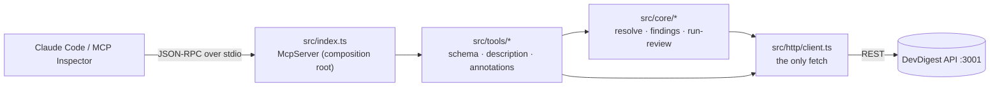

# `@devdigest/mcp-server` — DevDigest for Claude Code

A local **stdio MCP server** that lets Claude Code (or any MCP client) run DevDigest
reviews from a terminal: *"Review PR #3 in owner/repo with the Security Reviewer and
tell me if there are critical findings"* → `list_agents → run_agent_on_pr → get_findings`
→ the real findings DevDigest stored, not the model's guesses.

It is a **thin HTTP client** over the DevDigest API (`:3001`): no database, no secrets,
no business logic — it turns human ids (`owner/name`, PR number, agent name) into
UUIDs, calls the API and trims the answer to what a model needs. It is **not**
started by `./scripts/dev.sh`; the API must already be running.

Design and rejected alternatives → [specs/mcp-server.md](specs/mcp-server.md).
Token audit (Tool Search vs full schemas, GitHub MCP toolsets) → [docs/token-audit.md](docs/token-audit.md).

## Architecture



`http/client.ts` is the permission boundary: six GETs and one POST
(`/pulls/:id/review`). No delete, update, settings or secrets call exists, so no
tool can make one.

## Tools

| Tool | Args | Returns | Hints |
|---|---|---|---|
| `list_agents` | — | `{agents:[{id, name, enabled, model}]}` | read-only |
| `run_agent_on_pr` | `repo`, `pr`, `agent` | `{repo, pr, run_id, agent, verdict, score, summary, counts, total, returned, findings[≤20], more?}`; over ~2 min → `{status:"running", run_id, next}` | **writes** (starts a paid LLM run, 10/min), open-world |
| `get_findings` | `repo`, `pr`, `run_id?`, `response_format?` (`concise`\|`detailed`), `offset?`, `limit?` | same page shape, worst first; `counts` over all findings | read-only |
| `get_conventions` | `repo` | `{repo, conventions:[{rule, category, status, file, confidence}]}`, ACCEPTED first | read-only |
| `get_blast_radius` | `repo?`, `pr?` | `{status:"not_implemented", message}` — a stub, not an error | read-only |

- `repo` — `'owner/name'`, or a bare name if only one connected repo has it.
- `pr` — the GitHub PR number, not an internal id.
- `agent` — an id from `list_agents` (an exact name like `'Security Reviewer'` also works).
- Concise finding: `{severity, title, file, line, rationale}`; detailed adds `id, category, end_line, confidence, suggestion`.

Every miss answers `isError: true` with the next step — unknown repo → the connected
repos; unknown PR → known PR numbers + `gh pr list -R owner/name`; unknown agent →
all `id (name)`; no review yet → "call run_agent_on_pr first"; API down →
`./scripts/dev.sh`; HTTP 429 → wait a minute. Empty lists are results, not errors.

## Install and run

```bash
./scripts/dev.sh              # from the repo root — the API must be up on :3001
cd mcp-server && pnpm install
pnpm start                    # stdio server (it waits for a client on stdin)
```

`DEVDIGEST_API_URL` overrides the API base (default `http://localhost:3001`).

## Verify

```bash
pnpm typecheck && pnpm test   # tsc + vitest (core/, fake client, no network)

pnpm call                     # list the 5 tools with their annotations
pnpm call list_agents
pnpm call get_findings '{"repo":"owner/name","pr":3}'
pnpm call run_agent_on_pr '{"repo":"owner/name","pr":3,"agent":"nope"}'   # → isError + valid ids

pnpm inspect                  # MCP Inspector UI: Connect → Tools → List Tools
```

In the Inspector, `resources/list` and `prompts/list` show red `ERROR`s — expected:
the server declares only `tools`, so the SDK answers `-32601 Method not found`.

stdout must stay empty except for JSON-RPC (all logs go to stderr):

```bash
node_modules/.bin/tsx src/index.ts </dev/null 2>/dev/null | wc -c   # → 0
```

## Claude Code

The root [`.mcp.json`](../.mcp.json) registers the server as `devdigest`
(`npx --no-install --prefix mcp-server tsx mcp-server/src/index.ts`), so open Claude
Code **from the repo root**. The root `.claude/settings.json` sets
`MCP_TOOL_TIMEOUT=150000` so a review that takes up to the tool's 120 s limit is
not cut off.

```text
/mcp   →  devdigest · ✔ connected · 5 tools
```

Then ask in plain language — *"Review PR #3 in owner/name with the Security Reviewer
and tell me if there are critical findings"*. Claude Code calls `list_agents`, then
`run_agent_on_pr`; `get_findings` follows when the run outlives 2 minutes, there are
more than 20 findings, or you ask for details (`response_format: "detailed"`).
