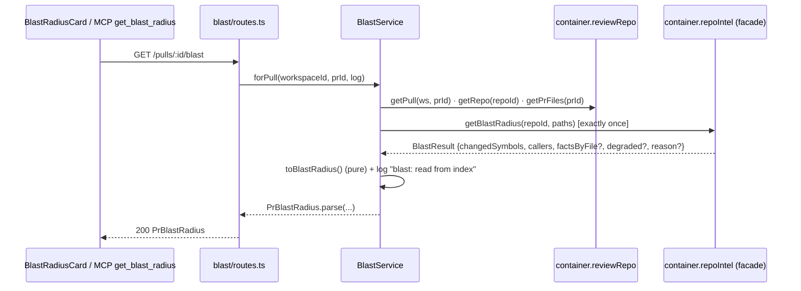

# Development Plan: Blast Radius (Lab 4 homework)

Status: implemented (2026-10-25; see "As built" at the end). Source: the approved plan `blast-floofy-pie.md` (user-approved;
its decisions are final). This spec turns it into phased tasks and records where the code
disagreed with the plan ("Corrections to the approved plan", below). When the work ships,
append an "As built" section, as `mcp-server/specs/mcp-server.md` does.

## Overview

A reviewer sees the diff but not what else in the repo the change reaches. The repo-intel index
(symbols, resolved `references`, `file_rank`, `file_facts` with endpoints/crons) is already built
on clone. The facade `repoIntel.getBlastRadius(repoId, changedFiles)` already returns a flat
`BlastResult`. Four pieces are missing:

1. a `blast` module with `GET /pulls/:id/blast` that maps the result onto the existing
   `BlastRadius` contract;
2. a Blast radius card on the PR Overview tab, with Tree and Graph views;
3. a working MCP tool `get_blast_radius` (it is a stub today);
4. fixes for three facade bugs that would make the map silently wrong.

There are no LLM calls anywhere in this feature. It only reads the index.

## Requirements

- R1 `GET /pulls/:id/blast` returns `PrBlastRadius` (shape below): changed symbols, one
  downstream group per changed symbol that has callers, and the endpoints/crons reached through
  the callers' files. It also returns `degraded` and `reason` flags that describe the index honestly.
- R2 Facade fixes in `repo-intel/service.ts`:
  - the cap of `MAX_CALLERS_PER_SYMBOL` (20) applies to each symbol separately, not to the whole list;
  - a `partial` index is reported as `degraded: true, reason: 'index_partial'`;
  - the fallback path reports its real reason (`flag_off` / `index_failed` / the stamped
    reason / `no_data`), not a hard-coded `no_data`.
- R3 `blast` is a new onion module: a pure `toBlastRadius` helper, a `BlastService` with narrow
  `BlastDeps`, an `index.ts` facade, a thin route, a container getter with an override, and
  registration in `modules/index.ts`. The service makes exactly one facade call per request and
  logs `blast: read from index`.
- R4 Ordering (P3, most important first): callers within a group by rank, descending; groups by
  the highest rank among their callers, stable on ties. A caller in the symbol's own declaration
  file is dropped. Endpoints and crons are deduplicated.
- R5 The Overview tab shows a `BlastRadiusCard` after `IntentCard`:
  - a summary with four counts (symbols, callers, endpoints, crons);
  - a Tree / Graph toggle;
  - Tree: collapsible groups, the first one expanded by default; `file:line` links to GitHub at
    the PR head; endpoint chips and cron chips shown separately;
  - Graph: a hand-drawn SVG with three columns;
  - states: Skeleton (loading), ErrorState (failure), a degraded badge with its reason plus a
    Resync button (no Resync for `flag_off`), and `noDownstream` text when there are no callers.
- R6 All UI text comes from `client/messages/en/blast.json`. No hardcoded strings.
- R7 The MCP tool `get_blast_radius(repo, pr)` takes both arguments (required) and returns the
  same map. An unknown PR gets an actionable `toolError`. The tool is `READ_ONLY`. The HTTP
  client gains exactly one GET.
- R8 Hermetic tests:
  - server: helpers, the service with fake deps, the facade;
  - client: an RTL test with the real hook and a faked `fetch`;
  - mcp: the core with a fake client.
- R9 Out of scope: prior PRs (they need the GitHub API, a token and rate limits — a separate
  feature), e2e flows, and any change to `BlastRadius` / `PrBrief` themselves.

## Affected modules & contracts

- `server` — the `repo-intel` facade fix; the new `modules/blast/`; `modules/index.ts`;
  `platform/container.ts`; `README.md` (API map).
- `client` — `lib/hooks/blast.ts`; `OverviewTab` and `PrDetailView` pass the new props through;
  `BlastRadiusCard` with nested `BlastTree` / `BlastGraph`; `messages/en/blast.json`.
- `mcp-server` — `http/client.ts`; a new `core/blast.ts`; `tools/get-blast-radius.ts`;
  `src/index.ts`; `test/fixtures.ts`; README tools table.
- **Contracts: an additive edit to an existing file, `server/src/vendor/shared/contracts/brief.ts`.**
  It only adds two new exports (`BlastDegradedReason`, `PrBlastRadius`). No existing schema
  changes; `BlastRadius`, `DownstreamImpact`, `BlastCaller` and `PrBrief` stay byte-identical.
  The client copy is refreshed with `./scripts/check-shared.sh --sync` in the same commit
  (server INSIGHTS 2026-09-20). `mcp-server` resolves `@devdigest/shared` to the server copy
  through tsconfig `paths`, as a type-only import, so it needs no sync.
- No migration. The tables (`references`, `file_rank`, `file_facts`, `repo_index_state`,
  `pr_files`) already exist.

### Wire contract (pinned — T2 and T3 code against this without waiting for T1b)

```ts
// added to server/src/vendor/shared/contracts/brief.ts, after BlastRadius
export const BlastDegradedReason = z.enum([
  'flag_off', 'index_failed', 'index_partial', 'repo_too_large', 'no_data',
]);
export type BlastDegradedReason = z.infer<typeof BlastDegradedReason>;

export const PrBlastRadius = BlastRadius.extend({
  pr_id: z.string(),
  degraded: z.boolean(),
  reason: BlastDegradedReason.nullable(),
});
export type PrBlastRadius = z.infer<typeof PrBlastRadius>;
```

The enum values are lowercase snake_case. This deliberately breaks the repo-wide "wire enums are
UPPER_CASE" rule: the values mirror the server's existing `DegradedReason`
(`repo-intel/types.ts:28`) 1:1, and that type is already on the wire as `degradedReason` in
`GET /repos/:id/index-state`.

Example response of `GET /pulls/:id/blast` (the values are illustrative):

```json
{
  "pr_id": "7d0c2f4e-…",
  "changed_symbols": [
    { "name": "getContext", "file": "server/src/modules/_shared/context.ts", "kind": "function" }
  ],
  "downstream": [
    {
      "symbol": "getContext",
      "callers": [
        { "name": "settingsRoutes", "file": "server/src/modules/settings/routes.ts", "line": 31 },
        { "name": "reposRoutes", "file": "server/src/modules/repos/routes.ts", "line": 40 }
      ],
      "endpoints_affected": ["GET /settings", "PUT /settings", "GET /repos"],
      "crons_affected": []
    }
  ],
  "summary": "1 changed symbols · 2 callers · 3 endpoints · 0 crons",
  "degraded": false,
  "reason": null
}
```

Invariants (asserted in T1b tests; the client and MCP may rely on them):

- `degraded === false` ⇔ `reason === null`.
- `downstream` contains only symbols that have at least one caller. Groups are ordered by their
  highest caller rank, descending. Callers inside a group are ordered by rank, descending, and
  there are at most 20 per group.
- `endpoints_affected` and `crons_affected` are deduplicated. They are `[]` on the degraded
  ripgrep path, which has no `factsByFile`.
- Rank is not on the wire (`BlastCaller` has no rank field). Order is the only rank signal.
- `summary` uses exactly the format
  `"<S> changed symbols · <C> callers · <E> endpoints · <J> crons"`. When degraded, it adds
  `" · index degraded: <reason>"`. The words are always plural. The UI does not show this
  string; MCP and logs do.
- `404` when the PR is not in the caller's workspace (`NotFoundError`).



## Corrections to the approved plan (code disagreed)

| # | Plan said | Code says | What this spec does |
|---|---|---|---|
| C1 | Spec at `server/specs/blast-radius.md` | The work touches server, client and mcp-server | Repo-root `specs/blast-radius.md` (root `AGENTS.md`: cross-package specs live in `specs/`). |
| C2 | Facade bug at `:389` (`degraded: false` on partial) | The early return at `service.ts:338` (`nameSet.size === 0`) has the same bug | T1b fixes both returns. |
| C3 | Map "too large repo" → `repo_too_large` after checking what the pipeline writes | The pipeline never writes `repo_too_large`. `walk.ts:65` silently keeps the first `MAX_INDEXED_FILES` (5000) files and records only `stats.bounded`; the status stays `full`. `full.ts` stamps `degradedReason` only on `no_clone` (`'no_data'`, `full.ts:89`). `tryGetIndexState` defaults `degradedReason` to `'index_failed'` for `degraded`/`failed` rows (`repository.ts:230`). | The fallback uses `flag_off` when the flag is off; otherwise `state?.degradedReason ?? 'no_data'`. That passes through what the pipeline stamped and yields `index_failed` for `failed`, as planned. `repo_too_large` stays in the enum (it mirrors `DegradedReason`, and the UI has a label for it), but nothing produces it in this PR. See Decisions and Risks. |
| C4 | Resync completion detected "as in ProjectContextView" | No `ProjectContextView` exists in this repo. `useResyncRepoIntel` / `useRepoIntelStatus` (`client/src/lib/hooks/repo-intel.ts`) have no consumers yet; only their doc comment describes the pattern. | T2 implements the pattern: snapshot `{lastIndexedSha, updatedAt}` on click, poll until either one changes or 120 s pass, then invalidate the blast query. A same-SHA resync still touches `updated_at` (`pipeline/incremental.ts:6`), so a no-op resync completes too. |
| C5 | `@devdigest/ui` `Tabs` / `Chip` for the toggle and tags | `Tabs` (`vendor/ui/kit/Tabs.tsx`) is a page-level tab bar with a bottom border and no ARIA state. `Chip` renders a `<button>`. | Toggle: two `Button`s with `active` + `aria-pressed` (`Button` spreads `...rest`). Endpoint/cron tags: `Badge` with `icon="Globe"` / `icon="Clock"`, which renders a non-interactive `<span>`. |
| C6 | MCP: projection inside `tools/get-blast-radius.ts`; test with a fake client | `mcp-server/AGENTS.md`: tools are thin, logic goes in `src/core/*`, and tests cover `core/`. `test/fixtures.ts`'s `fakeClient` lists every `DevDigestClient` method, so adding a method fails `pnpm typecheck` until the fixture gains it. | New `mcp-server/src/core/blast.ts` (resolve + projection, pure over the client). T3 also owns `test/fixtures.ts`. |
| C7 | (P1 test PR) "a helper imported by `routes.ts`" | `extractEndpoints` (`repo-intel/extract.ts:15`) works line by line: the verb and the path must be on the same line. Multi-line `app.get(\n '/x'` (intent, repo-intel routes) yields 0 endpoints. | P1 risk section below: pick callers whose routes are single-line (settings, repos, pulls, agents, skills, conventions, reviews, workspace, polling — 40 such declarations). |

Facts the plan cited that I verified as correct:

- `getBlastRadius` `service.ts:220`, `tryPersistentBlast` `:315`, the global `slice` `:386`,
  `degraded: false` `:389`, ripgrep `no_data` `:233`/`:302`.
- `container.reviewRepo.getPrFiles(prId)` (`reviews/repository.ts:38`, not workspace-scoped, so
  it is called after the scoped `getPull`).
- `IntentService.load` `intent/service.ts:132`; the `container.intent` getter + override
  `platform/container.ts:190`; static registration in `modules/index.ts`.
- `./scripts/check-shared.sh --sync` (does `rm -rf client/src/vendor/shared` then copies).
- `PrDetailView.tsx:148` renders `OverviewTab`; `repoFullName` (`:93`) and `pr.head_sha` are in scope.
- `githubBlobUrl(repoFullName, sha, file, startLine?)` in `client/src/lib/github-urls.ts`.
- `client/messages/en/blast.json` exists with `stat.*`, `view.*`, `callerCount`, `noDownstream`,
  `graph.*`; namespaces are auto-loaded by `src/i18n/request.ts`.
- `SectionLabel`, `Skeleton`, `Badge`, `EmptyState`, `ErrorState`, `Button` and the icons `Zap`,
  `Globe`, `Clock`, `ChevronDown`, `ChevronRight`, `RefreshCw` exist in `client/src/vendor/ui`.
- The MCP stub, `resolvePull`, `READ_ONLY`, `toolOk`/`toolError`/`apiFailure`, `http/client.ts`.

## Decisions

| Decision | Choice | Rejected alternative (reason) |
|---|---|---|
| Where `degraded`/`reason` live on the wire | A separate response wrapper `PrBlastRadius = BlastRadius.extend({pr_id, degraded, reason})` | Add `degraded` to `BlastRadius` itself — `BlastRadius` is part of `PrBrief` (`brief.ts`), where "index degraded" has no meaning, and changing it would ripple into every `PrBrief` consumer. |
| Facade bugs (global cap, partial reported as healthy, `no_data` everywhere) | Fix them in `repo-intel/service.ts`; blast trusts the facade | Work around them in `BlastService` (re-cap per symbol, re-read index state) — the facade owns the meaning of `degraded`; a workaround would leave every other consumer wrong and split the rule across two modules. |
| Graph rendering | A hand-written SVG, 3 columns, layout as a pure function in `BlastGraph/helpers.ts` | `reactflow` / `d3` — a new dependency (lockfile churn, bundle size, a `"use client"` island with its own CSS) for a fixed 3-column picture. |
| Source of `repo_too_large` (C3) | Not produced in this PR; the enum keeps the value; fallback = `state?.degradedReason ?? 'no_data'` | Derive it from `stats.bounded > 0` — would require exposing `stats` through `IndexState` (`tryGetIndexState`) and marking a `full` index as degraded, which changes semantics `getIndexState` consumers rely on; beyond the approved scope. Logged under Risks. |
| Where resync-completion orchestration lives (C4) | `useBlastResync(repoId, prId)` in `client/src/lib/hooks/blast.ts`, composing `useResyncRepoIntel` + `useRepoIntelStatus` | A `useEffect` inside `BlastRadiusCard` that invalidates `["blast", prId]` — would leak the private query key out of the data module (frontend-architecture §6: keys stay private to `lib/hooks/<domain>.ts`). |
| Tree/Graph toggle and endpoint/cron tags (C5) | `Button` × 2 with `aria-pressed`; `Badge` with an icon | `Tabs` / `Chip` — `Tabs` has no ARIA state and is page-tab styled; a `Chip` is a `<button>` with no action, which misleads keyboard and screen-reader users. |
| MCP logic placement (C6) | `core/blast.ts` (`getBlast(client, repo, pr)` → `Miss \| result`), the tool only wraps it | Inline in `tools/get-blast-radius.ts` — tools are thin by module convention, and the hermetic tests target `core/`. |
| Per-route rate limit on `GET /pulls/:id/blast` | None; the global 120/min applies | A per-route cap like intent's 20/min — intent's cap protects an LLM call; blast is a cheap indexed DB read, and a cap would only 429 the Overview tab. |
| Service collaborators | Narrow `BlastDeps` (`reviews: Pick<ReviewRepository,'getPull'\|'getRepo'\|'getPrFiles'>`, `repoIntel: Pick<RepoIntel,'getBlastRadius'>`), built by `createBlastService(container)` | Pass the whole `Container` — the Service Locator anti-pattern (onion §6); the tests would have to build a container. |

## Architecture changes

- `server/src/vendor/shared/contracts/brief.ts` (ring 0) — two new exports. Mirrored to
  `client/src/vendor/shared/contracts/brief.ts`.
- `server/src/modules/repo-intel/service.ts` (ring 2) — facade fixes, no new imports.
- `server/src/modules/blast/helpers.ts` (ring 1, pure) — `toBlastRadius(result)`,
  `buildSummary(...)`. Imports only `@devdigest/shared` and types from `../repo-intel/index.js`.
- `server/src/modules/blast/service.ts` (ring 2) — `BlastService`, `BlastDeps`, `BlastLog`,
  `BlastPort`, `createBlastService(container)`. Imports `type ReviewRepository` from
  `../reviews/index.js` and `type RepoIntel` from `../repo-intel/index.js` (facades only), plus
  `NotFoundError` from `platform/errors.ts`.
- `server/src/modules/blast/index.ts` — the facade re-export, same as `intent/index.ts`.
- `server/src/modules/blast/routes.ts` (ring 3b) — `GET /pulls/:id/blast`, `IdParams`,
  `getContext`, one call `app.container.blast.forPull(...)`. Adapts pino `(obj,msg)` to
  `BlastLog` like `intent/routes.ts:8`.
- `server/src/platform/container.ts` (composition root) — `get blast(): BlastPort` (lazy,
  `overrides.blast` first) + `ContainerOverrides.blast?: BlastPort`.
- `server/src/modules/index.ts` — `import blast from './blast/routes.js'` + a `blast` entry.
- Client (RSC boundary): `OverviewTab` is already `"use client"`; `BlastRadiusCard` and its
  nested components are client components (hooks, state). `PrDetailView` stays as is and only
  passes props. Data path: `lib/api.ts` → `lib/hooks/blast.ts` → `BlastRadiusCard`.
- mcp-server: `http/client.ts` gains `getBlastRadius(pullId)` (the permission boundary grows by
  one GET); `core/blast.ts` is pure over `DevDigestClient`; `src/index.ts` passes `client` to
  `registerGetBlastRadius`.

## Phased tasks

DAG: `T1a → {T1b ∥ T2 ∥ T3} → T4 → T5`.

### Phase 1 — Contract (lands first; everything else compiles against it)

- **T1a**
  - **Action:** Append `BlastDegradedReason` and `PrBlastRadius` (exact code in "Wire contract")
    to `server/src/vendor/shared/contracts/brief.ts`, directly after `BlastRadius`. Touch no
    existing schema. Run `./scripts/check-shared.sh --sync`. Commit both copies together.
  - **Module:** server (shared kernel) + client vendored copy
  - **Type:** backend
  - **Skills to use:** zod, typescript-expert, onion-architecture (ring 0)
  - **Owned paths:** `server/src/vendor/shared/contracts/brief.ts`, `client/src/vendor/shared/**`
    (written only by the sync script)
  - **Depends-on:** none
  - **Risk:** low
  - **Known gotchas:**
    - A one-sided contract edit compiles on that side and fails on the other with "two unrelated
      types" (server INSIGHTS 2026-09-20, client INSIGHTS 2026-09-20).
    - `--sync` does `rm -rf` on the client copy, so never hand-edit `client/src/vendor/shared`.
  - **Acceptance:**
    - `./scripts/check-shared.sh` prints `✓ client/src/vendor/shared matches server/src/vendor/shared`.
    - `cd server && pnpm typecheck` and `cd client && pnpm typecheck` both pass.
    - `git diff server/src/vendor/shared` shows only added lines.

### Phase 2 — Parallel implementation (three implementers; Owned paths are disjoint)

- **T1b — server: facade fix + `blast` module**
  - **Action:**
    1. **Facade** (`repo-intel/service.ts`):
       - In `tryPersistentBlast`, replace `callers.slice(0, MAX_CALLERS_PER_SYMBOL)` (`:386`)
         with a per-`viaSymbol` counter. Do this after the existing rank sort, so the
         lowest-ranked callers of each symbol are the ones dropped.
       - Both returns (`:338` and `:389`) become `degraded: state.status === 'partial'`, with
         `reason: 'index_partial'` in that case.
       - Make the index state that `tryPersistentBlast` already read available to the fallback.
         Either return it alongside the result, or re-read it via `this.repo.tryGetIndexState`
         in the fallback.
       - In the `getBlastRadius` fallback, both the `empty` and the ripgrep result use
         `reason = !config.repoIntelEnabled ? 'flag_off' : (state?.degradedReason ?? 'no_data')`.
       - Leave the ripgrep path's lack of a cap unchanged (see Risks).
    2. **`modules/blast/helpers.ts`:** `toBlastRadius(result: BlastResult): BlastRadius`.
       - Map `changedSymbols` → `changed_symbols`.
       - Group `callers` by `viaSymbol`.
       - Drop a caller whose `file` is one of the declaration files of a changed symbol with that
         name.
       - Within a group, sort by `rank` descending (stable sort).
       - Order groups by their highest caller rank, descending; on a tie keep first-seen order.
       - Map a caller to `{name: symbol, file, line}`.
       - `endpoints_affected` / `crons_affected` = the deduplicated union of
         `factsByFile?.[caller.file]` over the group's callers. Use `[]` when `factsByFile` is
         missing.
       - Add `buildSummary(counts, degraded, reason)` producing the pinned format.
    3. **`modules/blast/service.ts`:** `BlastService.forPull(workspaceId, prId, log?)`:
       - `load()` the pull and repo the same way `intent/service.ts:132` does
         (`NotFoundError('Pull request not found')` / `('Repo not found')`);
       - `paths = (await reviews.getPrFiles(pull.id)).map(f => f.path)`;
       - exactly one `repoIntel.getBlastRadius(pull.repoId, paths)`;
       - `degraded = r.degraded ?? false`, `reason = degraded ? (r.reason ?? 'no_data') : null`;
       - log `log?.info('blast: read from index', { changedFiles, changedSymbols, callers,
         endpoints, crons, degraded, reason })`;
       - return `PrBlastRadius.parse({ ...toBlastRadius(r), summary, pr_id, degraded, reason })`.
       - Also export `BlastDeps`, `BlastLog`, `BlastPort = Pick<BlastService,'forPull'>` and
         `createBlastService(container)`.
    4. **`modules/blast/index.ts`** facade.
    5. **`modules/blast/routes.ts`:** `GET /pulls/:id/blast` with `schema: { params: IdParams }`.
    6. **Wiring:** the `blast` entry in `modules/index.ts`; the `blast` getter + override in
       `platform/container.ts`.
    7. Add `/pulls/:id/blast` to the `server/README.md` API map (a `blast` node under "Repo
       intelligence").
    8. **Tests:**
       - extend `test/repo-intel-facade-degraded.test.ts`;
       - add `test/blast-helpers.test.ts` and `test/blast-service.test.ts` (fake deps, modelled
         on `test/intent-service.test.ts`).
  - **Module:** server
  - **Type:** backend
  - **Skills to use:** onion-architecture, fastify-best-practices, zod, typescript-expert
    (drizzle-orm-patterns only if a repository read turns out to be needed — it should not)
  - **Owned paths:** `server/src/modules/repo-intel/service.ts`, `server/src/modules/blast/**`,
    `server/src/modules/index.ts`, `server/src/platform/container.ts`,
    `server/test/repo-intel-facade-degraded.test.ts`, `server/test/blast-helpers.test.ts`,
    `server/test/blast-service.test.ts`, `server/README.md`
  - **Depends-on:** T1a
  - **Risk:** medium (facade semantics change for every `getBlastRadius` consumer)
  - **Known gotchas:**
    - `getResolvedCallers` inner-joins `file_rank` (`repo-intel/repository.ts:517`). On a
      `partial` index whose graph step failed, there are no rank rows, so callers come back
      empty. The `index_partial` badge is the honest signal; do not "fix" the join in this PR.
    - `pr_files.getPrFiles` is not workspace-scoped. Call it only after the scoped `getPull`.
    - `arch:check` does not see `container.db` (server INSIGHTS 2026-10-12): the route must only
      call `app.container.blast.forPull`.
    - Wire the `intent → reviews` direction through facades (server INSIGHTS 2026-10-23):
      import only `../reviews/index.js` and `../repo-intel/index.js`.
    - `pnpm` may be missing from PATH: prefix `~/Library/pnpm/bin`.
  - **Acceptance:**
    - `cd server && pnpm typecheck && pnpm test:unit && pnpm arch:check` all pass, and the
      `.dependency-cruiser-known-violations.json` diff is empty.
    - `repo-intel-facade-degraded.test.ts` has passing cases:
      - flag off → `reason: 'flag_off'`;
      - flag on with no state row → `'no_data'`;
      - state `failed` → `'index_failed'`;
      - state `partial` → `degraded: true, reason: 'index_partial'`, both with symbols and with
        none (the `:338` path);
      - per-symbol cap: 25 callers via A (ranks higher) plus 3 via B → 20 A and 3 B returned.
    - `blast-helpers.test.ts` covers: grouping, caller order, group order by max rank,
      declaration-file exclusion, fact union and dedup, missing `factsByFile` → `[]`, empty
      input → empty `downstream`, and the summary string (healthy and degraded).
    - `blast-service.test.ts`:
      - `getBlastRadius` is called exactly once (`vi.fn` call count `1`) with
        `pull.repoId` and the `pr_files` paths;
      - a PR from another workspace → rejects with `NotFoundError`;
      - a facade `{degraded: true, reason: 'index_partial'}` reaches the response unchanged;
      - a healthy response has `reason: null`;
      - every response passes `PrBlastRadius.parse`;
      - the log fake received `'blast: read from index'`.
    - `grep -n "container.db" server/src/modules/blast` returns nothing.

- **T2 — client: hook + Overview card**
  - **Action:**
    1. **`client/src/lib/hooks/blast.ts`:**
       - `useBlastRadius(prId)` → `api.get<PrBlastRadius>(\`/pulls/${prId}/blast\`)`, key
         `["blast", prId]` (private), `enabled: !!prId`, `retry: false`.
       - `useBlastResync(repoId, prId, enabled)`:
         - `useResyncRepoIntel(repoId)`;
         - `useRepoIntelStatus(enabled ? repoId : null, polling)`;
         - on `resync()`, snapshot `{lastIndexedSha, updatedAt}` and set `polling`;
         - when the polled state differs from the snapshot, or after `RESYNC_POLL_TIMEOUT_MS`
           (120 000, named constant), stop polling and `invalidateQueries({queryKey: ["blast", prId]})`;
         - return `{ resync, resyncing }`.
       - Add `export * from "./blast";` to `hooks/index.ts`.
    2. **`OverviewTab`** gets `repoId`, `repoFullName: string | null` and `headSha: string`, and
       renders `<BlastRadiusCard prId repoId repoFullName headSha />` after `IntentCard` when
       `prId` is set. **`PrDetailView.tsx:148`** passes `repoId`, `repoFullName`, `pr.head_sha`.
    3. **`_components/BlastRadiusCard/`** (`BlastRadiusCard.tsx`, `helpers.ts`, `constants.ts`,
       `styles.ts`, `index.ts`, `BlastRadiusCard.test.tsx`):
       - `SectionLabel icon="Zap"` with `t("title")`; on its right, the Tree/Graph toggle
         (`Button` + `aria-pressed`, labels `view.tree` / `view.graph`, group `aria-label`
         `view.label`).
       - Summary row via `summarize(blast)` in `helpers.ts`:
         - symbols = `changed_symbols.length`;
         - callers = the sum of `callers.length`;
         - endpoints and crons = unique across groups;
         - labels from `stat.*`.
       - States: Skeleton while loading; `ErrorState` (`t("error")`, retry = refetch) on error.
       - When `degraded`, show a `Badge` "`degraded.label`" with the reason text above the map,
         even when data is present. Next to it a Resync `Button` (`resync` / `resyncing`,
         `loading` while polling), hidden for `flag_off`.
       - An empty `downstream` → the `noDownstream` text with `count = changed_symbols.length`.
       - `constants.ts`: `BLAST_VIEW = { TREE: "tree", GRAPH: "graph" } as const`;
         `REASON_KEY: Record<BlastDegradedReason, "reason.flagOff" | …>`; `NO_RESYNC_REASON = "flag_off"`.
    4. **`BlastRadiusCard/_components/BlastTree/`** (`BlastTree.tsx`, `styles.ts`, `index.ts`):
       - one header `<button aria-expanded>` per group (chevron, symbol, `callerCount`,
         `aria-label` `expand`/`collapse` with `{symbol}`);
       - the expanded set is initialised to the first group's symbol;
       - expanded rows show `file:line` as an `<a href={githubBlobUrl(repoFullName, headSha, file, line)}
         target="_blank" rel="noopener noreferrer">`, or plain text when `repoFullName` is null,
         with the caller `name` on the right;
       - then endpoint Badges (`Globe`) and cron Badges (`Clock`).
    5. **`BlastRadiusCard/_components/BlastGraph/`** (`BlastGraph.tsx`, `helpers.ts`,
       `helpers.test.ts`, `index.ts`):
       - `layoutGraph(blast)` (pure) → three columns (changed symbols → callers →
         endpoints/crons), node positions, and cubic-Bezier edge paths;
       - render an `<svg role="img" aria-label={t("graph.ariaLabel")}>`;
       - truncate labels, with the full text in `<title>`;
       - legend labels `graph.legend.*`;
       - `graph.empty` when `downstream` is empty.
    6. **`client/messages/en/blast.json`:** keep the existing keys and add:
       - `title`, `error`, `resync`, `resyncing`;
       - `view.label`;
       - `degraded.label` (`"Index incomplete: {reason}"`);
       - `reason.{flagOff,indexFailed,indexPartial,repoTooLarge,noData}`;
       - `expand`, `collapse` (with `{symbol}`);
       - `graph.legend.{symbol,caller,endpoint,cron}`.
  - **Module:** client
  - **Type:** ui
  - **Skills to use:** frontend-architecture, react-best-practices, next-best-practices,
    react-testing-library, typescript-expert
  - **Owned paths:** `client/src/lib/hooks/blast.ts`, `client/src/lib/hooks/index.ts`,
    `client/src/app/repos/[repoId]/pulls/[number]/_components/OverviewTab/OverviewTab.tsx`,
    `client/src/app/repos/[repoId]/pulls/[number]/_components/PrDetailView/PrDetailView.tsx`,
    `client/src/app/repos/[repoId]/pulls/[number]/_components/BlastRadiusCard/**`,
    `client/messages/en/blast.json`
  - **Depends-on:** T1a
  - **Risk:** medium (the Graph layout and the resync poll are the new logic)
  - **Known gotchas:**
    - Import `PrBlastRadius` / `BlastDegradedReason` as `import type`. A value import from
      `@devdigest/shared` used to break `next dev` (client INSIGHTS 2026-10-19). It is fixed
      now, but types are all this task needs.
    - Do not hand-edit `src/vendor/*`.
    - i18n keys are camelCase, hence the `REASON_KEY` lookup instead of
      `` t(`reason.${reason}`) ``.
    - Keys: groups by `symbol`, callers by `${file}:${line}:${name}`. Never the array index.
    - Use `{n > 0 && …}`, never `{n && …}`, for counts.
    - Run prettier at the repo's ~120-column width, not the default 80 (client INSIGHTS 2026-10-19).
    - `pnpm` 12 locally vs 10 in CI (client INSIGHTS 2026-10-12): never touch the lockfile.
  - **Acceptance:**
    - `cd client && pnpm typecheck && pnpm lint && pnpm test` all pass.
    - `BlastRadiusCard.test.tsx` uses the real hooks, a real `QueryClient` and a stubbed
      `fetch`, as `IntentCard.test.tsx` does. It has 1–3 flow tests that together assert:
      1. the four summary counts for a 2-group fixture (e.g. `2`, `3`, `2`, `1`);
      2. the link `href` ends with `/blob/<headSha>/<file>#L<line>`, with
         `target="_blank"` and `rel="noopener noreferrer"`;
      3. endpoint and cron chips render separately (`GET /x` vs `job:poll`);
      4. group headers appear in server order (the higher-ranked symbol first);
      5. the first group is `aria-expanded="true"` and the second `"false"`, and clicking the
         second expands it;
      6. empty `downstream` → the `noDownstream` text;
      7. `degraded: true, reason: "index_partial"` → "Index incomplete" with the partial reason
         is visible; clicking Resync sends `POST …/repos/<repoId>/resync`;
      8. `reason: "flag_off"` → no Resync button;
      9. clicking Graph shows `getByRole("img", { name: "Blast radius graph" })`.
    - `BlastGraph/helpers.test.ts`: `layoutGraph` gives 3 distinct column x-positions, one edge
      per symbol→caller and caller→endpoint/cron pair, and no NaN coordinates for empty input.
    - `grep -rnE '"[A-Z][a-z]+ [a-z]+' …/BlastRadiusCard --include=*.tsx` finds no hardcoded
      UI sentences (manual review is fine).

- **T3 — mcp-server: real `get_blast_radius`**
  - **Action:**
    1. **`src/http/client.ts`:** add `getBlastRadius(pullId): Promise<PrBlastRadius>` →
       `request(\`/pulls/${id(pullId)}/blast\`)`, on both the interface and `createClient`.
    2. **New `src/core/blast.ts`:** `getBlast(client, repo, pr)`.
       - `resolvePull`; on a miss, return the `Miss`.
       - Otherwise return `{ repo: fullName, pr, summary, degraded, reason,
         changed_symbols: changed_symbols.map(s => \`${s.name}@${s.file}\`), downstream }`.
         `downstream` is passed through unchanged (the same map the UI shows).
       - An `ApiError` propagates.
    3. **`src/tools/get-blast-radius.ts`:** `registerGetBlastRadius(server, client)`.
       - `title` "Blast radius of a PR".
       - The description says when to call it: before reviewing or merging, to learn what else
         the PR touches (callers, HTTP endpoints, cron jobs). It only reads DevDigest's prebuilt
         code index, with no LLM. If `degraded` is true, mention the reason and that the map
         may be incomplete.
       - `inputSchema: { repo: repoArg, pr: prArg }` (required).
       - Handler: `'error' in r ? toolError(r.error) : toolOk(r)`; `catch` →
         `apiFailure(err, client.apiUrl, \`reading blast radius of ${repo}#${pr}\`)`.
       - `annotations: READ_ONLY`.
    4. **`src/index.ts`:** `registerGetBlastRadius(server, client)`.
    5. **`test/fixtures.ts`:** add `getBlastRadius: unexpected('getBlastRadius')`.
    6. **`test/blast.test.ts`.**
    7. **`README.md`:** update the tools table row (`repo`, `pr` → the shape above, read-only).
    8. **`specs/mcp-server.md`:** append one dated "As built" bullet saying the stub was replaced
       (pointer to `../../specs/blast-radius.md`).
  - **Module:** mcp-server
  - **Type:** backend
  - **Skills to use:** typescript-expert, zod, security (the permission boundary of `http/client.ts`)
  - **Owned paths:** `mcp-server/src/http/client.ts`, `mcp-server/src/core/blast.ts`,
    `mcp-server/src/tools/get-blast-radius.ts`, `mcp-server/src/index.ts`,
    `mcp-server/test/fixtures.ts`, `mcp-server/test/blast.test.ts`, `mcp-server/README.md`,
    `mcp-server/specs/mcp-server.md`
  - **Depends-on:** T1a
  - **Risk:** low
  - **Known gotchas:**
    - Never `console.log` under `src/`: stdout is JSON-RPC.
    - `@devdigest/shared` is type-only here (`import type`).
    - `pnpm typecheck` needs `server/node_modules`.
    - Use `node_modules/.bin/tsx src/index.ts </dev/null 2>/dev/null | wc -c` for the stdout
      check, not `pnpm -s` (mcp INSIGHTS 2026-10-24).
    - Add no other client methods: the method list is the capability boundary.
  - **Acceptance:**
    - `cd mcp-server && pnpm typecheck && pnpm test` both pass.
    - `blast.test.ts`, with a fake client:
      - an unknown PR → `{error}` containing `Known PRs: #` and `getBlastRadius` was never called;
      - a known PR → `getBlastRadius` called once with the resolved `pullId`;
      - the result has `changed_symbols[0] === "getContext@server/src/modules/_shared/context.ts"`,
        `downstream` deep-equals the API's, and `degraded`/`reason` pass through unchanged.
    - `grep -rn "console.log(" mcp-server/src` returns nothing.
    - `node_modules/.bin/tsx src/index.ts </dev/null 2>/dev/null | wc -c` → `0`.

### Phase 3 — Validation (read-only agents; fixes go back to the task that owns the path)

- **T4**
  - **Action:** Run `architecture-reviewer` and `plan-verifier` in parallel on the uncommitted
    diff. Route each finding to the owner of the path (T1b / T2 / T3) and re-run that task's
    Acceptance.
  - **Module:** server | client | mcp-server
  - **Type:** backend
  - **Skills to use:** onion-architecture (§8 checklist), frontend-architecture (§9 checklist)
  - **Owned paths:** none (read-only)
  - **Depends-on:** T1b, T2, T3
  - **Risk:** low
  - **Known gotchas:** a green `arch:check` is not proof that a handler is thin (server INSIGHTS
    2026-10-12).
  - **Acceptance:** both reports have no open violation. `./scripts/check-shared.sh` ✓.

### Phase 4 — Completion

- **T5**
  - **Action:**
    1. Run the end-to-end verification below (steps 2–6). Record the response of step 3.
    2. Run `engineering-insights`: the facade bugs and the `repo_too_large` finding go to
       `server/INSIGHTS.md`; the resync-completion pattern goes to `client/INSIGHTS.md`.
    3. Append "As built" to this spec and set `Status: implemented`.
    4. **Ask the user to run `/pr-self-review`** on the uncommitted diff. It is manual-only
       (`disable-model-invocation`), so no agent can start it. Report it as "not yet run" until
       the user does. A BLOCK means the task is not done. After committing, ask again with
       `--scope branch` before the PR.
    5. The PR description lists which subagent did which task.
  - **Module:** server | client | mcp-server
  - **Type:** backend
  - **Skills to use:** engineering-insights
  - **Owned paths:** `specs/blast-radius.md`, `server/INSIGHTS.md`, `client/INSIGHTS.md`,
    `mcp-server/INSIGHTS.md`
  - **Depends-on:** T4
  - **Risk:** low
  - **Known gotchas:** `INSIGHTS.md` is append-only.
  - **Acceptance:**
    - the step-3 curl returns ≥2 callers, ≥1 endpoint and `degraded: false`;
    - the user has run `/pr-self-review` and it ended without BLOCK.

## Risk for P1 "≥1 endpoint"

The facade only returns **direct** callers: resolved `references` whose `decl_file` is a
changed file. Endpoints come from the `file_facts` of **those callers' files**. Two effects
follow:

- A helper called from `service.ts` rather than `routes.ts` yields 0 endpoints, because the
  routes file is two hops away and `BFS_DEPTH` is not used by blast.
- `extractEndpoints` works line by line (`repo-intel/extract.ts:15-26`). A route written as
  `app.get(\n  '/pulls/:id/intent', …` is **not** detected. In this repo `intent/routes.ts` and
  `repo-intel/routes.ts` are multi-line, while about 40 declarations in `settings`, `repos`,
  `pulls`, `agents`, `skills`, `conventions`, `reviews`, `workspace` and `polling` are
  single-line.

The test PR changes an exported function that `routes.ts` files import directly. `getContext`
in `server/src/modules/_shared/context.ts` is the safe pick: 12 module files import it,
including the single-line route files. The PR must **modify an existing** function. A function
added only in the PR has no symbol in the index, which reflects the default branch at
`lastIndexedSha`. Check with curl before recording the video.

## Testing strategy

- **Contracts:** `./scripts/check-shared.sh` (no drift).
- **server:** `pnpm typecheck`, `pnpm test:unit` (new: `blast-helpers.test.ts`,
  `blast-service.test.ts`; extended: `repo-intel-facade-degraded.test.ts`), `pnpm arch:check`.
  `pnpm test:integration` is not required; no new SQL.
- **client:** `pnpm typecheck`, `pnpm lint`, `pnpm test` (new: `BlastRadiusCard.test.tsx`,
  `BlastGraph/helpers.test.ts`).
- **mcp-server:** `pnpm typecheck`, `pnpm test` (new: `blast.test.ts`; fixtures updated).
- Prefix `PATH=~/Library/pnpm/bin:$PATH` in shells where `pnpm` is missing.

### End-to-end verification (T5)

1. All the commands above pass.
2. `./scripts/dev.sh`; `curl localhost:3001/repos/<repoId>/index-state` → `"status":"full"`.
3. A test PR in the fork (see P1 risk) → `curl localhost:3001/pulls/<prId>/blast` returns ≥2
   callers, ≥1 entry in some `endpoints_affected`, and `"degraded":false`. The server log has a
   `blast: read from index` line and no LLM call for this request.
4. UI: PR → Overview → the Blast radius card shows the summary counts and the Tree. Clicking a
   `file:line` opens the GitHub blob at `#L<line>`. The toggle switches to Graph (SVG visible).
5. Degraded states:
   - `REPO_INTEL_ENABLED=false` → the badge shows the `flag_off` reason and there is no Resync
     button.
   - An index that is `partial` or absent → a badge with the reason. Resync → after reindexing,
     the map is fetched again (a second `GET /pulls/:id/blast` in the network tab).
   - A PR with no callers → the `noDownstream` text.
6. Claude Code: "show the blast radius of PR #N in <repo>" → `get_blast_radius` returns the
   same map as step 3. An unknown PR → the hint with known PR numbers.

## Risks & mitigations

- **`repo_too_large` is never produced** (C3). A repo of more than 5000 files is indexed
  truncated and reported as `full`. → Documented. Follow-up: expose `stats.bounded` through
  `IndexState` and map it, in a separate change to repo-intel.
- **A `partial` index with a failed graph returns 0 callers** (the `file_rank` inner join). →
  The `index_partial` badge + Resync tell the user. A Resync at the same SHA only touches
  `updated_at` and will not upgrade `partial` to `full`; the user needs a new commit or a full
  reindex. Out of scope.
- **Line drift:** caller lines come from the index (default branch at `lastIndexedSha`), but the
  links pin `pr.head_sha`. If the PR also edits the caller file, the anchor can be off by a few
  lines. → Accepted per the plan. The link still opens the right file.
- **The ripgrep fallback has no per-symbol cap and no `factsByFile`.** → The degraded badge is
  shown. Per-group endpoints are `[]` there by contract.
- **MCP output size** grows with the number of changed symbols (callers are capped at 20 per
  group, but the number of groups is not). → Acceptable for homework. If the token audit
  complains, add `limit`/`offset` later.
- **The facade semantics change** for other `getBlastRadius` consumers. → Today there are
  none: `grep -rn "getBlastRadius" server/src client/src` matches only `modules/repo-intel/`.
  T1b re-runs that grep before merging; the new blast service should be the only new match.
- **The Resync poll never completes** when the enqueue failed or the repo has no clone (no row
  is written). → `RESYNC_POLL_TIMEOUT_MS` stops polling and refetches anyway.

## Red-flags check

- [x] Every requirement maps to a task: R1 → T1a+T1b, R2 → T1b, R3 → T1b, R4 → T1b, R5 → T2,
      R6 → T2, R7 → T3, R8 → T1b/T2/T3, R9 → scope notes.
- [x] Dependencies form a DAG: T1a → {T1b, T2, T3} → T4 → T5.
- [x] Concurrent tasks (T1b, T2, T3) have non-overlapping Owned paths: server / client /
      mcp-server, and T1a's `client/src/vendor/shared/**` is finished before T2 starts.
- [x] Every Acceptance is measurable (named tests, command results, exact strings and counts).
- [x] Existing shared contract: `brief.ts` gets additive exports only. Called out above;
      `BlastRadius`/`PrBrief` are unchanged.
- [x] No migration and no edit to an existing migration. New imports go only through the
      `reviews` / `repo-intel` `index.ts` facades and the composition root (`arch:check`-clean).
- [x] Every decision records its rejected alternative.

## As built (2026-10-25)

Pipeline: planner → implementer T1a (contract) → implementers T1b ∥ T2 ∥ T3 →
architecture-reviewer ∥ plan-verifier → two fix implementers (server+mcp ∥ client) → main
session end-to-end check against the live API + Postgres index.

Deviations from the plan above, with the reason:

- **Changed files no longer come from `pr_files` alone.** End-to-end check: only 3 of 136 PRs of
  the indexed repo had `pr_files` rows (they are written only when someone opens PR detail), so
  the map was empty for most PRs and for every MCP call. `BlastDeps.changedFiles` now resolves
  paths in `BlastService.changedFiles` (`server/src/modules/blast/service.ts`): `diffFiles`
  (`loadDiff`: local `git diff base...head`, else `pr_files`) → if empty, `githubFiles` (the PR's
  file list via `getPullRequest`, no persistence). Fork-PR heads are not in the clone, so the git
  step usually misses; the GitHub step is what makes it work. If GitHub fails too (no token,
  401/403, 5xx), the service logs a `warn` and answers **502 `ExternalServiceError`** — never a
  healthy "0 changed symbols" (`/pr-self-review` WARNING). No new `BlastDegradedReason` was added:
  the enum describes the index, not GitHub.
- **Facade (review SHOULD #3/#4):** same-file references are excluded before the per-symbol cap
  (query `fromPath <> declFile` + a facade-level filter); an empty `changedFiles` with the flag
  on is a healthy empty result, not `no_data`; the index state is read once per call.
- **Graph edges** are symbol → caller and symbol → endpoint/cron (review SHOULD #5): the wire has
  endpoints per symbol group, not per caller, so caller → endpoint edges would overstate the data.
  Symbols without callers are not drawn.
- **Resync completion** uses a fresh baseline or a "pending baseline" filled by the first fresh
  poll (review SHOULD #1), covered by `client/src/lib/hooks/blast.test.tsx`.
- **`BlastDegradedReason` values are lowercase** (exception to the UPPER_CASE wire-enum rule):
  they mirror repo-intel's existing `DegradedReason`, tied by a compile-time two-way check in
  `server/src/modules/blast/helpers.ts`. Do not cite this as precedent for new enums.
- **No `response` schema on the route** — no other route declares one; the service validates
  with `PrBlastRadius.parse` instead.

Verified end-to-end: `getBlastRadius(repo, ['server/src/modules/_shared/context.ts'])` on the
`full` index → `getContext`: 8 callers (all `routes.ts`), 27 endpoints, `degraded: false`.

