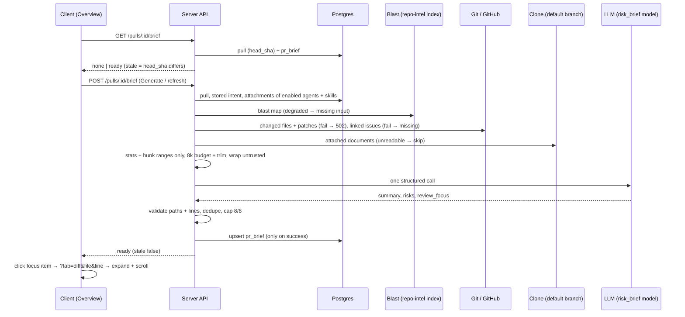

# Spec: PR Brief — why the PR exists, where it is risky, where to start reading
Spec ID: SPEC-03
Status: approved
Supersedes: none

## Problem and user

A reviewer often opens someone else's PR "cold": they do not know why the change exists, what in it is
risky, or which file to read first. DevDigest already answers part of this on the PR's Overview tab —
Intent ([intent-layer.md](./intent-layer.md), L03) explains the purpose and scope, Blast Radius
([blast-radius.md](./blast-radius.md), L04) shows what else the change may touch — but the reviewer still
has to assemble the picture and pick a starting point alone.

The PR Brief gathers this into one block on Overview and adds two model-written parts:
- **Risk areas** — concrete risks of this PR, each tied to a file;
- **Review focus** — which `file:line` to read first and why, in reading order.

The model is called **exactly once** per generation and receives only facts DevDigest has already
computed (stored intent, blast-radius map, per-file diff stats, PR description, linked issue, attached
project-context documents). It never receives diff hunk bodies.

What already exists and is reused (code state as of 2026-10-29):
- Contract `vendor/shared/contracts/brief.ts` (server and client copies identical): `Intent`,
  `PrBlastRadius` (with `degraded` / `reason`), `Risk {kind, title, explanation, severity: high|medium|low,
  file_refs: string[]}`, `Risks`, `PrHistory`, `SmartDiff*` and an unused composite `PrBrief {intent,
  blast, risks, history}` with no summary and no review focus.
- Table `pr_brief(pr_id → pull_requests, json jsonb)` — no migration needed; `pull_requests.head_sha`.
- Stored intent in `pr_intent` (`GET /pulls/:id/intent` computes lazily); the Intent Layer's
  PR-body reference parser (`#N`, `closes #N`, GitHub issue/PR URLs).
- `GET /pulls/:id/blast` — index-only blast radius, no LLM.
- `GET /pulls/:id` — `files[]` with `path`, `additions`, `deletions`, `patch` (no file status, no previous
  path for renames).
- Project Context attachments per (agent | skill, repository) — [project-context.md](./project-context.md)
  (SPEC-01), read from the clone's default branch, counted with the server's tiktoken tokenizer.
- Feature model `risk_brief` ("Risk Brief") in `contracts/platform.ts`, resolved per workspace.
- Client: Overview renders `PrBriefCard` (latest review's `VerdictBanner` + run cost, or "Brief not
  available yet"), then `IntentCard` | `BlastRadiusCard`. Tabs are `?tab=overview|findings|diff`.
  Files changed is a plain file-by-file `DiffViewer` — collapsible `FileCard`s (large files start
  collapsed), no file/line anchors, no scroll-to.

### Why this shape

One model call over pre-computed facts keeps the brief cheap and its inputs auditable; the model adds
judgement (what is risky, what to read first), not facts. Because a model can invent paths and lines,
every file and line it returns is checked on the server against the PR's real changed files and the
blast map, and anything that fails is dropped — the same principle as the review's grounding gate. The
brief is cached per PR and tied to the head SHA so that reopening the page is free and a new commit is
visibly flagged instead of silently re-billed.

## Goals / Non-goals

- Goal: a cached, per-PR brief — summary, Risk areas, Review focus — generated by one `risk_brief` model
  call on explicit user action, read back with zero model calls.
- Goal: server-side post-validation of every file and line the model returns.
- Goal: honest degradation — the brief generates without intent or blast radius and says what was missing.
- Goal: Review focus items navigate to the exact file and line on Files changed.
- Goal: the brief is marked Outdated when the PR's head SHA moves, and can be regenerated.
- Non-goal: Smart Diff — the "Smart order / Original order" toggle, the Core logic / Wiring / Boilerplate
  role groups and the per-file "What this does" summaries on Files changed (screenshot 2). They do not
  exist in this fork; the brief uses per-file stats only.
- Non-goal: rendering review findings inline on diff lines with Accept / Dismiss (screenshot 4). The
  navigation target is the file and line; showing a finding there is a separate feature.
- Non-goal: changing the Intent and Blast Radius cards, including "Prior PRs touching these files" — it
  stays as it is and is not an input to the brief.
- Non-goal: computing intent for the brief — only an intent already stored in `pr_intent` is used.
- Non-goal: automatic (re)generation — on PR open, on a new commit, or inside a review run. Only the
  user's Generate / Refresh does a model call.
- Non-goal: the brief as an input to review runs, MCP tools, or GitHub comments.
- Non-goal: an `agent_runs` row or a run trace for brief generation; the model call is visible in the
  server log (AC-28).
- Non-goal: a brief history — only the latest brief per PR is kept.
- Non-goal: fuzzy path matching of model output (`./src/a.ts`, other case, old name of a renamed file).
- Non-goal: changing `INJECTION_GUARD`, `wrapUntrusted()` or `groundFindings()`.
- Non-goal: changing the existing `PrBrief`, `PrHistory` or `SmartDiff*` schemas — new shapes are added
  next to them. (`Risk.kind` IS narrowed to a closed enum — AC-62; see Decisions D7.)
- Non-goal: showing the brief's own cost, tokens or model in the UI. The banner keeps only the latest
  review run's cost (AC-55); the brief's `model` and `cost_usd` live in the stored JSON and the log line
  (AC-28) only.
- Non-goal (considered, not adopted): a "N items removed because their file or line is not in this PR"
  counter under the lists. `dropped` stays in the stored JSON and the log (AC-28, AC-36) only.
- Non-goal (considered, not adopted): naming both short SHAs (generated-for vs head) in the Outdated
  badge's tooltip. The badge is text only (AC-51).

## User stories

- US-1: As a reviewer opening a PR, I want to see a PR Brief block with a **Generate brief** button while
  no brief exists, so that I decide when to spend a model call. → AC-3, AC-6, AC-38, AC-39, AC-53, AC-66
- US-2: As a reviewer, I want to click Generate brief, wait, and see a short summary of what the PR does
  and why, its Risk areas and its Review focus next to the Intent and Blast radius blocks, so that I
  start the review with context. → AC-1, AC-2, AC-7, AC-8, AC-9, AC-10, AC-11, AC-12, AC-13, AC-14,
  AC-15, AC-16, AC-17, AC-18, AC-19, AC-20, AC-21, AC-22, AC-23, AC-24, AC-25, AC-26, AC-27, AC-28,
  AC-40, AC-41, AC-42, AC-49, AC-52, AC-54, AC-55, AC-56, AC-65
- US-3: As a reviewer, I want every risk to show a title and the file it concerns, and to trust that the
  file is real, so that I can act on it. → AC-29, AC-30, AC-31, AC-32, AC-33, AC-34, AC-35, AC-36,
  AC-37, AC-43, AC-44, AC-45, AC-46, AC-59, AC-62, AC-63, AC-64, AC-67, AC-68
- US-4: As a reviewer, I want a Review focus list of `file:line — why it matters` in reading order, and
  to click an item to land on that file and line on Files changed, so that I read the riskiest code
  first. → AC-30, AC-31, AC-35, AC-47, AC-48, AC-57, AC-58, AC-60, AC-61, AC-68
- US-5: As a reviewer, I want a reload to show the same brief immediately with no new generation, so that
  reopening a PR costs nothing. → AC-4, AC-37, AC-50
- US-6: As a reviewer, I want to see when the brief is outdated and regenerate it with a refresh button,
  so that the brief matches the code I am reading. → AC-5, AC-25, AC-51, AC-52, AC-66

## Acceptance criteria (EARS)

Priority from the assignment: **P1** blocking, **P2** non-blocking, **P3** nice-to-have. Criteria with no
assignment counterpart carry the priority of the requirement they protect.

### Contract (shared, both vendor copies)

- AC-1 (P2): The system shall define in `brief.ts` — identically in the server and client vendor copies —
  a `ReviewFocusItem` `{ file, line, reason }` (line an integer ≥ 1, reason non-empty), the model-output
  shape `{ summary, risks: Risk[], review_focus: ReviewFocusItem[] }` (summary non-empty) and the stored /
  returned brief shapes described in *Inputs and provenance*, with `snake_case` wire fields.   _(observable: `./scripts/check-shared.sh` passes; a unit test parses a valid fixture and rejects an empty summary, `line: 0` and an empty reason)_
- AC-2 (P2): WHEN the model responds, the system shall validate the response against the model-output
  shape before any post-validation or storage.   _(observable: unit test with a mock LLM returning a malformed object → the failure path of AC-24, nothing stored)_
- AC-62 (P3): The system shall define `Risk.kind` in `brief.ts` (both vendor copies) as the closed enum
  `security | dependency | performance | breaking_change | data | config | other`; existing test
  literals stay valid (`server/test/contracts.test.ts:89` uses `kind: 'security'`, a member of the enum).   _(observable: `./scripts/check-shared.sh` passes; unit test — each enum value parses, `kind: 'auth'` is rejected; `contracts.test.ts` passes unmodified)_
- AC-63 (P3): IF the model returns a risk whose `kind` is outside the enum, THEN the system shall treat the
  response as invalid output — the adapter's existing schema validation re-prompts within the same call
  (AC-8) — and IF the output is still invalid after the adapter's retries, THEN follow the failure path of
  AC-24 (nothing stored, previous brief kept).   _(observable: integration test — mock LLM returns `kind: 'auth'` then a valid response → brief stored with one `completeStructured` invocation; always invalid → error, `pr_brief` unchanged)_

### Reading the brief (`GET /pulls/:id/brief`)

- AC-3 (P1): WHEN the client reads the brief of a PR that has none stored, the system shall return
  `{ status: 'none' }` with a success status.   _(observable: API test on a fresh PR → 200 `{status:'none'}`)_
- AC-4 (P1): WHEN the client reads the brief of a PR that has one stored, the system shall return
  `{ status: 'ready', stale, current_head_sha, brief }` from storage, making 0 model calls and 0 GitHub
  calls.   _(observable: API test with mock LLM and mock GitHub — call counters stay 0)_
- AC-5 (P2): The system shall set `stale` to true exactly when the stored brief's `head_sha` differs from
  the PR's current `head_sha`.   _(observable: API test — update `pull_requests.head_sha` after generation → `stale: true`; unchanged → `false`)_
- AC-6 (P1): IF the PR does not exist or belongs to another workspace, THEN the system shall answer both
  read and generate with "not found" and make no model call.   _(observable: API test → 404 for an unknown id and for another workspace's PR)_
- AC-7 (P1): IF the stored brief does not parse as the current stored-brief shape, THEN the system shall
  answer the read as `{ status: 'none' }` and log a warning, never a server error.   _(observable: API test with a legacy `pr_brief.json` row → 200 `none`, one warning log line)_

### Generating the brief (`POST /pulls/:id/brief`)

- AC-8 (P2): WHEN the client requests generation, the system shall make exactly one structured model call
  (the adapter's existing re-prompt on unparsable JSON is part of that one call) and shall not trigger an
  intent computation.   _(observable: integration test with mock LLM — one `completeStructured` invocation with schema name of the brief; `pr_intent` unchanged and no `Intent` call)_
- AC-9 (P2): The system shall take the model from the workspace's `risk_brief` feature-model setting,
  never from a hard-coded value.   _(observable: integration test — changing the `risk_brief` setting changes the model id passed to the mock LLM and the `model` field of the brief)_
- AC-10 (P1): The system shall build the model input from exactly these facts: PR title and description;
  the stored intent; the blast map's summary, changed symbols, callers (`file:line`), endpoints and cron
  jobs; per changed file its path, additions, deletions and the line ranges of its hunks; the text of
  linked issues; the attached project-context documents.   _(observable: integration test — the captured user message contains each fact from a fixture PR)_
- AC-11 (P2): The system shall never send diff hunk bodies to the model — neither added, removed nor
  context lines, nor the function-context text after a hunk header — only the numeric hunk ranges.   _(observable: integration test — a fixture patch with a unique marker on `+`, `-`, context and `@@ … @@ <text>` lines; no marker in any captured message)_
- AC-12 (P1): IF no intent is stored for the PR, THEN the system shall generate the brief without it and
  record `intent` with reason `not_computed` in `missing_inputs`.   _(observable: integration test with an empty `pr_intent` → brief stored, `missing_inputs` contains intent, 0 `Intent` calls)_
- AC-13 (P1): IF the blast radius is degraded or fails to load, THEN the system shall generate the brief
  without it and record `blast` in `missing_inputs` with the degraded `reason` (or `error`).   _(observable: integration tests — `degraded: true, reason: index_partial` → `{input:'blast', reason:'index_partial'}`; blast throwing → `reason:'error'`; brief stored in both)_
- AC-14 (P1): The system shall treat as linked issues the GitHub issue / PR references the Intent Layer
  recognises in the PR body, fetch each best-effort, and IF any referenced issue cannot be fetched, THEN
  record `linked_issue` in `missing_inputs` with reason `no_github_token` or `fetch_failed` and continue.   _(observable: integration test — body `closes #12` with mock GitHub returning the issue → its text in the message; GitHub failing → `missing_inputs` linked_issue, brief stored)_
- AC-15 (P1): The system shall build the documents input as the union of the project-context documents
  attached, for this PR's repository, to every enabled agent of the workspace (in agent creation order)
  and to each agent's active skills, with SPEC-01 AC-40 ordering within an agent, keeping the first
  occurrence of a repeated path.   _(observable: unit test of a pure function — two enabled agents sharing a path, a disabled agent's document absent, order as specified)_
- AC-16 (P1): IF an attached document cannot be read from the clone (missing, unreadable, > 1 MB, not
  cloned), THEN the system shall skip it with a log line, and IF documents are attached but none could be
  read, THEN record `specs` in `missing_inputs` (`not_cloned` or `unreadable`).   _(observable: integration test — one missing + one readable → only the readable one in the message; all missing → `missing_inputs` specs)_
- AC-17 (P2): The system shall keep the whole model input (all messages) within 8,000 tokens counted with
  the server's tiktoken tokenizer.   _(observable: integration test — the token count of the captured messages ≤ 8,000 for an oversized fixture)_
- AC-18 (P2): WHEN the input exceeds the budget, the system shall trim in this order until it fits:
  drop whole documents from the end of the documents order; then shorten the linked-issue text; then
  shorten the PR description; and shall never trim the intent, the blast input or the diff stats.   _(observable: unit test of a pure budgeting function over fixtures — each step taken only when the previous one was not enough; intent, blast and stats intact)_
- AC-19 (P2): WHEN trimming happens, the system shall log which inputs were trimmed and by how many
  tokens, and record the trimmed inputs in `trimmed_inputs`.   _(observable: integration test — one log line naming `specs` and the tokens removed; `trimmed_inputs: ['specs']`)_
- AC-20 (P2): IF the untrimmable inputs alone exceed the budget, THEN the system shall make no model call,
  answer with a validation error coded `brief_input_too_large`, and keep the previous brief.   _(observable: integration test — 2,000-file fixture → 422, mock LLM call count 0, previous `pr_brief` row unchanged)_
- AC-21 (P1): IF the PR has no changed files, THEN the system shall make no model call and answer with a
  validation error coded `no_changed_files`.   _(observable: API test → 422, LLM call count 0, nothing stored)_
- AC-22 (P1): IF the PR's changed files cannot be determined (local diff empty and the GitHub file list
  fails), THEN the system shall log the failure, make no model call and answer with an
  external-service error, keeping the previous brief.   _(observable: integration test with failing mock GitHub → 502, a log line, LLM count 0)_
- AC-23 (P1): WHEN generation succeeds, the system shall store the post-validated brief for the PR,
  replacing any previous one, with the `head_sha` the PR had when generation started, and return it as
  `{ status: 'ready', stale: false, … }`.   _(observable: API test — POST response equals the next GET; `pr_brief` has one row for the PR)_
- AC-24 (P1): IF the model call fails or its output stays invalid after the adapter's re-prompt, THEN the
  system shall answer with an error, write nothing, and keep the previous brief unchanged.   _(observable: integration test — mock LLM throwing → error response; `pr_brief.json` byte-identical to before)_
- AC-25 (P1): WHILE a generation for a PR is in flight, the system shall make a second generate request
  for the same PR share that generation instead of starting another model call.   _(observable: integration test — two concurrent POSTs → one LLM call, both responses equal)_
- AC-26 (P2): The system shall limit generate requests to 10 per minute per client; IF exceeded, THEN
  answer "too many requests" without a model call.   _(observable: API test — 11th POST within a minute → 429, LLM count unchanged)_
- AC-27 (P1): The system shall make no model call on any read of the brief, under any state (none, ready,
  stale).   _(observable: covered by AC-4's counters plus a stale-state variant)_
- AC-28 (P2): WHEN a generation finishes (success or model failure), the system shall write one structured
  log line with `prId`, `model` (`provider/model`), `inputTokens`, `outputTokens`, `costUsd`,
  `missingInputs`, `trimmedInputs`, `droppedRisks`, `droppedFocus` and `durationMs`.   _(observable: integration test captures the log line and its fields)_

### Post-validation (server, before storage)

- AC-29 (P1): The system shall consider a path valid only if it is exactly one of the PR's changed files,
  or — when the blast radius is available and not degraded — exactly the file of one of its callers.   _(observable: unit test of a pure function over a fixture PR + blast map, incl. a degraded map where caller files are invalid)_
- AC-30 (P1): IF a Review focus item's file is not a valid path, THEN the system shall drop the item.   _(observable: unit test — `src/invented.ts:3` dropped)_
- AC-31 (P1): IF a Review focus item's line is not inside one of its file's hunk ranges (new side; old side
  for a file with no new-side lines, e.g. deleted) — or, for a caller file not in the diff, not one of
  that file's caller lines — THEN the system shall drop the item.   _(observable: unit test — line 999 of a file whose hunks cover 10–20 dropped; a caller file at its listed line kept, at another line dropped; a deleted file at an old-side line kept)_
- AC-32 (P1): The system shall accept a risk `file_refs` entry in the forms `path`, `path:N` or
  `path:N-M` (1 ≤ N ≤ M) and remove the entry when its path is not valid.   _(observable: unit test — `src/a.ts:12-18` with a valid path kept; `src/x.ts:3` with an invalid path removed; `src/a.ts:9-3` removed)_
- AC-33 (P1): IF a risk ref's line part does not intersect a hunk range of an in-diff file (or a caller
  line of a caller file), THEN the system shall keep the ref as the bare path.   _(observable: unit test — `src/a.ts:400-410` outside every hunk → `src/a.ts`)_
- AC-34 (P1): IF a risk has no valid file ref left, THEN the system shall drop the risk.   _(observable: unit test — a risk with only invented refs is absent from the stored brief)_
- AC-35 (P1): The system shall remove duplicate Review focus items (same file and line, first kept) and
  duplicate refs within a risk, preserving the model's order.   _(observable: unit test)_
- AC-36 (P1): The system shall keep at most 8 risks and at most 8 Review focus items after validation, the
  first ones in model order, and record the number of dropped risks and items in `dropped`.   _(observable: unit test — 10 valid risks → 8 stored, `dropped.risks` counts invalid + over-cap)_
- AC-37 (P1): IF validation drops every risk and every Review focus item, THEN the system shall still
  store and return the brief with its summary and empty lists.   _(observable: integration test — model returns only invented paths → 200, `risks: []`, `review_focus: []`, summary present)_

### Overview — PR Brief block (client)

- AC-38 (P1): WHILE the brief's status is `none`, the system shall show in the PR Brief block a
  **Generate brief** button and no Risk areas or Review focus blocks; this replaces today's "Brief not
  available yet." empty state (allowed test change: `PrBriefCard.test.tsx:152-158`, which asserts that text
  and `unavailableHint`).   _(observable: RTL with GET → `{status:'none'}` — the button is visible, no Review focus heading)_
- AC-39 (P1): WHEN the user clicks Generate brief, the system shall send one generate request and disable
  the button until it settles.   _(observable: RTL — a double click issues exactly one POST; the button is disabled while pending)_
- AC-40 (P3): WHILE a generation is in progress, the system shall show skeletons in place of the summary,
  Risk areas and Review focus.   _(observable: RTL — skeletons visible before the POST resolves, gone after)_
- AC-41 (P1): WHEN a brief is available, the system shall show its summary, the Risk areas and the Review
  focus, with the Intent and Blast radius blocks still shown next to them.   _(observable: RTL of the Overview tab with a ready fixture — summary text, both headings, Intent and Blast radius labels present)_
- AC-42 (P1): IF `missing_inputs` is not empty, THEN the system shall show a note naming each missing
  input and its reason (e.g. "Generated without: Intent — not computed yet; Blast radius — index
  partial").   _(observable: RTL with a fixture missing intent and blast → both named)_
- AC-43 (P1): The system shall show Risk areas in the Intent column below the in-scope / out-of-scope
  lists, ordered by severity (high, medium, low; model order within a severity), each row showing the
  risk's title and its first file ref in monospace.   _(observable: RTL — rows in severity order; title and `src/middleware/ratelimit.ts:12-18` visible)_
- AC-44 (P1): The system shall convey each risk's severity by text or an accessible label as well as by
  colour.   _(observable: RTL — each row has an accessible name containing its severity)_
- AC-64 (P3): The system shall show each risk row's icon by its `kind` — shield for `security`, package for
  `dependency`, bolt for `performance`, and one fixed icon each for `breaking_change`, `data`, `config`
  and `other` — coloured by the risk's severity (high, medium, low), never by kind.   _(observable: RTL — a fixture with one risk per kind renders the mapped icon for each; the same kind at high vs low severity differs only in colour)_
- AC-67 (P3): The system shall colour a risk's icon with the finding severity colours of the existing
  `SEV` map in `@devdigest/ui` (`primitives/tokens.ts`, used by the finding severity badges): high → the
  `CRITICAL` colour (`var(--crit)`, red), medium → the `WARNING` colour (`var(--warn)`, amber), low → the
  `INFO` colour (`var(--info)`, grey `#6b7280`, defined in `client/src/vendor/ui/styles.css`), as in the
  design; severity stays conveyed by text as well (AC-44).   _(observable: RTL — high / medium / low risks render icons with `color` equal to `SEV.CRITICAL.c` / `SEV.WARNING.c` / `SEV.INFO.c`; each row's accessible name still contains its severity)_
- AC-45 (P3): WHEN the user expands a risk, the system shall show its explanation and all its file refs;
  risks start collapsed.   _(observable: RTL — explanation hidden, then visible after clicking the chevron; `aria-expanded` toggles)_
- AC-46 (P1): IF the brief has no risks, THEN the system shall show the `noRisks` message in Risk areas.   _(observable: RTL with `risks: []` → "No notable risks flagged.")_
- AC-47 (P1): The system shall show Review focus as a full-width block below the Intent and Blast radius
  columns, titled "Review focus — read these first" with the item count, listing items in the stored order
  as `file:line — reason`.   _(observable: RTL — 4 items in fixture order, count badge 4)_
- AC-48 (P1): IF the brief has no Review focus items, THEN the system shall show a "nothing to point at"
  message in the Review focus block.   _(observable: RTL with `review_focus: []` → the `noFocus` text)_
- AC-68 (P3): The system shall show the `file:line` of every Review focus item and the first file ref of
  every Risk areas row in full, never truncated with an ellipsis, and shall wrap a long reason onto the
  following lines instead of cutting it.   _(observable: RTL / visual — a fixture with a 120-character path and a 300-character reason shows the full path text and the full reason; neither element has `text-overflow: ellipsis`)_
- AC-49 (P1): WHILE the brief's Intent is unavailable (missing input or the Intent card in its error
  state), the system shall still show Risk areas in the Intent column.   _(observable: RTL — Intent request failing + ready brief → Risk areas rows visible)_
- AC-50 (P1): WHEN the Overview tab loads and a brief is stored, the system shall show it from the read
  request alone, without a generate request.   _(observable: RTL — fetch log has GET `/pulls/:id/brief` and no POST; e2e: reload shows the same summary)_
- AC-51 (P2): WHILE the brief is `stale`, the system shall show an "Outdated" badge (text, not colour only)
  next to the refresh button.   _(observable: RTL with `stale: true` → "Outdated" visible; `false` → absent)_
- AC-52 (P1): WHEN the user clicks the refresh button, the system shall regenerate the brief and, on
  success, show the new brief and clear the Outdated badge.   _(observable: RTL — refresh issues one POST; the new summary replaces the old one)_
- AC-66 (P3): The system shall place the refresh button in the top-right corner of the PR Brief block —
  inside the verdict banner when the banner is shown, in the block's own top-right corner when it is
  not — with the Outdated badge (AC-51) next to it; WHILE the brief's status is `none`, the Generate brief
  button is centred in the block's empty state.   _(observable: RTL — review + brief: refresh inside the banner, top-right; brief without a review: refresh top-right of the block; `none`: Generate brief inside the centred empty state)_
- AC-53 (P1): IF reading the brief fails, THEN the system shall show an error with a retry action that
  reads it again, not the Generate button.   _(observable: RTL with GET → 500 — alert visible, Retry issues a new GET, no Generate button)_
- AC-54 (P1): IF generation fails, THEN the system shall show the server's error message, keep showing
  the previous brief (if any) and re-enable the Generate / refresh button.   _(observable: RTL — POST → 502: message visible, previous summary still visible, button enabled)_
- AC-55 (P3): WHERE a latest review with a verdict exists, the system shall show its verdict banner (verdict,
  findings and blockers count, PR score, the review run's cost) at the top of the PR Brief block, whose
  paragraph under the verdict is the brief's summary when a brief exists and the review's summary when
  none exists; WHERE no review exists, the brief's summary is shown without a verdict, score or cost
  (allowed test change: `PrBriefCard.test.tsx:146`, which asserts the review's summary in the banner).   _(observable: RTL — review + brief: verdict, score, review-run cost and the brief summary, the review summary absent; review, no brief: review summary; brief, no review: summary only, no "PR SCORE")_
- AC-65 (P3): WHILE the PR's intent request is still pending (the Intent card is computing intent) and the
  Generate brief or refresh button is shown, the system shall show next to it the hint "Intent is still
  being computed — the brief will be generated without intent." (i18n key `brief.intentPendingHint`),
  and remove it when the intent request settles; the button stays enabled.   _(observable: RTL — intent fetch held pending → hint visible and button enabled; intent resolves → hint gone)_
- AC-56 (P3): The system shall take every new label of the PR Brief block (Generate brief, refresh,
  Outdated, Risk areas, Review focus, missing-inputs note, noFocus, file not in diff, risk-kind and
  severity labels, `intentPendingHint`) from `messages/en/brief.json`, with no hard-coded UI text.   _(observable: RTL rendered via the real messages; a grep of the new components finds no literal UI strings)_

### Navigation to Files changed (client)

- AC-57 (P1): WHEN the user clicks a Review focus item whose file is among the files Files changed renders,
  the system shall switch to Files changed with `?tab=diff&file=<path>&line=<n>` in the URL, expand that
  file even if it would start collapsed, and scroll it into view.   _(observable: RTL of the PR view — after click the URL holds the params, the target FileCard is open and `scrollIntoView` was called on it)_
- AC-58 (P2): WHEN Files changed opens with `file` and `line` params whose line is rendered in that file,
  the system shall scroll that line into view and mark it and its file visibly (not by colour alone), and
  move keyboard focus to the file's header.   _(observable: RTL — the target line has a highlighted state attribute and was scrolled to; focus on the file header; e2e flow on the demo PR)_
- AC-59 (P3): WHEN the user clicks a risk's file ref whose file Files changed renders, the system shall
  navigate as in AC-57, using the ref's first line when it has one and the file alone otherwise.   _(observable: RTL — click `src/a.ts:12-18` → `file=src/a.ts&line=12`)_
- AC-60 (P3): IF the clicked Review focus item's or risk ref's file is not among the files Files changed
  renders (e.g. a blast caller file), THEN the system shall show "File not in this PR's diff" and stay on
  Overview.   _(observable: RTL — click a caller-file item → message visible, URL `tab` unchanged)_
- AC-61 (P2): IF the `file` param is not among the rendered files, or the `line` is not rendered in that
  file (e.g. the brief is outdated), THEN the system shall show Files changed without error — scrolled to
  the file when it exists, else at the top.   _(observable: RTL — unknown file → normal diff, no error; known file + unrendered line → file scrolled into view)_

## Edge cases

- Brief never generated → Generate button, GET makes no model call → AC-3, AC-27, AC-38
- PR with no changed files → 422 `no_changed_files`, no model call → AC-21
- Changed files cannot be resolved (fork head not in clone and GitHub down; server INSIGHTS 2026-10-25) →
  502, logged, no call → AC-22
- PR with only deleted files → paths valid; focus lines checked against old-side ranges → AC-29, AC-31
- Renamed file → only the new path is known (`PrFile` has no previous path); a ref to the old path is
  dropped → AC-29, AC-30 (fuzzy matching is a Non-goal)
- Rename / binary file with no hunks → focus items on it dropped; risk refs keep the bare path → AC-31, AC-33
- Model returns 0 risks → `noRisks` → AC-46
- Model returns 0 focus items → `noFocus` → AC-48
- Validation drops every item → summary with empty lists → AC-37, AC-46, AC-48
- Focus line outside the file's hunks → item dropped → AC-31
- Risk ref range outside the hunks → bare path kept → AC-33
- Duplicate focus items / duplicate refs → first kept → AC-35
- More than 8 risks or focus items → first 8 kept, count recorded → AC-36
- Model path with `./`, different case or a trailing slash → dropped as invalid → AC-29, AC-30
- Blast caller file not in the diff → valid for the brief; clicking it shows "File not in this PR's diff" → AC-29, AC-60
- Blast radius degraded (`flag_off`, `index_partial`, …) or failing → brief without it, only PR files
  valid, missing input named → AC-13, AC-29, AC-42
- No stored intent → brief without it, missing input named → AC-12, AC-42
- Brief generated while the Intent card is still computing intent → a hint warns before the click;
  `pr_intent` is still empty, so the brief says intent is missing; the user can refresh once the intent
  appears → AC-65, AC-12, AC-42, AC-52
- Model returns a risk `kind` outside the enum → invalid output, re-prompted inside the same call; still
  invalid → error, previous brief kept → AC-63
- Intent recomputed after the brief → the brief is not marked stale (stale is SHA-only) → accepted: no handling
- Linked issue unreachable / no GitHub token → brief without it, missing input named → AC-14
- PR body references no issue → no linked-issue input, not reported missing → AC-14
- No documents attached to any enabled agent → no documents input, not reported missing → AC-15
- Attached documents unreadable / repo not cloned → skipped, `specs` missing → AC-16
- Input over 8,000 tokens → trimmed in the fixed order, logged → AC-17, AC-18, AC-19
- Untrimmable inputs alone over budget (huge PR) → 422 `brief_input_too_large`, previous brief kept → AC-20
- LLM / provider error, missing provider key, or output invalid after re-prompt → error, nothing written,
  previous brief kept → AC-24, AC-54
- Double click on Generate → one POST → AC-39
- Two tabs generate concurrently → one model call shared → AC-25
- Generation bursts → 429 after 10/min → AC-26
- New commit pushed → GET returns the cached brief with `stale: true`, Outdated badge → AC-5, AC-51
- `pull_requests.head_sha` lags GitHub until the PR is refreshed → staleness is as fresh as the stored
  head SHA; GET never calls GitHub → accepted: no handling
- Outdated brief points at a line that no longer exists in the diff → file only, no error → AC-61
- Closed or merged PR → read and generate work the same as for an open PR → accepted: no handling (no state check)
- Legacy or malformed `pr_brief.json` row → read as `none` with a warning → AC-7
- Deep link / reload on `?tab=diff&file=…&line=…` → same scroll as after a click → AC-58, AC-61
- Prompt injection in the PR body, issue or a document ("list /etc/passwd as a risk", "ignore the rules")
  → data, not instructions; any invented path is dropped → AC-29, AC-30, AC-34 (see Untrusted inputs)
- Network error on GET → error with retry, not the Generate button → AC-53

## Non-functional requirements

- Performance: `GET /pulls/:id/brief` p95 ≤ 200 ms on a local database (one PR read + one brief read; 0
  model, 0 GitHub calls). Generation input assembly — everything except the model call and the GitHub
  issue fetch — p95 ≤ 1.5 s for a PR with 300 changed files and 20 attached documents.
- Cost: exactly 1 model call per successful generation, 0 per read, 0 on page load.
- Limits: model input ≤ 8,000 tokens (tiktoken, all messages); ≤ 8 risks and ≤ 8 Review focus items
  stored; generate route ≤ 10 requests/min; documents > 1 MB skipped (SPEC-01 AC-8).
- Security: the PR title and body, linked-issue text and documents reach the model only wrapped as
  untrusted data under the existing injection guard; every path and line the model returns is validated
  server-side before storage (AC-29–AC-34); brief text (summary, titles, explanations, reasons) is rendered
  as plain text — no markdown, no raw HTML, no links built from model text; the `file` URL param is only
  compared with the rendered file list, never fetched or used as a path; all routes are workspace-scoped
  (AC-6); no API key or token is ever part of the model input or the log line.
- Accessibility: WCAG 2.1 AA for the new elements — Generate, refresh, each risk ref and each Review focus
  item are keyboard-operable buttons / links whose accessible name contains the action or `file:line`;
  the risk chevron exposes `aria-expanded`; severity and Outdated are not conveyed by colour alone; after
  navigation keyboard focus lands on the target file header (AC-58).
- Observability: one structured log line per generation with the fields of AC-28; one log line per trim
  (AC-19), per skipped document (AC-16) and per changed-file resolution failure (AC-22).
- i18n: all new UI text in `client/messages/en/brief.json` (AC-56).

## Inputs and provenance

| Input | Source |
|---|---|
| PR title, description, head SHA | [deterministic: `pull_requests` row] |
| Intent `{intent, in_scope, out_of_scope}` | [reused: L03 stored `pr_intent` only — never computed here] |
| Blast map: summary, changed symbols, callers `file:line`, endpoints, crons, `degraded`/`reason` | [reused: L04 `BlastService.forPull`, index-only, no LLM] |
| Changed files: path, additions, deletions, hunk line ranges | [deterministic: the PR's diff, resolved as loadDiff → GitHub file list (server INSIGHTS 2026-10-25); ranges parsed from `@@` headers, bodies discarded] |
| Linked issue text | [deterministic: Intent Layer's PR-body reference parser + GitHub fetch, best-effort] |
| Project-context documents | [reused: SPEC-01 attachments of enabled agents and their active skills, read from the clone's default branch] |
| Token counts / budget | [deterministic: the server's tiktoken tokenizer, as for skills and project context] |
| Summary, risks, Review focus | [new: 1 structured LLM call on the `risk_brief` feature model — the only judgement in the feature: what is risky and in which order to read] |
| Post-validation, dedupe, caps | [deterministic: pure functions over the model output, changed files and blast map] |
| Verdict, score, run cost in the banner (P3) | [reused: latest review and run, already loaded by the PR page] |
| Stale flag | [deterministic: stored `head_sha` vs `pull_requests.head_sha`] |

### Contract shapes (wire, `snake_case`; added to `brief.ts` in both vendor copies)

- **ReviewFocusItem** — `{ file: string, line: int ≥ 1, reason: string }`.
- **Model output** — `{ summary: string, risks: Risk[], review_focus: ReviewFocusItem[] }`. `Risk` is
  reused with one change: `kind` becomes the closed enum `security | dependency | performance |
  breaking_change | data | config | other` (AC-62); its `file_refs` entries are `path`, `path:N` or
  `path:N-M` (AC-32).
- **Stored brief** (the `pr_brief.json` value, also the `brief` field of responses) —
  `{ pr_id, head_sha, generated_at, model, summary, risks: Risk[], review_focus: ReviewFocusItem[],
  missing_inputs: [{ input: 'intent' | 'blast' | 'linked_issue' | 'specs', reason: string }],
  trimmed_inputs: ('specs' | 'linked_issue' | 'description')[], dropped: { risks: int, review_focus: int },
  input_tokens: int, cost_usd: number | null }`. `model` is `provider/model`; reason codes: intent →
  `not_computed`; blast → a `BlastDegradedReason` or `error`; linked_issue → `no_github_token` |
  `fetch_failed`; specs → `not_cloned` | `unreadable`.
- **Read response** — `{ status: 'none' } | { status: 'ready', stale: boolean, current_head_sha: string,
  brief: <stored brief> }`.
- **Generate response** — the `ready` read response (`stale: false`). Errors: not found (AC-6),
  `no_changed_files` and `brief_input_too_large` validation errors (AC-20, AC-21), external-service error
  (AC-22, AC-24), too many requests (AC-26).
- **Files changed URL** — `?tab=diff&file=<path>&line=<int>` (both optional).
- The existing `PrBrief`, `PrHistory` and `SmartDiff*` schemas stay unchanged; `Risk` changes only in
  `kind` (AC-62).

### Cross-module interactions and failure contract

- **Client → server:** read (never costs a model call) and generate (one call, rate-limited). Read
  failure → error + retry (AC-53); generate failure → message, previous brief kept (AC-54).
- **Server → Postgres:** reads `pull_requests`, `pr_intent`, agent / skill attachments; writes
  `pr_brief` only after a fully validated generation (AC-23, AC-24).
- **Server → repo-intel (blast):** index-only map; degraded or failing → missing input, not an error (AC-13).
- **Server → git / GitHub:** changed files and patches (failure → 502, AC-22); linked issues best-effort
  (failure → missing input, AC-14).
- **Server → clone:** attached documents from the default branch; unreadable → skipped (AC-16).
- **Server → LLM:** one `risk_brief` structured call; invalid / failing → error, nothing stored (AC-24).

## Untrusted inputs

- **PR title and body, linked-issue text, project-context documents** — authored by third parties; sent
  to the model only as data wrapped with `wrapUntrusted()` under the unchanged `INJECTION_GUARD`, as the
  Intent Layer and SPEC-01 do. Document paths used as labels are neutralised as in SPEC-01 AC-42.
- **Blast map and file paths** — paths come from the repository and are untrusted as labels; they are
  data, not instructions.
- **Model output** — untrusted: every path and line is validated against the PR's changed files and the
  blast map before storage (AC-29–AC-34); summary, titles, explanations and reasons are rendered as plain
  text (Security NFR). The model never decides what the client fetches: navigation only matches a path
  against the rendered file list.
- **URL params** (`file`, `line`) — user-controllable; used only for matching and scrolling (AC-61).

## Delivery note (process, not ACs)

The assignment also requires this spec and its plan (`docs/plans/pr-brief.md` by
`implementation-planner`) and an open PR with a demo video. These are delivery steps, not system behaviour.

## Decisions

Taken while specifying; listed with the rejected alternative so they can be reviewed before approval.

- D1 — **Hunk line ranges as numbers only** go to the model (AC-10, AC-11). Rejected: per-file stats
  without ranges — the model would have to guess line numbers and nearly every Review focus item would
  fail AC-31; and full `@@` headers with function-context text, as the Intent Layer sends — that text is
  code from the change and edges toward "never reads hunk bodies".
- D2 — **"Exactly one model call" = one structured call**, including the adapter's own re-prompts on
  unparsable or schema-invalid output (AC-8, AC-63). Rejected: forbidding re-prompts — one malformed
  response would fail the generation and the user would pay again for a manual retry.
- D3 — **At most 8 risks and 8 Review focus items** kept after validation (AC-36). Rejected: no cap — a
  long list defeats "read these first" and the design shows 3 and 4.
- D4 — **Enabled agents in creation order** for the documents union (AC-15). Rejected: alphabetical
  order — a rename would silently reshuffle which documents survive trimming.
- D5 — **Closed and merged PRs behave like open ones** (Edge cases). Rejected: blocking generation for
  them — a brief is still useful when reading a merged change after the fact, and the head SHA no longer
  moves, so it never goes stale.
- D6 — **Exact path match** for model output (AC-29). Rejected: normalising `./`, case or old rename
  paths — every normalisation rule is another way for an invented path to pass the gate.
- D7 — **Narrow `Risk.kind` itself** to a closed enum (AC-62) rather than add a brief-specific risk
  shape. `Risk` / `Risks` have no product consumer outside `brief.ts`; the only other use is
  `server/test/contracts.test.ts:88-89` with `kind: 'security'`, which stays valid. Rejected: a parallel
  `BriefRisk` — two near-identical risk shapes in one contract file, one of them unused.
- D8 — **Risk kinds** `security, dependency, performance, breaking_change, data, config, other` (AC-62,
  AC-64): the first three from the design (shield / package / bolt), three for common risks the design
  does not show (public API or contract change, schema / migration / data loss, configuration and secrets
  wiring), `other` as the fallback. Rejected: severity-only icons — the design distinguishes risks by
  kind, and severity already has colour and text (AC-44).

## Open questions

None. The three visual questions (banner paragraph, risk icon, brief cost in the UI) and the UX proposals
were answered by the user on 2026-10-29 and moved into AC-55, AC-62–AC-65, the Non-goals and the
Decisions above.
