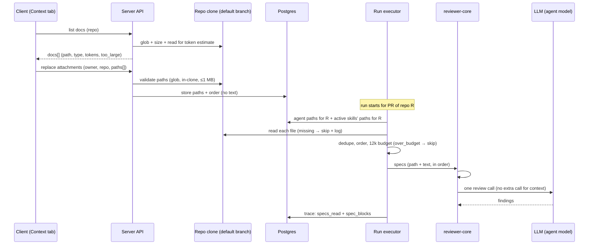

# Spec: Project Context — manually attaching specs to agents and skills
Spec ID: SPEC-01
Status: approved
Supersedes: none

## Problem and user

A reviewer sees the diff, the repo skeleton and the callers, but not the **project's intent**: PRDs,
architectural invariants, the security baseline, lessons from incidents. So an agent cannot say "this PR
violates `specs/public-api.md`" — it does not know such a document exists. The user (an agent author / a
tech lead configuring reviews for a repository) wants to pick the relevant MD documents from the
repository **by hand**, attach them to an agent or a skill, see up front how many tokens they will add,
and, after a run, check in the trace exactly what reached the prompt and how large it was.

What already exists and is reused (code state as of 2026-10-27):
- reviewer-core already has a `specs` slot in prompt assembly: a `## Project context` section, each
  document a separate `<untrusted source="spec-N">` block; `INJECTION_GUARD` applies to every
  `<untrusted>` block.
- The trace contract already has `specs_read: string[]` and `prompt_assembly.specs`; the trace drawer
  already shows a "Specs read" row and a "Project context (dynamic)" block. The executor currently always
  writes `specs_read: []`.
- Starter scaffolding with no implementation: the `SpecFile` / `IndexStatus` contracts, client hooks for
  `GET /repos/:repoId/context`, the `context` i18n namespace, the `context` sidebar key. No server route exists.
- The server already counts skill-block tokens (tiktoken) and has a safe clone-file reader that rejects
  paths escaping the clone (server INSIGHTS 2026-10-19).
- Agents and skills are **workspace-scoped**, documents are **repository-scoped**; the server's clone is
  synced to the default branch.

### Why this shape

This is the first of two features: here the user attaches documents by hand; an automatic selector that
picks documents from the PR's content is a separate, later feature. The feature adds no new LLM calls —
documents are read deterministically from the clone. It fills the `specs` prompt slot, the `specs_read`
trace field and the trace's Project context block that already exist, instead of building a parallel
mechanism next to them.

## Goals / Non-goals

- Goal: the server finds a repository's MD documents by a configurable glob and returns the list + content.
- Goal: a read-only Project Context page: list, filter, preview, "Used by", refresh.
- Goal: a **Context** tab in the agent editor and a **Project context to use** section in the skill
  editor — manual attaching with ordering, preview and a token estimate.
- Goal: at run start the server reads the attached files and adds them to `## Project context` as
  untrusted data with delimiters and the injection guard — **without a separate LLM call**.
- Goal: run transparency — the trace shows `specs_read`, the list of documents, their status and size in
  tokens, and the full text of each document added.
- Non-goal: automatic selection of documents based on PR content (a separate feature).
- Non-goal: creating, uploading, editing or deleting files from the Project Context page (the `+`,
  new folder, upload and Edit controls in the design).
- Non-goal: chunks / indexing / embeddings of documents ("Indexed: … chunks" in the design) and the
  "COVERAGE" ring — the metric has no definition and would likely need an LLM.
- Non-goal: reading a document from the PR branch (head) — the clone's default branch only.
- Non-goal: per-repo glob configuration in the UI — search roots and the glob come from server config
  only and are shared by all repositories.
- Non-goal: Project context in the CI runner (`source: 'ci'`) and a new MCP tool for context — an agent
  in a CI run works without Project context.
- Non-goal: changing the skill's own prompt block — the skill's "Serializes as" view (AC-36) is display
  only; its `### Skill: …` block and its `skill_blocks` tokens stay as they are.
- Non-goal: conflict detection for concurrent attachment edits — a save replaces the whole list and the
  last write wins (AC-22), as on the Skills tab.
- Non-goal: deduplicating text across the trace (`prompt_assembly.user` vs `repo_map` / `callers` /
  `spec_blocks`) — a separate trace-wide refactor.
- Non-goal: truncating a document to fit the budget — a document either fits whole or is skipped.
- Non-goal: changing `INJECTION_GUARD`, the semantics of `wrapUntrusted()`, `groundFindings()` or any
  other review-pipeline invariant (reviewer-core `prompt.ts`, `grounding.ts`). The trusted rule after the
  section (AC-43) is a new addition next to these, not a change to them.

## User stories

- US-1: As an agent author, I want to see all of the repository's specs/documents in one place and read
  them, so that I can decide what to give the reviewer. → AC-1, AC-2, AC-3, AC-4, AC-5, AC-6, AC-7, AC-8, AC-9, AC-10, AC-11, AC-12, AC-13, AC-14, AC-15, AC-16, AC-17, AC-18, AC-19, AC-20
- US-2: As an agent author, I want to attach documents to an agent by hand in the order I choose, so that
  the reviewer checks PRs against them. → AC-21, AC-22, AC-23, AC-24, AC-25, AC-29, AC-30, AC-31, AC-32, AC-33, AC-39
- US-3: As a skill author, I want to attach documents to a skill, so that every agent using the skill
  inherits them. → AC-34, AC-35, AC-36, AC-26, AC-39
- US-4: As an agent author, I want to see before a run how many tokens the context will add and whether
  it fits the budget. → AC-27, AC-28
- US-5: As a user starting a review, I want the attached documents taken from the project and added as
  text to the prompt as untrusted data, with no extra LLM calls. → AC-37, AC-38, AC-40, AC-41, AC-42, AC-43, AC-44, AC-45, AC-46, AC-47
- US-6: As a user, I want to open the run trace and see "Project context — attached specs", read the full
  text of each document added and its size in tokens. → AC-48, AC-49, AC-50, AC-51, AC-52, AC-53
- US-7: As a tech lead, I want the reviewer to cite the specific document when a PR breaks an invariant
  that document describes. → AC-54

## Acceptance criteria (EARS)

### Reader (server)

- AC-1: WHEN the client requests a repository's document list, the system shall return every `.md` file
  in the clone's working tree (default branch, state as of the last sync) that matches the glob from
  server config (default `**/{specs,docs,insights}/**/*.md`) under the configured search roots (default:
  the repository root).   _(observable: test on a fixture clone — the response holds exactly the expected paths; changing the glob in config changes the set)_
- AC-2: The system shall include files in hidden directories (e.g. `.devdigest/specs/x.md`) and always
  exclude everything under `node_modules/` and `.git/`, regardless of the glob.   _(observable: fixture with `.devdigest/specs/a.md` and `node_modules/p/docs/b.md` → only the first)_
- AC-3: The system shall treat each full repository-relative path as a distinct document and set its type
  to the deepest path segment from the set `specs` | `docs` | `insights` (e.g. `e2e/docs/specs/x.md` →
  `specs`; `specs/x.md` and `docs/x.md` are two documents of types `specs` and `docs`).   _(observable: unit test of a pure function over a set of paths, including two same-named files in different buckets)_
- AC-4: The system shall return for each document: the path relative to the repository root, the type,
  the size in bytes, the token estimate of its text (`0` for an empty file; `null` when the file is too
  large or is not valid UTF-8 text) and a `too_large` flag.   _(observable: the response shape matches the contract in "Inputs and provenance"; fixtures: empty file → `tokens: 0`, binary file → `tokens: null`)_
- AC-5: IF more files match than the list limit (default 500), THEN the system shall return the first 500
  in a stable order by path and `truncated: true`.   _(observable: fixture with 501 files → 500 items + `truncated`)_
- AC-6: IF the repository has not been cloned yet, THEN the system shall return a `not_cloned` state,
  distinct from an empty list.   _(observable: API test without a clone → `status: not_cloned`)_
- AC-7: WHEN the client requests the content of one document, the system shall return the text only if
  the path matches the glob, is not excluded and, after resolving symlinks, lies inside the clone;
  otherwise a "not found" response with no content.   _(observable: requests for `../../etc/passwd`, a symlink pointing outside, `node_modules/...` → 404; a valid path → the text)_
- AC-8: IF a file is larger than 1 MB, THEN the system shall mark it `too_large`, not count tokens for it
  and not return its content.   _(observable: 1.1 MB fixture → `too_large: true`, `tokens: null`, a content request → an error with the reason)_

### Project Context page (client)

- AC-9: WHEN the user opens Project Context (sidebar → Workspace), the system shall show the active
  repository's documents grouped by type (`specs`, `docs`, `insights`), with each document's path.   _(observable: RTL test with a faked fetch — three groups, rows with paths)_
- AC-10: WHEN the user types into the filter, the system shall keep only documents whose path contains
  that text (case-insensitive).   _(observable: RTL test — typing `api` leaves `public-api.md`)_
- AC-11: WHEN the user selects a document, the system shall show its rendered markdown preview.   _(observable: RTL test — markdown headings of the fixture document are rendered)_
- AC-12: WHILE a document is selected, the system shall show in the header "Used by N agents · M
  skills", where N is the agents whose effective set contains the document (directly or via a skill) and
  M is the skills that attached it directly, within this repository.   _(observable: RTL test — counters match the fixture)_
- AC-13: WHEN the user clicks refresh, the system shall re-read the list and the token estimates from the
  clone (no git fetch and no LLM calls) and update the page.   _(observable: after refresh a new file in the clone shows up in the list and a file emptied in the clone shows 0 tokens; LLM call counter 0)_
- AC-14: WHILE the document list is loading, the system shall show a skeleton.   _(observable: RTL — skeleton visible before the fetch resolves)_
- AC-15: IF the repository has no matching documents, THEN the system shall show an empty state that
  names the current glob.   _(observable: RTL — empty fixture → empty-state text contains the glob)_
- AC-16: IF the list status is `not_cloned`, THEN the system shall show a not-cloned state, distinct from
  the empty state.   _(observable: RTL — `not_cloned` fixture → not-cloned text, no empty-state text)_
- AC-17: IF loading the list fails, THEN the system shall show an error with a retry button that requests
  the list again.   _(observable: RTL with fetch → 500 — error visible; clicking retry issues a new request)_
- AC-18: IF the list is `truncated`, THEN the system shall show a notice that only the first 500
  documents are listed.   _(observable: RTL — truncated fixture → notice visible)_
- AC-19: The system shall offer no create, upload, edit or delete control on the Project Context page.   _(observable: RTL — no such buttons in the rendered page)_
- AC-20: The system shall show on the Project Context page a summary "N documents · ≈ X tokens ·
  refreshed <relative time>", where N is the number of listed documents, X the sum of their token
  estimates and the time is when the list was last read from the clone; no "indexed" or "chunks"
  wording appears on the page.   _(observable: RTL — summary text from the fixture; the page text contains neither "indexed" nor "chunks")_

### Context tab in the agent editor

- AC-21: The system shall show a **Context** tab in the agent editor with a list of the active
  repository's documents: checkbox, file name, directory, type badge, Preview button, a "Filter
  documents…" filter and an "N of M attached" counter.   _(observable: RTL test of the tab at `?tab=context`)_
- AC-22: WHEN the user toggles a checkbox, the system shall immediately save the agent's whole ordered
  attachment list for the active repository (optimistically), with no Save button; the checked state is
  keyed by the document's full path, so a toggle while the filter is active changes only that document
  and keeps the attachments and order of hidden documents.   _(observable: RTL — one request with the full list of paths, including attached documents hidden by the filter; same state after reload)_
- AC-23: IF saving the attachments fails, THEN the system shall restore the previous list state and show
  an error message (i18n).   _(observable: RTL with fetch → 500: the checkbox reverts, the error is visible)_
- AC-24: WHEN the user drags (or uses ↑/↓ on the keyboard) an attached document, the system shall save
  the new order, and that order is the order of the documents in `## Project context`.   _(observable: RTL — request with the reordered paths; integration test — order of the blocks in the prompt)_
- AC-25: WHILE the filter is non-empty, the system shall disable reordering.   _(observable: RTL — drag handles disabled while filtering)_
- AC-26: The system shall show on the agent's tab the documents of the skills active for this agent
  (enabled both for the agent and globally) as locked rows labelled "via <skill>", which cannot be
  removed from the agent's tab; a duplicate of a full path the agent already attached is shown once (as
  the agent's attachment).   _(observable: RTL with a fixture: agent + skill with overlapping paths)_
- AC-27: The system shall show "≈ N tokens" at the bottom of the tab — the token sum of the effective set
  (the agent's documents, then the skills' documents, without duplicates), computed on the same document
  text and with the same tokenizer as in the run; the `<untrusted>` wrapper is not counted, and an empty
  document counts 0.   _(observable: the number in the tab = the sum of the `attached` entries' `tokens` in the run trace for the same files, when nothing is skipped)_
- AC-28: IF the effective set's sum exceeds the 12,000-token budget, THEN the system shall show a warning
  listing the documents that will be skipped as `over_budget`.   _(observable: RTL with a 13,000-token fixture — the warning and the names are visible)_
- AC-29: WHEN the user clicks Preview, the system shall show the document's full rendered text without
  changing the attachments.   _(observable: RTL — the preview opens, 0 save requests)_
- AC-30: IF a document is `too_large`, THEN the system shall disable its checkbox and show the reason.   _(observable: RTL — disabled checkbox with a hint)_
- AC-31: IF an attached path is no longer in the repository's full set of matching documents (AC-33),
  THEN the system shall
  show it as a separate row with a "missing" status and allow detaching it.   _(observable: RTL — a missing row; unchecking saves the list without it)_
- AC-32: IF no repository is selected in the sidebar, THEN the system shall show a hint on the tab to
  select a repository and no checkboxes.   _(observable: RTL without an active repo)_
- AC-33: WHEN the client saves attachments, the system shall accept only paths in the repository's full
  set of matching documents — matching the glob, not excluded, inside the clone after resolving symlinks
  and ≤ 1 MB — regardless of the 500-item list limit (AC-5); otherwise a validation error, nothing saved.   _(observable: API test with `../secret.md` and a non-existent path → 422 (the server's standard validation error), 0 rows in the DB; an empty `.md` is accepted; with 501 matches, the path in position 501 is accepted)_

### Project context to use section in the skill editor

- AC-34: The system shall show a **Context** tab in the skill editor with a "Project context to use · N
  attached" list of the active repository's documents (checkbox, path, type badge, filter, Preview) and
  the hint "Any agent using this skill inherits these documents."   _(observable: RTL test of the skill tab at `?tab=context`)_
- AC-35: The system shall make the skill's document list behave like the agent's Context tab for:
  immediate save of the whole ordered, path-keyed list (AC-22), rollback with an error on save failure
  (AC-23), reordering (AC-24) disabled while filtering (AC-25), Preview without changing attachments
  (AC-29), a disabled checkbox for `too_large` documents (AC-30), "missing" rows (AC-31), the
  no-repository hint (AC-32) and server-side path validation (AC-33).   _(observable: the RTL/API tests of AC-22…AC-25 and AC-29…AC-33 run against the skill tab and the skill's attachment endpoint as well)_
- AC-36: The system shall show below the list a read-only "Serializes as" block: the line
  `## Project specifications` and one `- <path>` line per attached document, in order.   _(observable: RTL — the block's text for 1 attached `specs/public-api.md`)_

### Storage

- AC-37: The system shall store attachments as (workspace, owner — agent or skill, repository, path,
  order) — the path only, never the document's text.   _(observable: integration test — the stored data holds no file content)_
- AC-38: WHEN an agent, skill or repository is deleted, the system shall delete its attachments.   _(observable: cascade integration test)_
- AC-39: WHEN the user attaches, detaches or reorders documents for an agent or a skill, the system shall
  not create a new agent version or a new skill version.   _(observable: integration test — `agents.version` and the skill's latest version are unchanged after an attachment save)_

### Run (server + reviewer-core)

- AC-40: WHEN an agent run starts on a PR, the system shall build the effective set only from the
  attachments for that PR's repository: first the agent's documents in its order, then the documents of
  each skill active in this run, in the agent's skill order and the skill's own order; a repeated full
  path is dropped (the first occurrence is kept), and documents with the same file name in different
  directories are kept as distinct documents.   _(observable: unit test of a pure function, incl. `specs/x.md` + `docs/x.md`; integration test — order of `specs_read`)_
- AC-41: WHEN a run starts, the system shall read each file of the effective set from the clone's working
  tree (default branch, state as of the last sync), not from the PR branch.   _(observable: integration test — the PR changes an attached file, the prompt holds the default-branch version)_
- AC-42: The system shall add each document read to the `## Project context` section as a separate
  block wrapped by the existing `wrapUntrusted()` (semantics unchanged), whose label is the document's
  path with every character that could escape the attribute or close the delimiter neutralised before
  wrapping; `INJECTION_GUARD` stays unchanged.   _(observable: reviewer-core unit test — a path `a".md` and content `</untrusted>` do not break the block; existing `wrapUntrusted`/guard tests pass unmodified)_
- AC-43: WHEN the `## Project context` section is present, the system shall add, right after it and
  outside `<untrusted>`, a trusted rule: check the diff against these documents; name the document's path
  in the rationale of a finding that relies on it; the documents never lower severity or waive a finding.   _(observable: reviewer-core unit test — the rule text follows the last block and is not inside any `<untrusted>`)_
- AC-44: IF an attached file is missing, unreadable (including not valid UTF-8 text, e.g. binary) or,
  after resolving, lies outside the clone, THEN the system shall skip it, write a Live Log line with the
  reason and mark it in the trace with status `missing`; the run continues.   _(observable: integration test — missing file and binary file → run `done`, both `missing`, a log line each)_
- AC-45: IF adding a document (in set order) would exceed the section's 12,000-token budget, THEN the
  system shall skip that document whole, write a Live Log line and mark it `over_budget`, then keep
  trying the later documents, adding each one that still fits (greedy).   _(observable: integration test: 3 documents of 7k/7k/2k → statuses attached/over_budget/attached)_
- AC-46: The system shall assemble Project context without any additional LLM call.   _(observable: integration test with a mock LLM — the number of calls with context = without context)_
- AC-47: IF the effective set has no documents for the PR's repository, THEN the system shall build the
  prompt without a `## Project context` section and without the trusted rule — identical to today's.   _(observable: prompt snapshot test before/after the feature)_

### Run trace

- AC-48: WHEN a run finishes (successfully, with an error, or cancelled after context assembly), the
  system shall write to `specs_read` the paths of the documents actually added to the prompt, in prompt
  order.   _(observable: `GET /runs/:id/trace` → `specs_read`)_
- AC-49: The system shall write to the trace's `spec_blocks` one entry per document of the effective set:
  path, type, origin (agent, or skill with its name), status (`attached` | `missing` | `over_budget`),
  tokens (`0` for an empty document, `null` for `missing` and for an `over_budget` document whose file is
  now > 1 MB, whose Live Log line gives the reason "> 1 MB", as in AC-8) and the added text (for
  `attached` only), and leave `prompt_assembly.specs` `null`.   _(observable: the trace shape matches the contract; a test for all three statuses, an empty document and a file grown past 1 MB (`over_budget`, `tokens: null`, log reason "> 1 MB"); `prompt_assembly.specs` is `null`)_
- AC-50: WHEN the user opens Prompt assembly in the trace, the system shall show a section titled
  "Project context — attached specs (untrusted)" with a summary "N docs · ≈X tokens", rendered from
  `spec_blocks`.   _(observable: RTL TraceBody with a trace fixture that has `spec_blocks` and `specs: null`)_
- AC-51: WHEN the user expands a document in that section, the system shall show the full text added to
  the request, with a copy button and the token count.   _(observable: RTL — expand shows `spec_blocks[].text` verbatim)_
- AC-52: The system shall show in Configuration a "Specs read" row with the paths of the added documents,
  and the skipped ones with a status badge (`missing` / `over_budget`).   _(observable: RTL with a fixture covering all statuses)_
- AC-53: IF a trace was written before this feature (a `prompt_assembly.specs` string and no
  `spec_blocks`), THEN the system shall show it the same way as today.   _(observable: RTL with an old trace fixture — no errors, same rendering)_

### Verification (lab scenario)

- AC-54: WHEN a document with the invariant "module `api/` does not import `db/` directly" is attached to
  an agent and the agent reviews a PR in which a file under `api/` imports from `db/`, the system shall
  keep, after `groundFindings()`, at least one finding whose file is that changed file in the diff, whose
  line range intersects a diff hunk on the import line, and whose rationale contains the document's path.   _(observable: manual lab run on a real model: the trace has the document in `specs_read`; the persisted (post-grounding) findings include one on the import line that cites the path; the deterministic part — AC-42/AC-43 — is covered by unit tests)_

## Edge cases

- Empty repository with no matching `.md` → empty state with the current glob → AC-15
- Repository not cloned → `not_cloned` → AC-6, AC-16
- `node_modules/**/docs/*.md` in the repository → always excluded → AC-2
- Document in `.devdigest/specs/` (hidden directory) → found → AC-2
- Path with several type segments (`e2e/docs/specs/x.md`) → type by the deepest one → AC-3
- Same file name in different buckets (`specs/x.md` vs `docs/x.md`) → two distinct documents; dedupe is
  by full path only → AC-3, AC-40
- Empty `.md` file → listed and attachable, contributes 0 tokens (also after a refresh) → AC-4, AC-13, AC-33, AC-49
- Non-UTF-8 / binary `.md` file → `tokens: null` in the list; unreadable in the run, so `missing` → AC-4, AC-44
- More than 500 documents → truncated list with a flag → AC-5, AC-18
- File > 1 MB → cannot be attached, content not returned → AC-8, AC-30
- Path traversal / symlink outside the clone in a content request or an attachment → 404 / 422 → AC-7, AC-33
- Attached file deleted or renamed in the repository → "missing" in the tab, `missing` in the run → AC-31, AC-44
- Attached file grew beyond 1 MB after attaching → skipped as `over_budget` with `tokens: null` (not
  counted, as in AC-8) and a Live Log reason "> 1 MB" → AC-45, AC-49
- Sum of attachments > 12,000 tokens → warning in the tab, whole documents skipped in the run → AC-28, AC-45
- The same path attached by both the agent and a skill (or by two skills) → once, first occurrence → AC-26, AC-40
- Skill disabled for the agent or globally → its documents are not inherited → AC-26, AC-40
- Agent reviews a PR of a different repository than the one the documents were attached for → no context added → AC-40, AC-47
- PR modifies or deletes an attached spec → the prompt holds the default-branch version → AC-41
- Clone lags behind upstream (no sync for a while) → the state as of the last sync is read → accepted: no handling (updating is the existing Resync action)
- Document contains `</untrusted>` or "ignore previous instructions" → neutralised, the guard applies → AC-42
- File name with `"`, `<`, a newline → label neutralised → AC-42
- Model emits a finding that points at the spec document itself (not in the diff) → dropped by the
  grounding gate, as today → AC-54
- Attachments changed during a run → the run uses the set built at start → AC-40 (snapshot at start)
- Checkbox toggled while the filter is active → only that path changes; hidden attachments and order are kept → AC-22
- Double click / two tabs changing attachments at once → the whole list is saved, last write wins → AC-22 (no conflict detection — see Non-goals)
- Failure saving attachments → rollback + message → AC-23
- Map-reduce strategy → the section repeats in every per-file call, cost multiplies → accepted: no handling
- No active repository selected → hint on the tab → AC-32
- Deleting an agent / skill / repository → attachments are deleted → AC-38
- Old traces without per-document entries → render as before → AC-53
- Run fails before context assembly (e.g. diff load error) → `specs_read: []` → accepted: no handling
- Database error while reading attachments at run start → the run fails like any other run-start read
  error today → accepted: no handling

## Non-functional requirements

- Performance: document list — p95 ≤ 2 s for 500 documents totalling ≤ 5 MB on a local clone, including
  the token estimate; Project context assembly in a run — p95 ≤ 500 ms for ≤ 20 documents; 0 additional
  LLM calls and 0 network requests (GitHub / git fetch) on this path.
- Limits: section budget — 12,000 tokens per run, counted on document text only (the `<untrusted>`
  wrapper is not counted anywhere); file size limit — 1 MB; list limit — 500 documents.
- Security: content and attachments are accepted only for paths that match the glob, are not excluded
  and, after resolving symlinks, lie inside the clone; access only within the user's workspace (an
  agent, skill or repository of another workspace → "not found"); markdown in the preview renders
  without raw HTML/scripts.
- Accessibility: WCAG 2.1 AA for the new elements — each checkbox has an accessible name containing the
  path, reordering is keyboard-accessible (↑/↓), the type badge is not conveyed by colour alone.
- Observability: Live Log — `Project context: N docs attached (+X tokens)`, one line per document
  (`+X tokens`), one line per skip with the reason (`missing` / `over_budget`); the run's structured log
  carries the fields `runId`, `docs_attached`, `docs_skipped`, `context_tokens`.
- i18n: all UI text in `messages/en/*.json` (namespaces `context`, `agents`, `skills`, `runs`), no
  hard-coded strings.

## Inputs and provenance

| Input | Source |
|---|---|
| List of `.md` documents, type, size | [deterministic: clone working tree (default branch) + glob from server config] |
| Document token estimate | [deterministic: the same tokenizer that counts skill blocks, on the document text that goes into the prompt] |
| Agent / skill attachments (paths, order, repository) | [new: stored metadata, Postgres] |
| The agent's active skills and their order | [reused: skill bindings, as for skill blocks in the run] |
| Document text in the run | [deterministic: reading the file from the clone at run start] |
| Trusted rule after the section | [deterministic: constant text in reviewer-core] |
| "Used by N agents · M skills" | [deterministic: aggregate over attachments and skill bindings] |
| Finding citing a document (AC-54) | [reused: the agent's existing review LLM call — no new call] |

Contracts at the boundaries (shape, not implementation; `snake_case` on the wire):

- **Repository document list:** `{ status: 'ok' | 'not_cloned', glob: string, truncated: boolean,
  read_at: string, docs: [{ path, type: 'specs' | 'docs' | 'insights', size_bytes, tokens: int | null,
  too_large: boolean }] }`. `read_at` is when the list was read from the clone (feeds AC-20). The existing
  starter `SpecFile` may be extended or replaced — the plan decides.
- **Document content:** `{ path, type, content, tokens }` or "not found".
- **Agent / skill attachments:** read and full replacement of the ordered list for the
  (owner, repository) pair: `{ repo_id, paths: string[] }`. For an agent, the read also returns inherited
  rows `{ path, via_skill: { skill_id, name } }`.
- **Trace:** `specs_read: string[]` (existing field — `attached` only, in prompt order) and a new optional
  `prompt_assembly.spec_blocks: [{ path, type, origin: { kind: 'agent' } | { kind: 'skill',
  skill_id, name }, status: 'attached' | 'missing' | 'over_budget', tokens: int | null, text: string | null }]`
  (`nullish` for old traces, like `skill_blocks`). `spec_blocks[].text` is the source of truth for
  per-document text and for the drawer section: new traces leave `prompt_assembly.specs` `null`, and the drawer's "Project context —
  attached specs (untrusted)" section renders from `spec_blocks`; old traces that carry a `specs` string
  render as before (AC-53). Skills store their text twice today (`skills` + `skill_blocks[].text`); this
  spec deliberately does not repeat that. `prompt_assembly.user` stays an exact copy of the message sent,
  as for every section today, so the document text also appears inside `user` (see Non-goals). The
  contract change goes into the server and client
  `vendor/shared` together.

### Cross-module interactions and failure contract

- **Client → server API:** document list / content requests and full replacement of an ordered
  attachment list `{ repo_id, paths[] }`. Failure: no clone → `not_cloned` (AC-6, AC-16); list error →
  error state with retry (AC-17); a path outside the full set of matching documents (not limited to the
  500 listed) or `too_large` on save → validation error, nothing saved (AC-33), and the client rolls
  back (AC-23).
- **Server → clone:** glob scan and file reads on the default branch as of the last sync, never a fetch.
  Failure: no clone → `not_cloned` (AC-6); outside the clone / excluded → "not found" (AC-7); > 1 MB →
  `too_large` (AC-8); at run time a missing, unreadable or outside file → skipped + `missing`, the run
  continues (AC-44).
- **Server → Postgres:** paths + order per (owner, repository), never text (AC-37); read once at run
  start as a snapshot (AC-40). Failure: a save error reaches the client, which rolls back (AC-23); a read
  error at run start fails the run as today (accepted, see Edge cases).
- **Run executor → reviewer-core:** the ordered (path, text) list of `attached` documents only, already
  deduped and budgeted (AC-40, AC-45); `over_budget` documents are logged and recorded in the trace
  (AC-45, AC-49); an empty list → no section and no rule (AC-47). reviewer-core does no I/O.
- **reviewer-core → LLM:** the section travels inside the agent's existing review call(s); no extra call
  (AC-46). Findings that cite a document still pass `groundFindings()` unchanged (AC-54).

## Untrusted inputs

- **Document content** — text authored in the repository, so it is data, not instructions. Each document
  is wrapped with `wrapUntrusted()` (AC-42); `INJECTION_GUARD` is unchanged and applies to these blocks.
- **Document path** — also untrusted (the file name is controlled by the repository's author): used as a
  block label only after neutralisation (AC-42), and as API input only after the glob / clone-boundary
  check (AC-7, AC-33).
- **The trusted rule** (AC-43) sits outside `<untrusted>`: an instruction inside the wrapper is ignored
  by the guard's own definition (reviewer-core INSIGHTS 2026-10-23). The rule does not let documents
  lower severity or waive findings — a document can only add grounds for a finding.
- **Documents never replace diff evidence.** A document can add grounds for a finding, but every
  spec-based finding still has to pass the grounding gate: its file is in the diff and its lines
  intersect a hunk (AC-54).
- **Markdown preview** in the client — untrusted text; rendered without raw HTML.
- Documents are read from the default branch, not the PR branch, so a PR's author cannot rewrite, in the
  same PR, the rule it is checked against (AC-41).

## Open questions

None. All earlier questions were resolved on 2026-10-28 and moved into the ACs, Non-goals and NFRs.
